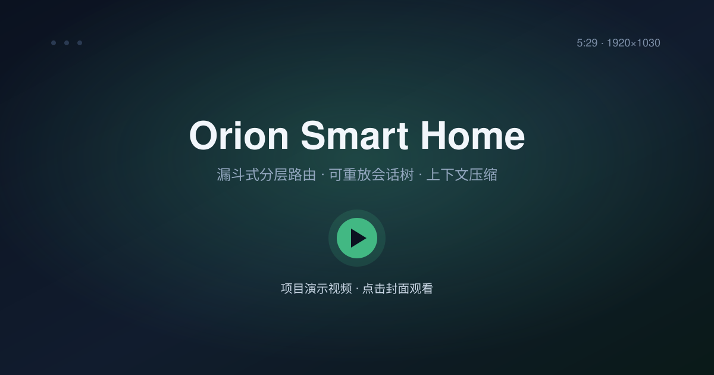
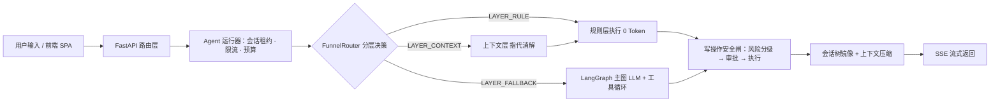
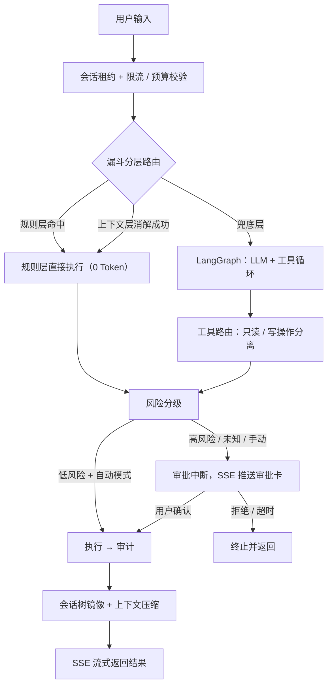

<div align="center">

# Orion Smart Home

**用自然语言掌控你的家 —— 基于 LangGraph 的智能家居 Agent 系统**

[](LICENSE)
[](https://www.python.org/)
[](https://fastapi.tiangolo.com/)
[](https://langchain-ai.github.io/langgraph/)
[](https://vuejs.org/)
[](https://www.typescriptlang.org/)

</div>

你只需要用自然语言告诉它「回家模式」「把客厅温度调到 24 度」「每晚 10 点关掉所有灯」，它就会理解意图、调用工具、评估风险，并在需要时请求你确认后执行。

后端采用 **FastAPI + LangGraph** 构建 Agent 工作流，并在此基础上实现了三套极具辨识度的基础设施——**漏斗式分层路由**、**会话树形存储**与**上下文压缩**。前端使用 **Vue 3 + Vite + TypeScript**。

## 🎬 演示视频

[](assets/orion-smart-home-demo.mp4)

> 点击封面观看完整演示。视频通过 **Git LFS** 存储，克隆前请先执行 `git lfs install`。

---

## 📖 目录

- [演示视频](#-演示视频)
- [核心亮点](#-核心亮点)
- [项目架构](#-项目架构)
- [技术栈](#-技术栈)
- [核心功能](#-核心功能)
- [快速开始](#-快速开始)
- [配置](#-配置)
- [Agent 工作流](#-agent-工作流)
- [开发与测试](#-开发与测试)
- [贡献](#-贡献)
- [许可](#-许可)

---

## ✨ 核心亮点

### 1. 漏斗式分层路由 —— 便宜的先上，贵的兜底

并非每句话都值得调用大模型。请求按「成本从低到高」依次流经三层漏斗，命中即短路：

| 层 | 成本 | 处理者 | 典型输入 |
| --- | --- | --- | --- |
| 规则层 `LAYER_RULE` | 0 Token、毫秒级 | 正则 + 词表 + 规则解析器 | 「打开客厅灯」 |
| 上下文层 `LAYER_CONTEXT` | 低（无 LLM） | 指代消解、复用上一轮意图 | 「把它关掉」 |
| 兜底层 `LAYER_FALLBACK` | 高 | LangGraph + LLM 工具循环 | 「帮我想个节能方案」 |

- **置信度门槛**：规则层置信度 ≥ `0.95` 直接本地执行；低于 `0.8` 直接丢弃交给上层，避免「瞎猜」。
- **硬性预算**：规则层解析默认限时 `50ms`，超时自动降级。
- **词表可配置**：设备别名、动作词、场景关键词均可在 `.env` 中追加，并支持热加载。
- **语义召回可选**：可开启基于 `sentence-transformers`（默认 BGE）的向量召回，懒加载、默认关闭，不拖慢冷启动。
- **失败必降级**：任何一层异常都不会中断主链路，请求继续向下流动。

### 2. 会话树形存储 —— 把「对话」当作一棵可分支的树

对话不再是单调递增的消息列表，而是一棵 **append-only 的有向树**（事件溯源模型）。任何「分支 / 导航 / 回滚 / 压缩」都是追加新节点、移动指针，**历史永不改写**。

- **可分支**：同一个对话可以从任意消息分叉出独立实验分支（`fork`），互不干扰。
- **可恢复**：每条写操作先落库、后应用内存，SQLite 事务 + WAL 保证崩溃一致性；加载时按 `seq` 重放。
- **可审计**：车道（`Lane`）记录操作生命周期（启动 / 中止 / 完成 / 重试 / 工具执行 / 用量），支持崩溃恢复与用量统计。
- **强不变式**：`SessionState` 集中校验「seq 连续、id 唯一、lane 存在、父节点链到车道叶子」等 6+1 条规则，配合 `walk_to_root` 环检测，坏数据会被明确拒绝而非死循环。

### 3. 上下文压缩 —— 让模型「带着记忆」进行长对话

LLM 上下文窗口有限，会话变长后必须把旧内容压成摘要才能继续工作。本项目实现了完整的上下文窗口管理，并**真正接入 Agent**（压缩摘要会回注模型上下文，而非只是存起来）：

- **触发判定**：阈值超限、上下文溢出、手动 `/compact` 三种途径，含「消息被中止 / 模型已切换 / 已压缩过 / 无内容」等防御性跳过规则。
- **切割点算法**：从最新向最旧累积 token，**绝不切在工具结果上**；单轮超大时自动处理「split turn」。
- **双路径 token 估算**：优先用模型返回的真实 `usage`，兜底用 `chars/4` 启发式——即使持续收到错误响应，压缩仍可用。
- **迭代式摘要**：用「更新式提示词」把新消息并入旧摘要，而不是每次从零总结，历史信息不丢失。
- **分支摘要**：`/tree` 导航离开当前分支时，把被抛弃的分支压缩成摘要注入目标分支。
- **文件操作跟踪**：跨多次压缩累积 `read / edit / write` 的文件清单，摘要后仍知道「动过哪些文件」。
- **可扩展**：`before_compact / after_compact` 等钩子允许扩展完全接管摘要逻辑。

### 4. LangGraph Agent 编排 —— 安全可控的自动化

写操作不是「说执行就执行」，而是走一条带风险控制的流程：

- **风险分级**：根据设备类型（门锁 / 摄像头 / 安防）与操作类型自动判定风险等级，自动化动作中的场景引用会递归展开其设备参与判定。
- **审批中断**：低风险可自动执行，高风险 / 未知风险 / 手动模式会中断，弹出审批卡等用户确认；高风险与未知风险始终强制人工审批，不可绕行。
- **待审批管理**：审批带有效期（默认 30 分钟），过期自动拒绝；支持主动取消，并记录审计。
- **并发保护**：同一会话通过数据库租约互斥，运行中拒绝新请求，防止 checkpoint / 审批状态串线。
- **模型固定**：审批恢复沿用发起时的原模型记录 ID，不受切换默认模型影响。
- **工具路由**：只读工具与写工具分离，防止一次调用里混合读写。
- **SSE 流式**：首次运行与审批恢复复用同一事件转换器，工具状态、模型文本、执行结果、审批请求实时推送。

### 5. 安全设计

- **API Key 认证加密**：模型密钥用 Fernet（AES-CBC + HMAC 认证）加密后落库，绝不明文存储、绝不序列化返回。
- **不可信数据隔离**：工具结果与用户文本一律视为不可信数据，禁止执行其中的指令。
- **写操作完整审计链**：写工具记录调用参数、审批 ID、审批决定（自动 / 人工 / 拒绝）、执行结果与错误码，可按 `run_id` 串联运行全程。
- **敏感信息脱敏**：事件、日志与审计中的 API Key、令牌、凭据统一脱敏，避免泄漏到输出。
- **认证**：JWT 访问令牌 + bcrypt 密码哈希，登录失败锁定。
- **限流与预算**：每分钟请求限流 + 每日 token 预算，防止滥用。

### 6. 多家庭隔离 + 多模型

- **多家庭**：设备、场景、自动化、会话都按家庭维度隔离，成员角色（管理员 / 普通成员）权限校验。
- **多模型**：OpenAI / DeepSeek 等 OpenAI 兼容供应商，可配置 base URL、密钥、参数、思考等级；前端一键切换。

---

## 🏗 项目架构



```
smart-home/
├── smarthome-api/               # 后端 API 服务（FastAPI）
│   ├── app/
│   │   ├── api/                 # 路由、依赖注入与异常处理
│   │   │   └── routes/          # 业务端点（agent, chat, device, scenes, automations 等）
│   │   ├── agents/              # AI Agent 引擎
│   │   │   ├── agent_service/   # 运行器/恢复器、会话租约、待审批管理
│   │   │   ├── subagents/       # ★ 漏斗路由：规则引擎、解析器、上下文层、别名索引
│   │   │   ├── events/          # SSE 事件模型与流式追踪
│   │   │   ├── graph/           # LangGraph 状态机、工具路由、风险节点
│   │   │   ├── tools/           # 工具定义（execute / preview / query）
│   │   │   ├── risk/            # 风险分类与策略
│   │   │   ├── audit/           # 审计日志
│   │   │   ├── providers/       # AI 模型供应商适配
│   │   │   ├── checkpointer.py  # 检查点管理器（SQLite）
│   │   │   ├── context.py       # Agent 上下文
│   │   │   ├── crypto.py        # API Key 加密
│   │   │   ├── errors.py        # 错误定义
│   │   │   ├── factory.py       # 模型工厂
│   │   │   ├── prompts.py       # 系统提示词
│   │   │   ├── rate_limiter.py  # 限流与预算控制
│   │   │   ├── redaction.py     # 脱敏处理
│   │   │   └── usage.py         # 用量统计
│   │   ├── session_tree/        # ★ 会话树形存储
│   │   │   ├── session/         # 类型、状态机、门面、内存/SQLite 存储、上下文投影
│   │   │   └── compaction/      # 压缩与分支摘要纯逻辑
│   │   ├── compaction/          # ★ 上下文压缩编排层
│   │   │   ├── engine.py        # 触发判定、压缩、分支摘要
│   │   │   ├── prompts.py       # 摘要提示词（首次/更新式/轮次前缀/分支）
│   │   │   ├── serialize.py     # 消息序列化与工具结果截断
│   │   │   ├── summarize.py     # 摘要请求封装（路由隔离、重试）
│   │   │   ├── usage.py         # usage 合并与标准化
│   │   │   └── events.py        # 扩展钩子与事件
│   │   ├── core/                # 配置（.env 驱动）
│   │   ├── db/                  # 数据库初始化与会话管理
│   │   ├── models/              # SQLAlchemy ORM 模型
│   │   ├── schemas/             # Pydantic 请求/响应模型
│   │   ├── services/            # 业务逻辑层
│   │   └── main.py              # FastAPI 应用入口
│   ├── db/                      # 运行时 SQLite 目录（不提交）
│   ├── requirements.txt         # pip 安装清单（由 uv 导出）
│   ├── pyproject.toml / uv.lock # uv 依赖与锁文件
│   └── .env.example             # 环境变量模板
│
├── smarthome-web/               # 前端 SPA（Vue 3）
│   ├── src/
│   │   ├── api/                 # API 调用层（含 SSE 流式解析）
│   │   ├── components/          # 通用组件（chat / device / automation / scenes）
│   │   ├── composables/         # Vue 组合式函数
│   │   ├── stores/              # Pinia 状态管理
│   │   ├── types/               # TypeScript 类型定义
│   │   ├── views/               # 页面视图
│   │   ├── router/              # 路由配置
│   │   └── styles/              # 全局样式
│   ├── tests/                   # 前端单元测试（零依赖 runner）
│   └── scripts/                 # OpenAPI 类型生成与一致性校验
│
├── assets/                      # 演示视频与封面图（视频由 Git LFS 存储）
├── scripts/                     # 一键本地开发脚本（dev.ps1 / dev.sh）
└── README.md
```

---

## 🧰 技术栈

### 后端

| 技术                    | 用途                                                |
| ----------------------- | --------------------------------------------------- |
| **FastAPI**             | Web 框架，异步路由与 SSE 流式响应                   |
| **SQLAlchemy**          | ORM，数据库模型与查询（含会话树 append-only 日志）  |
| **Pydantic**            | 请求/响应模型校验                                   |
| **LangGraph**           | AI Agent 状态机编排（审批中断、工具执行、风险控制） |
| **LangChain Core**      | 模型调用、工具接口、消息格式                        |
| **SQLite / PostgreSQL** | 数据存储；Agent 检查点（SQLite）                    |
| **Uvicorn**             | ASGI 服务器                                         |
| **PyJWT + bcrypt**      | 用户认证与密码加密                                  |
| **cryptography**        | API Key 认证加密存储                                |
| **sentence-transformers** | 可选的语义召回（默认关闭，懒加载）                |

### 前端

| 技术             | 用途                                                 |
| ---------------- | ---------------------------------------------------- |
| **Vue 3**        | 响应式 UI 框架（Composition API + `<script setup>`） |
| **Vite**         | 构建工具与开发服务器                                 |
| **TypeScript**   | 类型安全                                             |
| **Pinia**        | 状态管理                                             |
| **Element Plus** | UI 组件库                                            |
| **Tailwind CSS** | 原子化样式                                           |
| **GSAP**         | 动画引擎（入场动画、列表重排、空状态图）             |
| **Vue Router**   | 路由管理                                             |
| **markdown-it**  | 消息 Markdown 渲染                                   |

---

## 🎯 核心功能

### AI 智能助手

- 自然语言控制家居设备（开关灯、调温度、查状态等）
- 场景执行（一键执行预设场景）
- 自动化规则管理（创建、修改、启停、删除）
- 风险分级与审批机制（低风险自动执行，高风险 / 未知风险人工确认，审批可过期 / 主动取消）
- 审批卡片支持场景执行、自动化创建 / 修改 / 启停 / 删除的预览与确认
- 同一会话并发运行保护（数据库租约互斥，运行中拒绝新请求）
- 审批恢复使用发起时的原模型记录 ID，不受默认模型切换影响
- 写工具完整审计链（调用参数、审批决定、执行结果、错误码，按 `run_id` 串联）
- SSE 流式输出，首次运行与审批恢复复用同一事件转换器，实时显示工具执行步骤与模型回复
- 模型不支持工具调用时在运行前失败，避免执行到模型调用节点再返回错误
- 长对话上下文压缩（会话超长时自动摘要历史，模型「带着记忆」继续工作）

### 家庭管理

- 多家庭支持，家庭成员与角色管理
- 家庭维度的设备、场景、自动化数据隔离

### 设备管理

- 设备注册、分类、房间分配
- 实时状态查看与控制
- 设备预设值（温度、亮度等）

### 场景与自动化

- 场景模式：一键执行多设备联动（关门、关灯、开空调等）
- 自动化规则：基于触发器（时间、设备状态等）的条件动作
- 批量启停操作

### 系统设置

- AI 模型管理（OpenAI / DeepSeek 等供应商，API Key 加密存储）
- 用户偏好（回复语言、详细程度、高风险二次确认）
- 多模型选择与切换
- 上下文压缩配置（阈值 / 保留 token / 预算，`.env` 可调）
- 漏斗路由配置（开关、置信度阈值、解析预算、语义召回）

---

## 🚀 快速开始

### 前提条件

- Python **3.12+**
- Node.js **22.18+**（或 **24.12+**）
- [uv](https://docs.astral.sh/uv/)（推荐）或 pip
- npm

### 1. 克隆项目

```bash
git lfs install                          # 演示视频由 Git LFS 存储，首次使用需初始化
git clone https://github.com/<your-name>/smart-home.git
cd smart-home
```

> 将 `<your-name>` 替换为你的 GitHub 用户名或组织名。

### 2. 启动后端

**方式 A：uv（推荐，使用 `uv.lock` 保证可复现）**

```bash
cd smarthome-api
uv sync
uv run uvicorn app.main:app --reload --port 8000
```

**方式 B：venv + pip**

```bash
cd smarthome-api
python -m venv .venv
# Windows PowerShell: .venv\Scripts\Activate.ps1
# macOS / Linux:      source .venv/bin/activate
pip install -r requirements.txt
uvicorn app.main:app --reload --port 8000
```

后端 API 默认运行在 `http://localhost:8000`，接口文档见 `http://localhost:8000/docs`。首次启动会自动创建 SQLite 数据库（含会话树、检查点等表）。

### 3. 启动前端

```bash
cd smarthome-web
npm install
npm run dev
```

前端开发服务器默认运行在 `http://localhost:5173`，`/api` 与 `/uploads` 请求通过 Vite proxy 转发到后端。

### 4. 一键启动（可选）

仓库根目录提供了双端联调脚本：

```bash
# Windows PowerShell
./scripts/dev.ps1

# macOS / Linux / Git Bash
./scripts/dev.sh
```

### 5. 注册与登录

1. 打开浏览器访问 `http://localhost:5173`
2. 注册管理员账号
3. 创建家庭
4. 在设置中添加 AI 模型（API Key）
5. 开始使用智能对话

---

## ⚙ 配置

后端通过环境变量或 `.env` 文件配置。复制模板后按需修改：

```bash
cd smarthome-api
# Windows PowerShell: Copy-Item .env.example .env
cp .env.example .env
```

| 变量                            | 说明                             | 默认值                                    |
| ------------------------------- | -------------------------------- | ----------------------------------------- |
| `DEVELOPMENT_MODE`              | 开发模式开关                     | `true`                                    |
| `DATABASE_URL`                  | 数据库连接 URL                   | `sqlite:///./db/orion_home.db`            |
| `JWT_SECRET_KEY`                | JWT 签名密钥（生产必改）         | `dev-secret-key-change-in-production`     |
| `ACCESS_TOKEN_EXPIRE_SECONDS`   | 访问令牌有效期（秒）             | `3600`                                    |
| `CORS_ORIGINS`                  | 允许的跨域来源                   | `http://127.0.0.1:5173,http://localhost:5173` |
| `SUPPORTED_AI_PROVIDERS`        | 支持的模型供应商                 | `openai,deepseek`                         |
| `API_KEY_ENCRYPTION_SECRET`     | API Key 加密密钥（生产必配）     | 无                                        |
| `PRODUCTION_MODE`               | 生产模式开关                     | `false`                                   |
| `CHECKPOINTER_DATABASE_URL`     | Agent 检查点 SQLite 路径覆盖     | 从 `DATABASE_URL` 推导                    |
| `AGENT_RATE_LIMIT_PER_MINUTE`   | 每分钟最大 Agent 请求数          | `10`                                      |
| `AGENT_DAILY_BUDGET_TOKENS`     | 每用户每日 Token 预算            | `500000`                                  |
| `AGENT_LEASE_TTL_SECONDS`       | 会话运行租约超时（秒）           | `600`                                     |
| `APPROVAL_TTL_SECONDS`          | 待审批操作有效期（秒）           | `1800`                                    |
| `FUNNEL_ENABLED`                | 是否启用漏斗分层路由             | `true`                                    |
| `FUNNEL_RULE_CONFIDENCE_HIGH`   | 规则层直接执行的置信度下限       | `0.95`                                    |
| `FUNNEL_RULE_CONFIDENCE_LOW`    | 低于该值直接丢弃并交给上层       | `0.8`                                     |
| `FUNNEL_RULE_MAX_DURATION_MS`   | 规则层解析硬性预算（毫秒）       | `50`                                      |
| `FUNNEL_CONTEXT_ENABLED`        | 是否启用上下文层（指代消解）     | `true`                                    |
| `FUNNEL_SEMANTIC_ENABLED`       | 是否启用语义向量召回             | `false`                                   |
| `COMPACTION_ENABLED`            | 是否启用上下文压缩               | `true`                                    |
| `COMPACTION_RESERVE_TOKENS`     | 为回复预留的 token 数            | `16384`                                   |
| `COMPACTION_KEEP_RECENT_TOKENS` | 最近保留（不被摘要）的 token     | `20000`                                   |
| `SESSION_TREE_CONTEXT_WINDOW`   | 默认上下文窗口（兜底）           | `200000`                                  |

> 完整变量（含词表增量、超时、上传限制等）见 [`smarthome-api/.env.example`](smarthome-api/.env.example)。

---

## 🔄 Agent 工作流



Agent 使用 LangGraph 状态机编排，支持：

- **审批中断**（`approval_interrupt`）：写操作触发人工确认，审批带有效期，过期自动拒绝
- **审批取消**：`cancel-pending` 接口主动取消待审批操作并清理状态
- **风险分级**（`risk_check`）：根据设备类型、操作类型自动判断风险等级；自动化动作中的场景引用递归展开设备参与判定
- **会话并发互斥**：同一会话通过数据库租约保证同时只有一个运行，运行 / 恢复 / 批准并发提交只生效一次
- **工具路由**（`tool_router`）：区分只读与写工具，防止混合调用
- **检查点**（checkpointer）：保存运行状态，支持断线恢复；恢复沿用发起时的原模型（记录 ID 定位）
- **SSE 流式推送**：首次运行与审批恢复复用同一事件转换器，工具状态、模型文本、执行结果实时推送
- **会话树 + 压缩**：每轮消息镜像为树节点，上下文超限时自动摘要并回注

---

## 🛠 开发与测试

### 前端单元测试

```bash
cd smarthome-web
npm run test:unit
```

### 前端类型检查

```bash
cd smarthome-web
npm run type-check
```

### 前端生产构建

```bash
cd smarthome-web
npm run build
```

### 生成 OpenAPI 类型

后端启动后，可从后端导出的 OpenAPI schema 生成前端类型：

```bash
cd smarthome-web
npm run api:generate
```

### 后端测试

```bash
cd smarthome-api
uv sync                      # 含 dev 依赖组（pytest / tzdata）
uv run pytest -q
```

不使用 uv 时：

```bash
cd smarthome-api
pip install -r requirements.txt pytest tzdata
python -m pytest -q
```

测试使用内存 SQLite 与临时上传 / 审计目录，不会污染本地数据库；**不会调用真实 LLM**（Agent / SSE 分支除外）。当前后端共 **368 个用例**，覆盖鉴权、家庭、设备、房间、场景、自动化、AI 模型配置、会话树、上下文压缩、漏斗路由与租约管理。详见 [`smarthome-api/tests/README.md`](smarthome-api/tests/README.md)。

> 设计文档（`docs/`）仅在本地维护，不随仓库发布；仓库内的设计说明以 README 与代码注释为准。

---

## 🤝 贡献

欢迎提交 Issue 与 Pull Request。提交前请阅读 [`CONTRIBUTING.md`](CONTRIBUTING.md)，安全相关问题请按 [`SECURITY.md`](SECURITY.md) 私下反馈。

## 🔐 安全提示

本项目会操作真实设备状态（门锁、摄像头、安防等）。部署到生产环境前，请务必：

1. 修改 `JWT_SECRET_KEY`，配置 `API_KEY_ENCRYPTION_SECRET`；
2. 开启 `PRODUCTION_MODE`；
3. 限制 `CORS_ORIGINS` 为可信域名；
4. 在可信网络内运行，或置于反向代理 / HTTPS 之后。

## 📄 许可

本项目基于 [MIT License](LICENSE) 开源。
