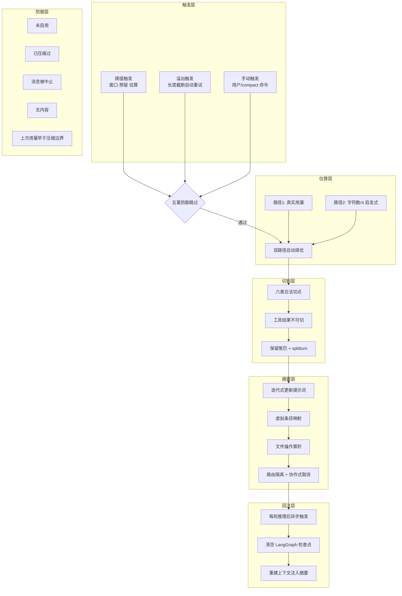
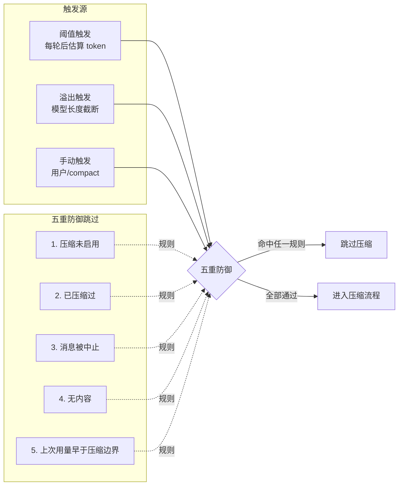
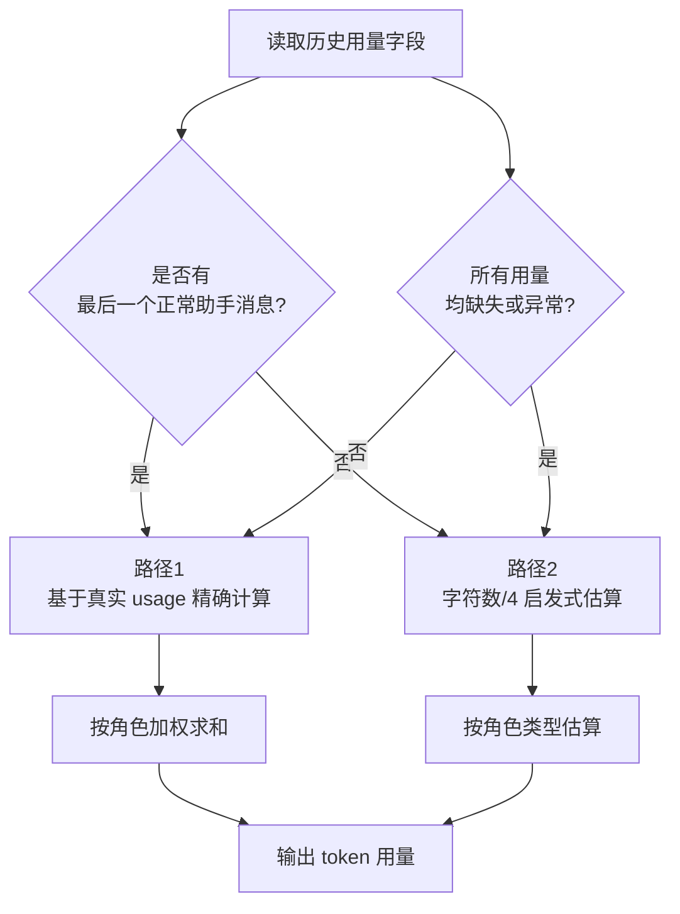
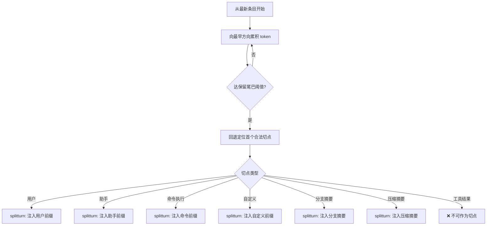
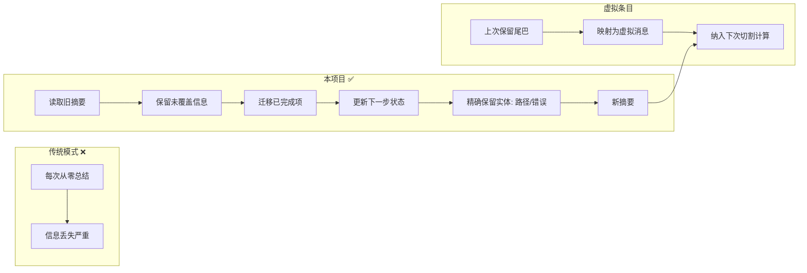
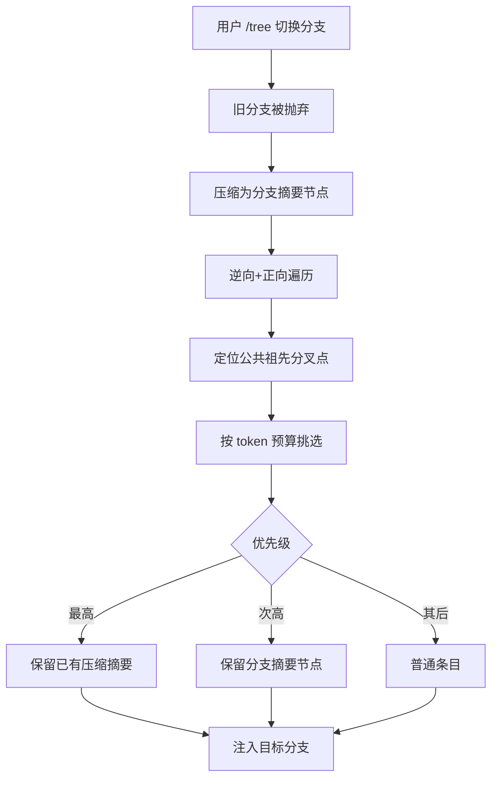
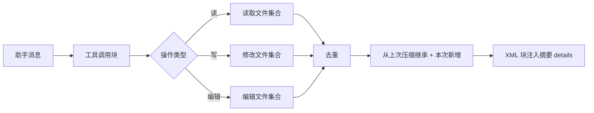
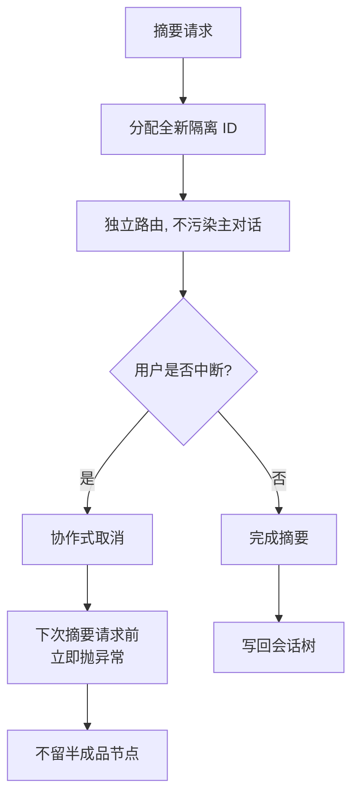
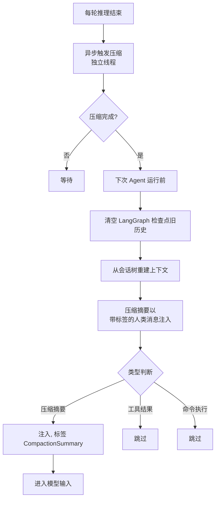
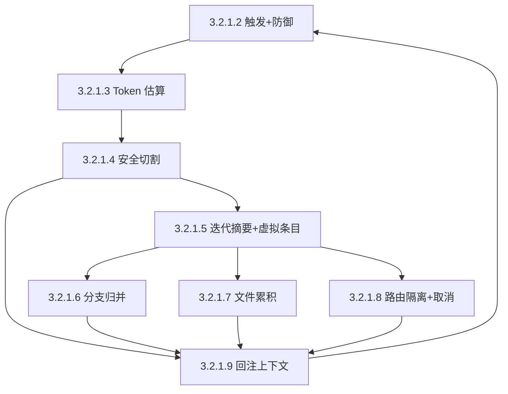

# 上下文压缩技术路线图

> 适用项目：智能家居 Agent 上下文压缩引擎
> 目标：在有限上下文窗口下，保障长会话连续性、工具调用可追溯性、分支切换无损性，并避免重复 / 无效压缩。

## 一、整体技术路线



## 二、模块详解

### 3.2.1.2 三源触发 + 五重防御跳过



**触发源**

| 来源 | 触发条件 | 行为 |
| --- | --- | --- |
| 阈值触发 | 每轮推理后自动估算 token，达 `窗口 - 预留` | 后台评估，进入压缩 |
| 溢出触发 | 模型返回长度截断 | 调用方触发并自动重试一次 |
| 手动触发 | 用户输入 / 显式 `compact` 命令 | 立即执行压缩 |

**五重防御跳过规则**

1. **压缩未启用**：全局开关关闭时直接跳过
2. **已压缩过**：本轮已触发过压缩，避免重复
3. **消息被中止**：上游消息处于中止态，跳过
4. **无内容**：无可压缩消息，跳过
5. **上次用量早于压缩边界**：token 计量基准失效，跳过

> 核心目的：杜绝重复压缩与无效压缩，保证每次压缩都是"有意义的一次"。

### 3.2.1.3 双路径 Token 估算容错



**两条路径**

- **路径 1：真实用量**：基于最后一个正常助手消息返回的 usage 字段，向前回溯累加历史上下文 token。
- **路径 2：启发式估算**：所有 usage 缺失或异常时启用，按角色类型以 `字符数 / 4` 估算。

**双路径自动择优**

- 优先路径 1（精度高）
- 路径 1 失效时无缝切换到路径 2
- 即使本地 1B 量化模型偶发返回异常，也能继续推进压缩流程，避免单路径方案导致的"压缩卡死"。

### 3.2.1.4 语义安全切割点算法



**核心不变量**

> "工具结果"永远不可作为切割点 —— 防止上下文断裂

**六类合法切点**

1. 用户
2. 助手
3. 命令执行
4. 自定义
5. 分支摘要
6. 压缩摘要

**算法流程**

1. 从最新条目向最早方向累积 token
2. 达到"保留尾巴"阈值后回退
3. 定位首个合法切点
4. 根据切点类型动态构建 `splitturn` 结构
5. 确保历史尾部与当前轮次前缀完整衔接

### 3.2.1.5 迭代式更新摘要 + 虚拟条目映射



**更新式提示词（取代"从零总结"）**

- 保留旧摘要中未被新历史覆盖的信息
- 迁移已完成项
- 更新下一步状态
- 精确保留文件路径、错误消息等关键实体

**虚拟条目映射**

- 将上次压缩的"保留尾巴"重新映射为虚拟消息条目
- 纳入下次切割计算
- 使压缩后的消息仍被视为有效历史

> 效果：连续压缩 5–10 次后仍保持高精度。

### 3.2.1.6 分支导航自动归并摘要



**算法步骤**

1. 逆向 + 正向遍历定位公共祖先分叉点
2. 按 token 预算从最新条目往回挑选
3. 优先保留**已有的压缩摘要**与**分支摘要**节点

> 目的：历史压缩成果在分支切换中不丢失。

### 3.2.1.7 跨压缩文件操作累积跟踪



**三集合累积**

- **读取文件集合**：从 `read` 类工具调用提取
- **修改文件集合**：从 `write` 类工具调用提取
- **编辑文件集合**：从 `edit` 类工具调用提取

**累积与去重**

- 从上次压缩继承并叠加本次新增
- 跨多次压缩持续累积
- 最终以 XML 块形式注入摘要 `details` 字段

> 价值：智能家居 Agent 对文件 / 函数 / 路径操作强依赖，仅凭摘要即可获知完整操作历史。

### 3.2.1.8 路由隔离 + 协作式取消



**路由隔离**

- 每次摘要请求分配全新隔离 ID
- 防止大提示词污染主对话路由
- 与主对话的消息流解耦

**协作式取消**

- 用户主动中断压缩时立即终止
- 下次摘要请求前立即抛出异常
- 不留半成品节点
- 保障系统状态一致性

### 3.2.1.9 摘要真正回注 Agent 上下文



**关键设计**

- **异步触发**：每轮推理结束后异步触发压缩，独立线程，不阻塞事件循环
- **检查点重置**：压缩完成后，下次 Agent 运行前清空 LangGraph 检查点旧历史
- **上下文重建**：从会话树重建上下文
- **带标签注入**：压缩摘要以带标签的人类消息形式注入，例：
  ```
  [CompactionSummary] ...历史摘要内容...
  ```
- **明确标识**：标识其为历史摘要而非新指令
- **中间态跳过**：工具结果、命令执行等中间状态不进入对话历史

> 突破"只存不喂"的行业惯例，实现压缩与 Agent 上下文的真正接通。

## 三、模块依赖关系



## 四、关键不变量

| 编号 | 不变量 | 守护模块 |
| --- | --- | --- |
| INV-1 | 工具结果不可作为切割点 | 3.2.1.4 |
| INV-2 | 压缩后消息仍视为有效历史 | 3.2.1.5 |
| INV-3 | 摘要内容需带 `[CompactionSummary]` 标签 | 3.2.1.9 |
| INV-4 | 工具结果 / 命令执行不进入对话历史 | 3.2.1.9 |
| INV-5 | 文件操作集合跨压缩累积 | 3.2.1.7 |
| INV-6 | 同一轮次不重复压缩 | 3.2.1.2 |
| INV-7 | 异常用量不阻塞压缩流程 | 3.2.1.3 |
| INV-8 | 分支切换不丢失历史压缩成果 | 3.2.1.6 |

## 五、验收指标

| 模块 | 指标 | 目标 |
| --- | --- | --- |
| 3.2.1.2 | 误触发率 | 趋近 0（五重防御覆盖常见无效场景） |
| 3.2.1.3 | 估算卡死率 | 0%（双路径保障） |
| 3.2.1.4 | 切割合规率 | 100%（工具结果零切割） |
| 3.2.1.5 | 连续 10 次压缩信息保留率 | ≥ 95% |
| 3.2.1.6 | 分支切换历史丢失率 | 0% |
| 3.2.1.7 | 文件操作追溯完整率 | 100% |
| 3.2.1.8 | 半成品节点残留 | 0 |
| 3.2.1.9 | 摘要回注后回答准确率 | 与无压缩场景偏差 ≤ 5% |
