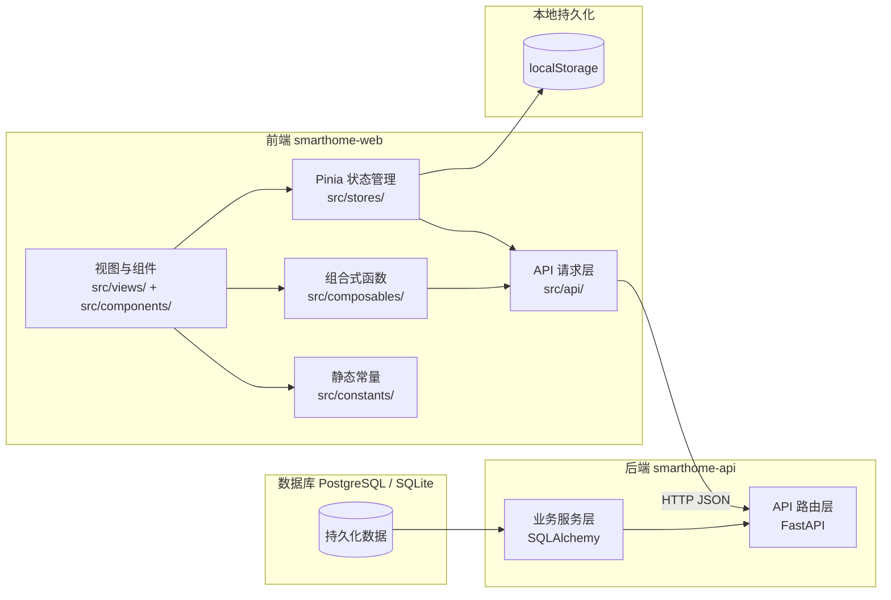
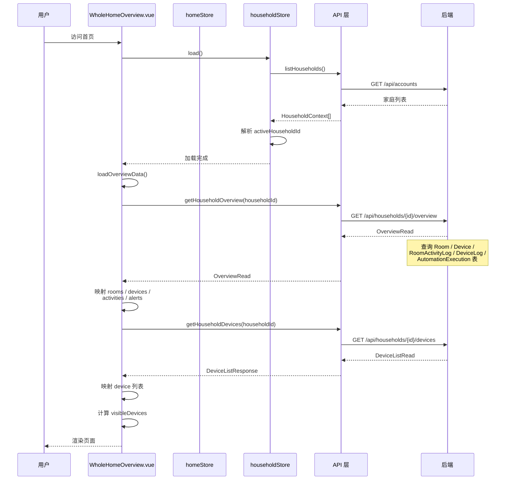

# 前端数据来源概览

本文档梳理 `smarthome-web` 前端模块中所有数据的来源，帮助开发者理解每块数据如何流入、存储和展示。

## 数据流向总览

**核心原则：** 前端不做数据模拟，所有业务数据均通过 API 层向后端发起真实 HTTP 请求，后端从数据库查询后返回。部分展示元数据和占位值在本地硬编码。

---

## 1. API 请求层 — 数据入口

路径：`src/api/`

| 模块 | 文件 | 主要接口 | 后端路径 |
|------|------|----------|----------|
| 设备 | `device.ts` | `listDevices`, `getDevice`, `createDevice`, `updateDevice`, `deleteDevice`, `syncDevices`, `batchAssignDeviceGroup`, `listDeviceLogs`, `uploadDeviceImage` | `/api/devices` |
| 总览 | `overview.ts` | `getHouseholdOverview`, `getHouseholdDevices`, `syncHouseholdDevices`, `executeMode`, `createInspection`, `getInspection`, `createSyncJob`, `getSyncJob`, `getSchedule`, `saveSchedule` | `/api/households/{id}/overview`, `/api/schedules/` |
| 房间 | `room.ts` | — | `/api/rooms` |
| 场景 | `scenes.ts` | `fetchScenes`, `fetchSceneSummary`, `createScene`, `updateScene`, `deleteScene`, `executeScene`, `getSceneExecution`, `getSceneLogs`, `previewScene`, `useSceneTemplate`, `batchUpdateSceneEnabled`, `batchUpdateSceneSchedule` | `/api/scenes` |
| 自动化 | `automation.ts` | — | `/api/automations` |
| 认证 | `auth.ts` | 登录/注册/刷新令牌 | `/api/auth` |
| AI 对话 | `chat.ts` | SSE 流式对话 | `/api/agent/run` |
| AI 模型 | `aiModel.ts` | 模型列表 | `/api/ai-models` |
| 账户 | `account.ts` | 家庭列表、成员列表 | `/api/accounts` |

所有 API 请求统一通过 `apiRequest<T>`、`rawRequest<T>`、`streamRequest` 三个入口函数（定义在 `client.ts`）发起，自动处理：
- `Authorization` 请求头注入
- `ApiResponse<T>` 包装解包（`{ code, message, data }`）
- 401 自动清理会话
- 422 字段级校验错误解析
- 幂等 GET 指数退避重试

---

## 2. Pinia Store — 状态管理层

路径：`src/stores/`

### 2.1 `home.ts` — 首页看板

| 数据字段 | 来源 | 说明 |
|----------|------|------|
| `devices` (DashboardDevice[]) | 计算属性，由 `deviceIds` + `devicesById` 组合 | 从 `apiListDevices()` 加载 |
| `deviceIds` / `devicesById` | `loadDevices()` → `apiListDevices()` | 分离 ids 和 byId 优化响应式性能 |
| `automations` (Automation[]) | 初始为 `[]`，通过 `toggleAutomation` 本地切换 | 当前仅做本地状态切换，未持久化 |
| `energyToday` | **硬编码：`18.62`** | 占位值，后端概览接口未返回此字段 |
| `securityAlertHandled` | 初始为 `false` | 本地布尔标记，无后端来源 |
| `deviceSummary` | 计算属性 | 从 `devices` 统计在线/离线/总数 |
| `chatPhase` | 计算属性 | 从 `useHomeChat` 的 `agentStatus` 派生 |
| `sidebarCollapsed` | `localStorage` | 持久化 `orion.sidebar-collapsed` |

### 2.2 `scenes.ts` — 场景管理

| 数据字段 | 来源 | 说明 |
|----------|------|------|
| `scenes` (Scene[]) | `loadScenes()` → `fetchScenes()` | 后端 API |
| `summary` (SceneSummary) | `loadScenes()` → `fetchSceneSummary()` | 后端 API |
| `filters` | 本地响应式对象 | 搜索/筛选条件，初始值全为空 |
| `runningSceneId` | 本地 `ref` | 执行场景时临时标记 |
| `stepStatuses` | 本地 `ref` | 由 `resetStepStatuses()` 或轮询 `apiGetSceneExecution()` 更新 |
| `stats` | 计算属性 | 从 `summary` 派生，含空值兜底（`?? 0`） |

### 2.3 `automations.ts` — 自动化规则

| 数据字段 | 来源 | 说明 |
|----------|------|------|
| `automations` | `loadAutomations()` → API | 后端返回的自动化规则列表 |
| `selectedDetail` | `loadSelectedAutomation()` → API | 单条规则详情 + 执行历史 |
| `executions` | `loadSelectedAutomation()` → API | 执行历史 |
| `filters` | 本地响应式对象 | 搜索/筛选条件 |
| `TEMPLATE_POOL` | **硬编码常量** | 4 条预设模板（"离家模式""夜间节能""到访提醒""起床模式"） |
| `TRIGGER_TYPE_MAP` | **硬编码常量** | 触发类型 → 显示标签/图标/色调映射 |
| `TRIGGER_DISPLAY_META` | **硬编码常量** | 按触发来源名称的显示元数据 |
| `stats` | 计算属性 | 从 `backendSummary` 派生 |
| `visible` | 计算属性 | 按 `filters` 过滤 `automations` |

### 2.4 `households.ts` — 家庭上下文

| 数据字段 | 来源 | 说明 |
|----------|------|------|
| `households` | `load()` → `apiListHouseholds()` | 后端 API |
| `activeHouseholdId` | 计算 + `localStorage` | 优先取 `localStorage` 存储值，其次取列表第一项 |
| `members` | `refreshMembers()` → `apiListMembers()` | 后端 API |
| `activeHousehold` | 计算属性 | 从 `households` + `activeHouseholdId` 派生 |
| `activeRole` / `isAdmin` | 计算属性 | 从 `activeHousehold` 派生 |

### 2.5 `auth.ts` — 认证

| 数据字段 | 来源 | 说明 |
|----------|------|------|
| `user` | 登录/注册/刷新 API | 后端返回用户信息 |
| `token` | `sessionStorage` | 键 `smart-home-access-token` |

### 2.6 `settings.ts` — 设置

| 数据字段 | 来源 | 说明 |
|----------|------|------|
| 各类设置项 | API + `localStorage` | 由 `settingsPersistence.ts` 管理 |

---

## 3. 组合式函数 (Composables) — 业务逻辑复用层

路径：`src/composables/`

| 组合式函数 | 数据来源 | 用途 |
|-----------|----------|------|
| `useHomeChat` | `chat.ts` API → SSE 流 | AI 对话状态管理，含消息列表、会话管理、审批流程 |
| `useDeviceQuery` | `listDevices()` API | 设备列表搜索/筛选/分页 |
| `useBatchedDeviceUpdates` | 本地累积更新 | 批量设备状态更新，合并后一次性提交 store |
| `useTaskPolling` | API 轮询 | 任务状态轮询（场景执行、设备同步等） |
| `useDebouncedFilter` | 本地 | 防抖搜索 |
| `useAuthenticatedLoader` | 全局 | 认证后自动加载数据 |
| `useAsyncAction` | 本地 | 异步操作状态管理 |
| `useAnimation*` | 本地 | 动画状态与 GSAP 控制 |

---

## 4. 硬编码数据与占位值

以下数据在代码中写死，无后端来源：

### 4.1 前端硬编码

| 位置 | 值 | 说明 |
|------|-----|------|
| `stores/home.ts` | `energyToday = 18.62` | 今日能耗，占位值 |
| `stores/home.ts` | `securityAlertHandled = false` | 安全告警标记，初始未处理 |
| `stores/automations.ts` | `TEMPLATE_POOL` | 4 条自动化模板（名称/描述/触发条件/设备） |
| `stores/automations.ts` | `TRIGGER_TYPE_MAP` | 触发类型 → 图标/色调映射 |
| `stores/automations.ts` | `TRIGGER_DISPLAY_META` | 触发来源名称 → 显示元数据 |
| `stores/automations.ts` | `DEFAULT_TRIGGER_META` | 默认触发元数据兜底 |
| `views/WholeHomeOverview.vue` | `DEVICE_TONE_MAP` | 设备类型 → 色调映射 |
| `views/WholeHomeOverview.vue` | `frequent: false, favorite: false` | 常用/收藏标记，始终为 false |
| `views/WholeHomeOverview.vue` | `formatDeviceTime()` | 日期格式化逻辑，无后端依赖 |
| `constants/device-colors.ts` | 设备类型 → 颜色映射 | 展示用色值 |
| `constants/iconRegistry.ts` | 图标名称注册表 | 图标名称到 SVG 的映射 |
| `constants/status-colors.ts` | 状态 → 颜色映射 | 展示用色值 |
| `constants/settingsSections.ts` | 设置页面分节定义 | 导航结构 |

### 4.2 后端返回的占位值（前端直接展示）

来自 `app/api/routes/overview.py` 的 `get_overview` 接口：

| 字段 | 值 | 说明 |
|------|-----|------|
| `home_status.people_home` | `0` | 始终为 0，无传感器接入 |
| `home_status.temperature` | `0` | 始终为 0，无传感器接入 |
| `home_status.humidity` | `0` | 始终为 0，无传感器接入 |
| `home_status.air_quality` | `"excellent"` | 始终为 "excellent" |
| `home_status.pm25` | `0` | 始终为 0，无传感器接入 |
| `room.temperature` | `0` | 始终为 0，无传感器接入 |

---

## 5. 计算属性与派生数据

以下数据由现有数据计算得出，不产生网络请求：

| 位置 | 计算属性 | 依赖 | 用途 |
|------|----------|------|------|
| `stores/home.ts` | `devices` | `deviceIds` + `devicesById` | 合并分片设备数据 |
| `stores/home.ts` | `deviceSummary` | `devices` | 在线/离线/总数统计 |
| `stores/home.ts` | `hasWarning` | `deviceSummary` + `securityAlertHandled` | 是否有警告标记 |
| `stores/home.ts` | `chatPhase` | `agentStatus` + `eventReceived` + `executionSteps` | AI 对话阶段状态 |
| `stores/scenes.ts` | `stats` | `summary` | 场景统计数字 |
| `stores/scenes.ts` | `selectedScene` | `scenes` + `selectedSceneId` | 当前选中的场景 |
| `stores/automations.ts` | `visible` | `automations` + `filters` | 筛选后的展示列表 |
| `stores/households.ts` | `activeHousehold` | `households` + `activeHouseholdId` | 当前活动家庭 |
| `views/WholeHomeOverview.vue` | `visibleDevices` | `devices` + `selectedTab` + `searchKeyword` | 按标签和关键字筛选 |
| `views/WholeHomeOverview.vue` | `onlineRate` | `summary` | 在线率 |
| `views/WholeHomeOverview.vue` | `todayLabel` | 当前日期 | 今日日期标签 |

---

## 6. 本地持久化 (localStorage)

| 键 | 用途 | 存储位置 |
|---|------|----------|
| `smart-home-access-token` | 认证令牌 | `api/client.ts` |
| `smart-home-active-household-id` | 活动家庭 ID | `stores/households.ts` |
| `orion.sidebar-collapsed` | 侧边栏折叠状态 | `stores/home.ts` |
| 各类设置项 | 用户设置偏好 | `utils/settingsPersistence.ts` |

---

## 7. 数据流示例

以下以"首页总览"页面为例，展示完整数据流：

---

## 8. 总结

| 数据类别 | 来源 | 占比 |
|----------|------|------|
| 后端 API 实时数据 | 数据库查询返回 | ~80% |
| 硬编码占位值 | 前端/后端代码中写死 | ~5% |
| 计算派生数据 | 由现有数据计算得出 | ~10% |
| 本地持久化数据 | `localStorage` / `sessionStorage` | ~5% |

**关键结论：** 本项目采用纯后端驱动的数据架构，前端不做数据模拟。所有业务数据（设备、房间、场景、自动化、记录等）均通过 HTTP API 从后端获取，前端仅负责展示逻辑、状态管理和本地缓存。少量占位值（如能耗、环境传感器数据）因未接入真实硬件而写死，后续可替换为真实传感器数据源。