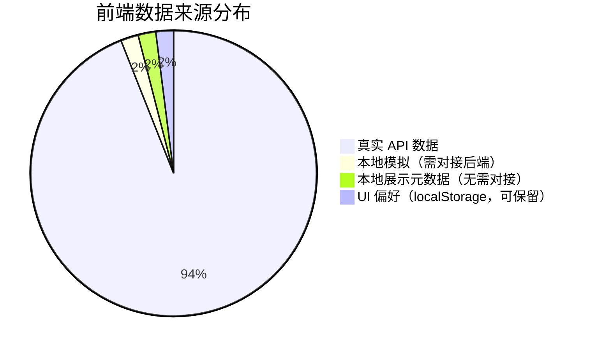

# 前端模拟数据来源说明

## 背景

本项目采用**后端驱动**架构，前端所有业务数据理论上应通过 HTTP API 从后端获取。但由于部分功能的后端接口尚未对接或尚未实现，前端通过以下方式模拟了本应由后端提供的数据：

- **硬编码常量**：代码中直接写死的数据
- **本地状态**：组件/Store 中维护的本地变量，无后端来源
- **localStorage 持久化**：数据存入浏览器本地存储，不经过后端

以下逐一列出这些模拟数据点，并标注其应对接的后端接口状态。

---

## 1. 首页看板 — `stores/home.ts`

### 1.1 `automations`（自动化规则列表）

| 项 | 内容 |
|-----|------|
| 位置 | `stores/home.ts` L52：`const automations = shallowRef<Automation[]>([])` |
| 当前状态 | 已对接后端（2026-08-25） |

**对接内容：**

- 新增 `loadAutomations()` 方法，调用 `GET /api/households/{household_id}/automations` 获取后端数据
- 通过 `watch({ immediate: true })` 监听 `activeHouseholdId`，在家庭就绪时自动加载，切换家庭时自动重载
- `toggleAutomation()` 改为异步方法，先本地乐观更新，再调用 `PATCH /api/automations/{id}/enabled` 持久化到后端，失败时自动回滚
- 新增 `automationsLoading` 加载状态标记
- 添加 `TRIGGER_LABEL` 映射后端 `triggerType` 到前端展示文字

### 1.2 `energyToday`（今日能耗）

| 项 | 内容 |
|-----|------|
| 位置 | `stores/home.ts` L54：`const energyToday = ref(18.62)` |
| 当前状态 | 已对接后端（2026-08-25） |

**对接内容：**

- 后端新增 `device_energy_records` 数据表（`DeviceEnergyRecord` 模型），按设备存储能耗记录
- 后端新增接口 `GET /api/households/{household_id}/energy/today`，聚合今日能耗总量、设备数与最近记录时间
- 前端新增 `getTodayEnergy()` API 函数和 `loadTodayEnergy()` store 方法
- `energyToday` 通过 `watch({ immediate: true })` 监听家庭切换，从后端加载真实能耗数据（无数据时置 0，加载失败保留原值）

> 备注：初始默认值 `18.62` 仅在 `activeHouseholdId` 尚未就绪前作为占位；家庭就绪后即被后端数据覆盖。

### 1.3 `securityAlertHandled` / `alerts`（安全告警）

| 项 | 内容 |
|-----|------|
| 位置 | `stores/home.ts` L56-57：`securityAlertHandled` + `alerts = shallowRef<OverviewAlert[]>([])` |
| 当前状态 | 已对接后端（2026-08-25） |

**对接内容：**

- 新增 `loadOverviewAlerts(householdId)` 方法，调用 `GET /api/households/{id}/overview` 拉取 `alerts` 数组
- `alerts` 列表项统一归一为 `{ level, title, location }` 形态（兼容 `level`/`severity`、`title`/`message`/`name`、`location`/`room_name` 等多种后端字段）
- `alertCount` 与 `hasWarning` 改为基于 `alerts.value.length` 计算，`securityAlertHandled` 仍为本地"已处理"标记（点掉后当日隐藏）
- `watch({ immediate: true })` 监听家庭切换自动重新加载告警

> 备注：`securityAlertHandled` 是纯本地 UI 状态，刷新后重置；这是预期行为（告警"处理"为单次会话动作），不视为模拟数据问题。

---

## 2. 设置中心 — `stores/settings.ts`

### 2.1 `securityMeta`（安全元数据 — 登录设备 + 安全日志）

| 项 | 内容 |
|-----|------|
| 位置 | `stores/settings.ts` L74：`securityMeta = ref<SecurityMeta>(loadStoredSecurityMeta(createEmptySecurityMeta()))` |
| 当前状态 | 已对接后端（2026-08-25） |

**对接内容：**

- 后端新增 `user_security_devices` 与 `user_security_logs` 两张表（`SecurityDevice` / `SecurityLog` 模型）
- 后端新增接口 `GET /api/account/me/security`，返回当前用户的设备列表与最近日志
- 后端新增接口 `POST /api/account/me/security/logs` 记录一条日志
- 后端新增接口 `PATCH /api/account/me/security/devices/{id}` 更新设备信任状态
- 后端新增接口 `DELETE /api/account/me/security/devices/{id}` 移除登录设备（当前设备不可移除）
- 前端 `api/security.ts` 完整封装上述接口（`getSecurityMeta` / `addSecurityLog` / `updateDeviceTrust` / `deleteSecurityDevice`），并对后端字段（`device_name` / `is_current` / `last_active_at` / `created_at`）做驼峰映射
- 前端 `loadSecurityMeta()` 在应用启动（`App.vue`）、登录成功（`LoginDialog.vue`）、设置页打开（`SettingsCenter.vue`）时触发；带 `securityMetaLoaded` 缓存与并发 `Promise` 复用
- `loadSecurityMeta()` 首次成功时，若后端日志为空且 localStorage 中存在旧日志，会自动将旧日志通过 `apiAddSecurityLog` 一次性迁移到后端，完成后强制重载一次
- 所有变更操作（`recordSecurityLog` / `updateDeviceTrust` / `revokeSecurityDevice`）改为"先调后端、再写本地"，并在 store 内完成 localStorage 同步
- 兜底机制：后端不可用时，`.catch` 静默降级为离线模式，localStorage 数据仍可见

### 2.2 `backupHistory`（备份历史）

| 项 | 内容 |
|-----|------|
| 位置 | `stores/settings.ts` L86-88：`backupHistory = ref<BackupRecord[]>(loadBackupHistory([]))` |
| 模拟方式 | **localStorage** — 初始化为空数组，通过 `loadBackupHistory()` 从 `localStorage` 读取。`recordBackup()` 生成新记录写入 `localStorage`，最多保留 6 条 |
| 现状 | 备份记录仅存本地，不反映真实备份状态；`BackupSettingsCard.vue` / `BackupHistoryDialog.vue` 中展示的"备份历史"全部为本地记录 |
| 应对接接口 | 后端目前**无**备份管理相关接口，需新增（如 `GET /api/account/me/backups` + `POST /api/account/me/backups`） |
| 修复优先级 | **低** — 设置中心辅助功能，未阻塞主流程 |

### 2.3 `syncDevices()`（设备同步状态）

| 项 | 内容 |
|-----|------|
| 位置 | `stores/settings.ts` L685-712 |
| 当前状态 | 已对接后端（2026-08-25） |

**对接内容：**

- `syncDevices()` 改为异步方法，遍历 `["Home Assistant", "Matter", "Zigbee", "MQTT"]` 四个平台
- 依次调用 `POST /api/devices/sync` 真实执行设备同步
- `lastSync` 展示同步结果：成功时显示同步设备数量（如 `刚刚（5 台）`），部分失败时显示 `同步完成（部分失败）`

---

## 3. 设置默认值 — `utils/settingsPersistence.ts`

### 3.1 `defaultSettings`（设置默认值）

| 项 | 模拟数据 | 位置 |
|-----|------|------|
| AI 模型名称 | `"Orion GPT-4o"` | L33 |
| 模型温度 | `0.7` | L34 |
| 最大 Token | `4096` | L35 |
| Home Assistant 地址 | `"https://home.example.com:8123"` | L42 |
| 开启双重认证 | `true` | L58 |
| 自动备份 | `true` | L61 |
| 性能模式 | `false` | L30 |

> 说明：这些默认值在用户首次使用或设置重置时生效，部分数据（如模型名称、Home Assistant 地址）会在用户登录后通过 `loadAccountHome()`、`loadAIModel()` 等 API 调用覆盖。但 `localStorage` 中若已有缓存，会优先使用缓存值。

### 3.2 `suggestions`（设置建议）

| 项 | 内容 |
|-----|------|
| 位置 | `utils/settingsPersistence.ts`（默认值）、`utils/settingsSuggestions.ts`（派生函数）、`stores/settings.ts`（`suggestions` computed + `loadAiSuggestions`） |
| 当前状态 | 已通过 **前端规则匹配 + AI 增强** 双层方案解决（2026-08-26） |

**方案 A：前端规则匹配（默认）**

- `utils/settingsSuggestions.ts` 新增 `deriveSuggestions(settings, { aiModels })` 纯函数
- 基于真实 `SettingsState` + `AIModelRead[]` 实时计算，仅列出用户**未完成**的配置项
- 覆盖 6 条规则：
  1. 双重认证未开启（`security.twoFactorEnabled === false`）
  2. 自动备份未启用（`backup.autoBackup === false`）或超过 7 天未备份
  3. 设备同步空 / 超过 24 小时未同步（`summary.lastSync`）
  4. Home Assistant 未配置 token（`homeAssistant.tokenConfigured === false`）
  5. AI 模型未配置或没有激活模型（`aiModels`）
  6. 通知全部关闭（三个通知开关均为 `false`）
- `stores/settings.ts` 暴露 `suggestions` computed，SettingsCenter 直接绑定 `settingsStore.suggestions`
- `SettingsState.suggestions` 字段类型保留为兼容字段（`defaultSettings` 中初始化为空数组）

**方案 B：AI 增强建议（可选，按需触发）**

- 后端新增接口 `POST /api/settings/suggestions/ai?force=...`
  - 请求体：`{ "snapshot": <SettingsState 快照> }`
  - 响应：`{ suggestions: AiSuggestionItem[], cached: boolean }`
  - 后端调用当前用户激活的 `AIModel.invoke([SystemMessage, HumanMessage])`
  - **提示词统一管理**：静态 prompt 常量 `SUGGESTIONS_SYSTEM_PROMPT` 位于 `app/agents/subagents/domains/settings_suggestions.py`；服务 `from app.agents.subagents.domains import SUGGESTIONS_SYSTEM_PROMPT` 引用（与其他领域 prompt 同包、同文件名、同命名风格）
  - system prompt 严格约束 JSON 结构（最多 5 条，`target` 必须在 7 个允许值内）
  - 后端 `_extract_json` 兼客 Markdown 代码块包裹 + 边界括号匹配
  - 后端 `_sanitize` 过滤非法 target / 缺失字段 / 重复 id
  - 内存缓存：`(user_id, settings_hash) -> payload`，TTL 5 分钟，LRU 上限 256
  - 错误语义：未配置激活模型返回 400；LLM 调用失败返回 502
- 前端 `api/settingsAi.ts` 封装 `fetchAiSuggestions(snapshot, { force, signal })`
- `stores/settings.ts` 暴露：
  - `aiSuggestions: ref<SettingsSuggestionItem[]>`（默认空）
  - `aiSuggestionsLoading`、`aiSuggestionsError`
  - `loadAiSuggestions(force = false)`：自动取消上一次未完成请求（`AbortController`）
  - 快照中跳过敏感 / 大字段（`accessToken` / `parameters` / `compat`）仅传摘要
- `SettingsSuggestionPanel.vue` 增加 **“AI 补充”** 按钮：
  - 未加载过且未在加载中 → “AI 补充”
  - 加载中 → 禁用态 “生成中”
  - 已加载 → “刷新 AI”（下次调用不强制刷新，5 分钟内复用后端缓存）
  - 错误提示：面板内红字展示 `aiSuggestionsError`
  - 列表合并：本地建议 + AI 建议按 `(target, title)` 去重，AI 项以 `settings-` / `ai-` 前缀 id 识别
  - AI 项图标使用 `sparkles`，优先级标签为 "AI"（区别于本地"高优先级"/"建议"）

**降级策略**

- 任意环节失败（后端 400 / 502 / 网络异常） → `aiSuggestions` 清空，错误信息可展示，**本地规则建议始终可用**
- 本地规则零网络依赖，即便后端 AI 不可用也能展示 1~6 条核心建议
- 后端 LLM 输出非 JSON → 返回空数组，前端 UI 体验与“未配置模型”一致

| 应对接接口 | 已对接 `POST /api/settings/suggestions/ai`（方案 B 可选增强） |
| 修复优先级 | ✅ 已修复（低 → 关闭） |

---

## 4. 自动化模板 — `stores/automations.ts`

### 4.1 `TEMPLATE_POOL`（自动化模板规则池）

| 项 | 内容 |
|-----|------|
| 位置 | `stores/automations.ts` L91-96（本地兏底）、`api/automationTemplates.ts`（AI 接口） |
| 当前状态 | 已通过 **AI 增强** 解决（2026-08-26），保留本地兏底 |

**原始硬编码 4 条本地模板：**

| 模板名称 | 触发类型 | 设备数 | 图标 | 色调 |
|----------|---------|-------|------|------|
| 夜间安防 | 时间触发 | 6 | security | purple |
| 晨间唤醒 | 时间触发 | 5 | illumination | orange |
| 节能回家 | 位置触发 | 7 | home | green |
| 影院模式 | 设备状态 | 4 | automation | blue |

**AI 增强设计：**

- 后端新增接口 `POST /api/automations/templates/ai`
  - 请求体：`{ device_summary: { online, offline, by_type }, count: 1-10, force: false }`
  - 响应：`{ templates: AutomationTemplateItem[], cached: boolean }`
  - 后端调用当前用户激活的 `AIModel.invoke()` 生成贴合设备构成的模板
  - **提示词统一管理**：静态 prompt 常量 `AUTOMATION_TEMPLATES_SYSTEM_PROMPT` 位于 `app/agents/subagents/domains/automation_templates.py`；服务 `from app.agents.subagents.domains import AUTOMATION_TEMPLATES_SYSTEM_PROMPT` 引用
  - system prompt 严格约束 JSON 结构：`trigger_type` ∈ {schedule, location, device, manual}、`tone` ∈ {purple, orange, green, blue, teal, red, amber}、icon 需为前端已支持的名称
  - **每个 action 携带 `device_type` + `room` 语义提示**（`device_type` 必须与 `by_type` 中某一项一致），让前端能从用户设备中匹配真实 `device_id`
  - 后端 `_sanitize` 过滤非法字段、兑底 `triggers`/`actions`、去重名称、兑底 `device_type/room` 为 None
  - **多设备并行 action**：LLM 给一条语义提示可能匹配多台同 type 设备（例如 `device_type=light, room="all"` → 所有灯），前端拆为多条独立 action 提交（position 顺序 = 并行顺序）
  - **后端将 `room` 为 `null`/`none`/`any`/`all`/`全部` 统一规范化为 `None`**（LLM 输出的语义不区分大小写会被反规范化）
  - 内存缓存：`(user_id, summary_hash, count) -> payload`，TTL 10 分钟，LRU 上限 256
  - 错误语义：未配置激活模型 400；LLM 错误 502
- 前端 `api/automationTemplates.ts` 封装 `fetchAiAutomationTemplates(summary, count, { force, signal })`（Action DTO 含 `device_type?` / `room?`）
- 前端 `types/deviceSummary.ts` 新增 `DeviceSummary` 类型 + `buildDeviceSummary(devices)` 转换函数
- `stores/automations.ts` 新增：
  - `aiTemplates`、`aiTemplatesLoading`、`aiTemplatesError`
  - **`aiTemplatePayloads: Map<name, { triggers, actions: { deviceId, resolved } }>`**：保存 AI 原始 payload 供创建时透传
  - **`resolveDeviceId(deviceType, room, devices)`**：(1) type+room → (2) type+在线 → (3) 任意同 type → 失败返回 null
  - `loadAiTemplates(count, force)`：重复调用自动取消上一次请求（`AbortController`）；同时从 `useHomeStore` 取全量设备列表调用 `resolveDeviceId`
  - `cancelAiTemplates()`：页面卸载时取消进行中请求
  - `displayTemplates` computed：优先返回 `aiTemplates`，未加载时返回 `TEMPLATE_POOL`（兏底）
  - **`useTemplate(name)` 重构**：优先用 AI payload 透传 triggers + actions，**过滤 unresolved action 避免后端 422**，返回 `{ ...rule, unresolved: count }`
  - **`aiTemplateBindings: Record<ruleId, position[]>`**：记录被 AI 透传绑定的 position 列表，供 `buildAutomationSteps` 标记 `aiBound`，在 AutomationCenter 流程面板上显示 "AI" 黄色角标
  - **action 数量上限保护**：`loadAiTemplates` 展开后超过 49 条会截断（保留 1 位后端兑底位），超量警告 `console.warn`
  - **生命周期管理**：`updateAutomation` 保存时清理该 ruleId 的 bindings（位置已不可靠）；`removeAutomation` 删除时清理 bindings 防止内存泄漏
- `composables/useAutomationModeController.ts` `useTemplate`：
  - 拿 `result.unresolved` 计数；> 0 时 `ElMessage.warning("X 个动作未匹配设备，请在编辑面板手动绑定")`；否则 `ElMessage.success`
- `views/AutomationCenter.vue` 模板面板：
  - 替换原硬编码 3 条 → 绑定 `store.displayTemplates`
  - 新增 “AI 推荐 / 生成中 / 刷新 AI” 按钮（与 SettingsSuggestionPanel 风格一致）
  - 错误提示：面板内红字展示 `aiTemplatesError`
  - `onMounted` 后台预取 6 条（延时 1500ms 避开主加载）
  - `onBeforeUnmount` 取消进行中请求

**兑底策略：**

- AI 加载中 / 失败 / 用户未配置模型 → 面板展示原硬编码 4 条本地模板
- 同一项 `(name, description)` 去重避免本地与 AI 同时出现同名
- 本地模板保留作为离线场景与快速体验

| 应对接接口 | 已对接 `POST /api/automations/templates/ai`（AI 增强，保留本地兏底） |
| 修复优先级 | ✅ 已修复（低 → 关闭） |

### 4.2 `TRIGGER_TYPE_MAP` / `TRIGGER_DISPLAY_META`（触发类型展示映射）

| 项 | 内容 |
|-----|------|
| 位置 | `stores/automations.ts` L69-88 |
| 模拟方式 | **硬编码** — 触发类型 → 显示标签/图标/色调的映射表 |
| 说明 | 属于纯展示层元数据，**不需要对接后端**，但需与后端 `triggerType` 枚举值保持一致 |

---

## 5. 首页总览 — `views/WholeHomeOverview.vue`

### 5.1 `frequent` / `favorite`（常用/收藏标记）

| 项 | 内容 |
|-----|------|
| 位置 | `views/WholeHomeOverview.vue` L286-287 |
| 模拟方式 | **硬编码** — `loadOverviewData()` 中映射设备时始终设为 `false` |

```typescript
devices.value = deviceList.items.map((device) => ({
    // ...
    frequent: false,   // 始终为 false
    favorite: false,   // 始终为 false
}));
```

| 说明 | 前端有本地切换逻辑 (`toggleFavorite`)，但初始值/数据来源无后端支持。刷新页面后收藏状态丢失。`frequent` 完全无切换逻辑 |
| 应对接接口 | 后端 `Device` 模型**无** `favorite`/`frequent` 字段，需新增用户偏好接口或设备扩展字段 |
| 修复优先级 | **中** — 用户交互后状态无法持久化 |

---

## 6. localStorage 本地持久化数据

以下数据在前端本地管理。已对接后端的字段会在加载阶段被真实数据覆盖；未对接的字段则完全保留在本地，**不同设备登录时数据不共享**：

| 存储键 | 用途 | 管理位置 | 对接状态 |
|--------|------|----------|----------|
| `smart-home-settings` | 用户偏好设置 | `utils/settingsPersistence.ts` | ✅ 已对接 `PUT /api/user/preferences`（`appearance` / `notifications` / `security` / `backup` / `aiAssistant` 关键字段） |
| `smart-home-security-meta` | 安全元数据（登录设备、安全日志） | `stores/settings.ts` | ✅ 已对接 `/api/account/me/security`（含首次迁移） |
| `smart-home-backup-history` | 备份历史记录 | `stores/settings.ts` | ❌ 后端**无**，需新增 |
| `smart-home-access-token` | 认证令牌（sessionStorage） | `api/client.ts` | ✅ 正常，令牌本应在前端存储 |
| `smart-home-active-household-id` | 活动家庭 ID | `stores/households.ts` | ⚪ 辅助功能，可保留 |
| `orion.sidebar-collapsed` | 侧边栏折叠状态 | `stores/home.ts` | ⚪ 纯 UI 偏好，可保留 |

> 注意：`smart-home-settings` 中的部分字段（如 `appearance`、`notifications`、`security`、`backup`）已通过 `loadUserPreferences()` / `saveSettings()` 对接后端 `PUT /api/user/preferences` 接口，实现了双向同步。`aiAssistant` 字段已对接 `autoExecuteLowRisk` / `confirmHighRisk` / `language` / `detailLevel` 等关键开关；`homeAssistant` 字段由独立的 AI 模型配置接口（`/api/ai-models`）管理，本地仅做缓存。

---

## 7. 汇总

### 修复记录

| 日期 | 修复项 | 改动概要 |
|------|--------|----------|
| 2026-08-25 | `home.ts` → `energyToday` | 后端新增 `device_energy_records` 表 + `GET /api/households/{id}/energy/today` 接口；前端 `loadTodayEnergy()` 从 API 加载真实能耗 |
| 2026-08-25 | `home.ts` → `automations` | 新增 `loadAutomations()`、`watch({ immediate: true })` 自动加载；`toggleAutomation` 改为乐观更新 + 后端持久化 |
| 2026-08-25 | `settings.ts` → `syncDevices()` | 改为异步调用 `POST /api/devices/sync` 遍历四个平台，展示真实同步结果 |
| 2026-08-25 | `home.ts` → `alerts` / `securityAlertHandled` | 新增 `loadOverviewAlerts()`，`alertCount` / `hasWarning` 改为基于 `overview.alerts` 计算 |
| 2026-08-25 | `settings.ts` → `securityMeta` | 后端新增 `user_security_devices` / `user_security_logs` 表 + `/api/account/me/security` 系列接口；前端 `loadSecurityMeta()` 接入并自动迁移旧 localStorage 日志 |
| 2026-08-26 | `settings.ts` → `suggestions` | 方案 A：新增 `utils/settingsSuggestions.ts` + store `suggestions` computed，基于真实 settings + aiModels 派生 6 条规则；方案 B：新增 `POST /api/settings/suggestions/ai` 后端接口 + `SettingsSuggestionPanel` "AI 补充"按钮，AI 项与本地建议按 `(target, title)` 去重合并 |
| 2026-08-26 | `automations.ts` → `TEMPLATE_POOL` | 新增 `POST /api/automations/templates/ai` 后端接口（按设备构成生成 6 条模板，10 分钟缓存）+ `views/AutomationCenter.vue` 模板面板绑定 `displayTemplates` + AI 刷新按钮；保留 `TEMPLATE_POOL` 作为离线兏底 |

### 剩余待修复项

| 优先级 | 模拟数据 | 修复预估成本 |
|--------|---------|-------------|
| 🟡 中 | `overview.vue` → `frequent`/`favorite` 始终 false | 中 — 需新增后端用户偏好/设备扩展字段接口 |
| 🟢 低 | `settings.ts` → `backupHistory` 本地模拟 | 高 — 需新增后端备份管理接口 |

### 数据分类占比


