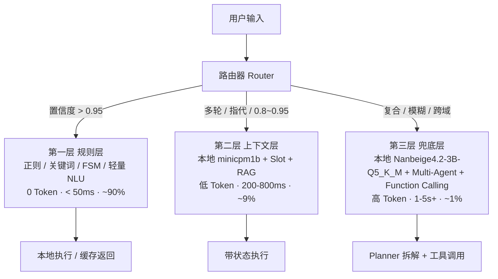

# 智能家居意图识别漏斗式分层路由架构设计

> 本文提出并形式化 Orion Smart Home 的**漏斗式分层路由架构（Funnel Routing Architecture）**：用最低的成本拦截最高频的请求，把最昂贵的算力留给最稀缺的复杂场景。
>
> 该设计不是凭空引入一套新系统，而是在现有代码基础上的一次演进：当前 `subagents/router.py` 的关键词路由是规则层的雏形，`graph/` 的 LangGraph 主图与 `subagents/` 的领域子 Agent 是上下文层与兜底层的地基。本文会逐层说明「现有代码在哪」「还需要补什么」。
>
> 核心代码位置：
> - 现有规则路由：`smarthome-api/app/agents/subagents/router.py`
> - 子 Agent 工厂 / 契约：`smarthome-api/app/agents/subagents/factory.py`、`contracts.py`
> - 主图编排：`smarthome-api/app/agents/graph/__init__.py`
> - 风险 / 审批：`smarthome-api/app/agents/graph/risk_node.py`、`approval.py`、`execute.py`
> - 工具定义：`smarthome-api/app/agents/tools/__init__.py`
> - 会话树 / 压缩：`smarthome-api/app/services/session_tree.py`、`smarthome-api/app/compaction/`

---

## 1. 文档目的

说明以下问题：

1. 为什么智能家居的意图识别需要**分层**，而不是让所有请求都走大模型。
2. 每一层（规则层 / 上下文层 / 兜底层）的定位、技术选型、延迟与成本边界。
3. 路由器（Router）如何决定一次请求进入哪一层。
4. 这套漏斗如何映射到 Orion 现有代码，以及分阶段落地路径。

## 2. 背景与问题

当前 Orion 以**单一大模型 + 扁平工具集 + 领域子 Agent 路由**处理所有请求。尽管 `subagents/router.py` 已经用 `DOMAIN_KEYWORDS` 做了一层关键词规则路由，但它只负责「挑领域」，最终几乎每个请求仍会进入 LLM 图执行（`build_graph` 里的 `model_node`）。

这带来三个问题：

| 问题 | 智能家居中的具体表现 |
| ---- | -------------------- |
| 高频请求被过度消费 | 「开灯」「关窗帘」这类每天上百次的肌肉记忆型指令，也要完整走一次模型推理，延迟高、Token 有开销 |
| 简单场景用重武器 | 一次「室内多少度」只需读缓存，却可能触发模型 + 工具调用链 |
| 复杂场景算力不足 | 真正需要强推理的「根据天气和湿度决定是否开加湿器」反而与简单指令共用同一套提示词与预算 |

漏斗模型的思路是把「普通门诊 / 专科医生 / 多科室会诊」这三层分离：**90% 的请求在本地规则层毫秒级解决，9% 用低成本小模型处理多轮与指代，仅 1% 交给大模型做跨域推理。**

## 3. 术语

| 术语 | 定义 |
| ---- | ---- |
| 规则层（Rule Layer） | 基于正则 / 关键词 / FSM / 轻量 NLU 的确定性意图识别，0 Token，本地完成 |
| 上下文层（Context Layer） | 使用小参数模型（7B–14B，可私有化）处理指代消解、多轮槽位、相对控制 |
| 兜底层（Fallback Layer） | 使用大参数模型 + Multi-Agent 编排处理跨域、模糊、强推理与长尾知识 |
| 路由器（Router） | 根据规则匹配置信度、会话状态、是否含指代等信号，决定请求进入哪一层 |
| 置信度（Confidence） | 规则层匹配结果的可信程度，用于放行 / 丢弃 / 追问的阈值判定 |
| 槽位（Slot） | 多轮对话中待填充的意图参数，如 `alarm_time`、`target_temp` |
| 家庭图谱（Household Graph） | 结构化描述「谁在哪个房间、哪些设备在线、当前状态」的上下文，注入模型作为常识 |
| 写提案（Write Proposal） | 模型生成的、需经风险审批后才能执行的写操作请求，与现有 `WRITE_TOOL_NAMES` 写工具参数一致 |
| 边缘网关（Edge Gateway） | 部署在家庭本地的网关，承载规则层与部分上下文层，保证断网可用 |

## 4. 总体架构



| 层级 | 比喻 | 占比 | 核心技术 | 响应延迟 | 模型消耗 |
| ---- | ---- | ---- | -------- | -------- | -------- |
| 第一层 规则层 | 普通门诊 | ~90% | 正则、关键词、FSM、轻量 NLU（Rasa DIET / Snips） | < 50ms | 0 Token |
| 第二层 上下文层 | 专科医生 | ~9% | 本地 minicpm1b + 会话状态 + RAG | 200–800ms | 低 |
| 第三层 兜底层 | 多科室会诊 | ~1% | 本地 Nanbeige4.2-3B-Q5_K_M + LangGraph Multi-Agent + Function Calling | 1–5s+（SSE 流式） | 高 |

---

## 5. 第一层：规则层（普通门诊）

**定位**：拦截意图明确、表达高度固定、单轮即可完成的请求。这是用户每天重复上百次的「肌肉记忆」型指令。

### 5.1 场景映射

| 场景分类 | 典型指令 | 处理逻辑 |
| -------- | -------- | -------- |
| 直接控制 | 「打开客厅灯」「空调调到 26 度」「关闭窗帘」 | 正则提取（动作 + 实体 + 参数）→ 直接下发 IoT 指令 |
| 固定场景 | 「我回来了」「睡觉了」「观影模式」 | 关键词匹配 → 触发预设 Scene ID |
| 简单查询 | 「现在几点了」「室内温度多少」 | 模板匹配 → 读取设备 State 缓存直接返回 |
| 快捷自动化 | 「十分钟后关电视」 | 时间正则 + 设备正则 → 写入本地定时器 |

### 5.2 设计要点

- **别名库热加载**：用户自定义的「宝宝房」「主卧」必须在规则层建立倒排索引，确保本地秒级解析；别名变更即时生效，无需重启。
- **置信度阈值**：
  - 匹配置信度 `> 0.95` → 直接放行执行。
  - `< 0.8` → 丢弃给下一层（上下文层或兜底层）。
  - `0.8 ~ 0.95` → 进入模糊匹配或发起追问。
- **本地优先**：规则层可完全下沉到边缘网关，无需上云。

### 5.3 与现有代码的关系

`subagents/router.py` 的 `route_intent()`（`DOMAIN_KEYWORDS` 关键词匹配）已经是规则层的雏形，但它只输出「领域标签」，不输出「可执行的动作 + 实体 + 参数」，也没有置信度概念。规则层要做的是把它从「分类器」升级为「可执行意图解析器」：在保留 `DOMAIN_KEYWORDS` 做领域粗分的基础上，增加动作 / 实体 / 参数的正则提取，并为每次匹配打分。

---

## 6. 第二层：上下文层（专科医生）

**定位**：处理省略、指代、多轮对话，以及需要结合当前设备状态的请求——也就是「话只说一半」或需要「看图说话」的场景。

### 6.1 场景映射

| 场景分类 | 典型指令 | 处理逻辑 |
| -------- | -------- | -------- |
| 指代消解 | （刚问了客厅温度）「那卧室呢？」 | Slot Tracking：继承上一轮 `query_temp` 意图，替换实体为 `bedroom` |
| 条件省略 | 「太亮了」 | State Awareness：查询当前所在房间 / 最近交互设备 → 推断「调暗当前灯光」 |
| 多轮槽位填充 | U:「帮我定个闹钟」A:「好的，定在什么时候？」U:「明早七点」 | Dialog Manager：维护 `alarm_time` 槽位，填满后触发执行 |
| 相对控制 | 「声音大一点」「再暖一点」 | Delta Calculation：读取当前音量 / 色温 → `current + step` → 下发 |

### 6.2 设计要点

- **家庭图谱注入**：将 Household Graph（谁在哪个房间、哪些设备在线、当前状态）作为 System Prompt 的一部分注入小模型，赋予其「常识」。
- **状态机兜底**：小模型在多轮中迷失（Hallucination）时，强制回退到预定义的 Dialog Flow 状态机，避免对话失控。
- **与 Orion 现有基础设施复用**：
  - 槽位与多轮状态可直接落在现有的**会话树（session tree）**上，继承其分支、回滚、压缩能力。
  - 上下文过长时复用 `compaction/` 的压缩机制，保证小模型上下文不溢出。
  - 小模型产出的写操作（如「调暗灯光」）仍走 `risk_check → approval` 链路，不因「更便宜」而绕过风险控制。

---

## 7. 第三层：兜底层（多科室会诊）

**定位**：处理跨领域、模糊、复合需求、强推理、长尾知识问答。需要拆解子任务并协调多个子系统。

### 7.1 场景映射

| 场景分类 | 典型指令 | 处理逻辑 |
| -------- | -------- | -------- |
| 复合跨域 | 「我睡觉了，顺便看看明天天气决定要不要开加湿器」 | Planner Agent 拆解：1. 触发睡眠场景（Scene）2. 查天气（Tool）3. 若湿度 < 40% 则开加湿器（Device） |
| 模糊意图 | 「家里有点闷，而且感觉不太安全」 | Reasoning：「闷」→ 开新风 / 空调换气；「不安全」→ 检查门窗传感器 / 布防 |
| 复杂自动化生成 | 「工作日我老婆开车出门就开省电模式，但我在家就算了」 | Code/Logic Gen：生成含多重 Condition（Time + Person + Location + Presence）的 Automation JSON |
| 故障诊断 | 「扫地机器人今天怎么没工作？是不是网断了？」 | Troubleshooter Agent：调日志查询工具 → 分析错误码 → 给修复建议 |

### 7.2 设计要点

- **异步与流式**：耗时长，必须通过 SSE 推送「正在思考…」「正在查询天气…」「正在配置自动化…」的过程态，避免用户以为卡死。Orion 已具备 SSE 流式能力，可直接复用。
- **写操作沙箱**：大模型生成的自动化规则或批量控制指令**绝对不能直接执行**，必须生成 Write Proposal，经前端 UI 确认或 Risk Assessor 审批。这与现有 `SubAgentOutput.write_proposals` 及 `risk_check` 审批链路的语义完全一致。

---

## 8. 路由器（Router）

路由器是分层的决策中枢。它在现有 `resolve_delegated_domain()` 之上，增加置信度阈值与会话状态判断：

```python
def smart_home_router(user_input: str, session_state: SessionState) -> RouteResult:
    # 1. 尝试规则层（普通门诊）：确定性解析 + 置信度打分
    rule_result = rule_engine.parse(user_input)
    if rule_result.confidence > 0.95:
        return execute_local(rule_result)          # 毫秒级返回，0 Token

    # 2. 尝试上下文层（专科医生）：有多轮依赖或简单指代时用小模型
    if session_state.has_active_dialog() or has_pronouns(user_input):
        small_model_result = small_llm.invoke(user_input, context=session_state)
        if small_model_result.is_clear():
            return execute_with_state(small_model_result)   # 写操作仍走 risk_check

    # 3. 兜底层（多科室会诊）：复杂、模糊、跨域
    return large_llm_agent.plan_and_execute(user_input, full_household_context)
```

**分流信号优先级**：规则置信度 → 会话是否有活动对话框 → 是否含指代词 → 是否命中复合意图。

| 信号 | 判定 | 去向 |
| ---- | ---- | ---- |
| `rule_result.confidence > 0.95` | 意图明确、单轮可完成 | 规则层直接执行 |
| `0.8 ~ 0.95` | 可能匹配但不够确定 | 上下文层或发起追问 |
| `< 0.8` 且无多轮 / 指代 | 规则层不认，但语义较复杂 | 兜底层 |
| `session_state.has_active_dialog()` | 正在多轮对话 | 上下文层（继承槽位） |
| `has_pronouns(user_input)` | 含「那 / 它 / 卧室呢」等指代 | 上下文层（继承上一轮意图） |

**与现有代码的衔接点**：现有 `resolve_delegated_domain()` 只做「是否委托给单个可委托领域」的判定，未委托则一律进主图（相当于兜底层）。新路由器应把「规则层直接执行」前置到委托判定之前，让高频指令在进入任何 LLM 图之前就被拦下。

---

## 9. 与现有系统的映射

下表列出每层在 Orion 中的「已具备」与「待补」。

| 层次 | 已具备（可直接复用） | 待补（新增能力） |
| ---- | -------------------- | ---------------- |
| 规则层 | `subagents/router.py` 的 `DOMAIN_KEYWORDS` / `route_intent` | 动作 + 实体 + 参数正则提取、别名倒排索引、置信度打分、本地定时器 |
| 上下文层 | 会话树、`compaction/` 压缩、`get_domain_tools` 领域窄工具集、子 Agent 工厂 | 本地小模型适配（minicpm1b）、Slot 状态机、家庭图谱 System Prompt 注入 |
| 兜底层 | `build_graph` 主图、`risk_check → approval` 审批、SSE 流式、`SubAgentOutput.write_proposals` | Planner / Code-Gen / Troubleshooter 等领域子 Agent 的编排与工具补齐 |
| 路由器 | `resolve_delegated_domain()`、`is_write_domain()` | 置信度阈值、会话状态分流、规则层前置拦截 |

**关键不变式（贯穿三层）**：无论哪一层产出的**写操作**，都必须回流到 `risk_check → approval` 单写路径，越底层执行越可控、越上层越智能但越需监管。

---

## 10. 收益分析

| 维度 | 收益 |
| ---- | ---- |
| 用户体验（UX） | 90% 的开灯关灯在 50ms 内完成，用户感觉不到 AI 的存在；仅 1% 的复杂任务需要等待 2 秒，符合心理预期 |
| 成本 | 若所有请求都走 GPT-4o，一个活跃家庭每天 200 次交互的月成本可达数十元；漏斗过滤后 99% 由零成本规则或廉价小模型处理，整体 Token 成本可降 95% 以上 |
| 隐私与离线可用性 | 规则层与部分上下文层可下沉到家庭边缘网关；断网时「开灯」「关窗帘」仍可用，守住智能家居的可靠性底线 |
| 渐进式演进 | 初期可把上下文层硬编码为规则；数据积累后再训练小模型；兜底层使用本地 Nanbeige4.2-3B-Q5_K_M 等本地模型，后期微调垂直领域 Home-LLM |

---

## 11. 落地路线图

### P0：规则层前置拦截（高频指令零 Token）

- 在 `route_intent` 基础上增加动作 / 实体 / 参数提取与置信度打分。
- 实现 `置信度 > 0.95` 的本地直接执行路径（控制、场景、简单查询、快捷自动化）。
- 建立别名倒排索引与热加载。

验收标准：`「打开客厅灯」` 在进入 LLM 图之前完成，全程 0 Token、< 50ms；断网时仍可执行。

### P1：上下文层多轮与指代

- 接入本地小模型 minicpm1b，作为第二层。
- 实现 Slot 状态机与家庭图谱注入，复用会话树 / 压缩基础设施。
- 小模型迷失时回退 Dialog Flow 状态机。

验收标准：`「那卧室呢？」` 能继承上一轮 `query_temp` 意图并替换实体；写操作仍走 `risk_check → approval`。

### P2：兜底层 Multi-Agent 编排

- 使用本地 Nanbeige4.2-3B-Q5_K_M 作为底层模型，补齐 Planner / Code-Gen / Troubleshooter 等子 Agent 与对应工具。
- 所有写操作产出 Write Proposal，经审批后执行；SSE 流式过程态。

验收标准：`「我睡觉了，顺便看明天天气决定要不要开加湿器」` 能正确拆解并串行 / 并行协调多个子系统。

---

## 12. 风险与注意事项

- **规则层脆弱性**：正则与关键词难覆盖所有表达变体，需要持续的别名维护与回退路径（未命中 → 上下文层 / 兜底层）。规则层是「快路径」，不是「唯一路径」。
- **缓存一致性与 TOCTOU**：规则层读取的 State 缓存可能滞后，直接下发前需复核设备状态，避免与真实状态不一致（可复用现有 `resource_version` 版本复核思想）。
- **别名冲突**：不同家庭成员对同一房间的别名可能冲突，需按家庭维度隔离并在冲突时降级到追问。
- **小模型幻觉**：上下文层必须有状态机兜底，避免多轮对话失控；写操作一律不绕过审批。
- **隐私边界**：家庭图谱与设备状态注入模型时需脱敏（复用 `redaction.py`），不上传不必要的敏感数据。
- **性能预算**：规则层必须严格控制 `< 50ms`，避免正则回溯或倒排索引效率问题拖垮快路径。

---

## 13. 关联文档

- [子 Agent 设计：面向智能家居的多 Agent 编排](./sub-agent-design.md)
- [会话树形存储](./session-tree-storage.md)
- [上下文压缩机制](./session-tree-compaction-review.md)
- [后端 Agent 未完成项与实施建议](./backend-agent-gap-analysis.md)

---

## 14. 当前实现状态（2026-08 快照）

> 本节是**事实快照**而非设计意图，与第 5–9 节的"应有形态"对照阅读。代码是唯一真源，文档若与代码冲突以代码为准；任何对实现的修改应同步回本节。

### 14.1 已落地（与代码一一对应）

| 文档章节 | 实现位置 | 行数 | 已覆盖能力 |
| -------- | -------- | ---- | ---------- |
| §5 规则层（解析） | `smarthome-api/app/agents/subagents/rule_engine.py` | 786 | 动作 / 实体 / 参数正则提取；置信度三档（0.97 / 0.85 / 0.4）；复合意图（`顺便 / 决定 / 看看` 等）拒识；房间抽取；中文数字解析；预算超时退出；倒排别名索引 `AliasIndex`（房间 / 设备，冲突不静默覆盖） |
| §5 规则层（执行） | `smarthome-api/app/agents/subagents/rule_layer.py` | 749 | 设备反查（精确 → 房间+类型 → 名称包含，三级降级）；风险分类（复用 `risk.classify_*`）；低风险 + `auto_execute_low_risk` 直执，否则产 `ApprovalRequired`；SSE 事件同构（`run_started / tool_started / tool_completed / execution_status / approval_required / run_completed`）；`AuditRecorder` 完整记录；简单查询（时钟 / 温度 / 湿度占位）直接读缓存返回 |
| §6 上下文层 | `smarthome-api/app/agents/subagents/context_engine.py` | 330 | 指代消解：继承上一轮 `query` 意图并替换 `entity_ref`；实体复用：继承 `control` 意图与 `write_proposals`，替换目标实体；相对控制（`再亮 / 大一点` 等）拒绝并回退兜底层；上一轮不可继承或无上下文 → 安全回退 |
| §8 路由器 | `smarthome-api/app/agents/subagents/funnel_router.py` | 307 | `LAYER_RULE` / `LAYER_CONTEXT` / `LAYER_FALLBACK` / `LAYER_DIRECT` 四层标签；置信度阈值来自 `Settings`；会话状态 + 指代词检测；进程级单例 `get_funnel_router()` / `reset_funnel_router()` |
| §8 与 Runner 衔接 | `smarthome-api/app/agents/agent_service/runner.py` L303–333 | — | `_route_funnel` 前置拦截；`LAYER_RULE` → `execute_rule_layer` 早退；`LAYER_CONTEXT` → `_resolve_context_turn` 调 `ContextEngine` 消解，命中同样走 `execute_rule_layer`；未命中或开关关闭 → 原主图 |
| §9 配置项 | `smarthome-api/app/core/config.py` L110–134 | — | `funnel_enabled` / `funnel_context_enabled` / `funnel_rule_confidence_high`（默认 0.95） / `funnel_rule_confidence_low`（默认 0.8） / `funnel_rule_max_duration_ms`（默认 50） / `funnel_alias_hot_reload`（默认 True） |

### 14.2 关键不变式（贯穿三层已守住）

- **单写路径**：所有写操作（无论来自规则层 / 上下文层 / LLM 兜底层）都走 `risk.classify_*` → `risk_check → approval` 链路（见 `rule_layer.py::_classify_for_proposal` 与 `_execute_one_proposal` 的 `needs_approval` 判定），绝不因"层更便宜"而绕过风险控制。
- **0 Token 强路径**：`LAYER_RULE` 命中后 SSE 事件流里没有任何模型调用，`store_usage` 的 `input_tokens / output_tokens` 均为 0。
- **永不抛异常**：规则层 / 上下文层 / 路由器 `try/except` 兜底，任意异常一律"未命中 → 上层接管"。

### 14.3 与设计文档的偏差（已实现但偏离 §5–§7 原意的地方）

1. **§5.2 模糊匹配 0.8 ~ 0.95 的"追问"行为**：当前实现是**升入上下文层**消解，而非"先追问再执行"。`FunnelRouter` 在 `[low, high)` 区间返回 `LAYER_CONTEXT`，由 `ContextEngine` 做指代 / 实体复用；`RuleEngine` 内部仍设 `needs_clarification=True`（保留追问信号），但 `_run_agent_body` 当前只读 `matched` 不读追问字段。**回归时需检查 `runner._run_agent_body` 内的 context 分支是否需要 `clarification_prompt` 透传**。
2. **§5.3 别名热加载**：`funnel_alias_hot_reload` 是**死开关**——`config.py` 描述为"别名变更时是否即时刷新"，但代码中无任何订阅 / 通知机制，`AliasIndex` 仅在构造时一次性绑定。详见 §15.1。
3. **§6.1 多轮槽位填充**（"帮我定个闹钟 / 明早七点"）：**未实现**。`ContextEngine` 只覆盖意图继承 + 实体替换，不维护 `alarm_time` 等槽位状态机，命中即归还兜底层。
4. **§6.1 条件省略**（"太亮了"）：**未实现**。需要"最近交互设备"上下文，超出当前 `_load_previous_user_message` 范围，归还兜底层。
5. **§7 兜底层 Multi-Agent 编排**：沿用现有 LangGraph 主图 + `resolve_delegated_domain` 子 Agent 委托作为**占位**。本地模型（minicpm1b / Nanbeige4.2-3B-Q5_K_M）、Planner / Code-Gen / Troubleshooter 子 Agent **未实现**。

### 14.4 验收对应

| 文档标准 | 实际状态 |
| -------- | -------- |
| P0：`「打开客厅灯」` 0 Token < 50ms | ✅ 代码路径已具备（`RuleEngine.parse` 预算 50ms 退出 + `execute_rule_layer` 不调 LLM），**但 `tests/` 目录为空，缺少自动化测试**（见 §15.2） |
| P0：断网仍可执行 | 🟡 规则层解析 / 执行是纯本地逻辑，理论可达；但 `rule_layer.py::_classify_for_proposal` 走 SQL（设备 / 场景查询），需验证在数据库不可达时是否优雅降级（当前未测试） |
| P1：`「那卧室呢？」` 继承 `query_temp` 替换实体 | ✅ `ContextEngine._inherit_from_previous` 已实现，**但同样缺测试** |
| P2：`「我睡觉了，顺便看明天天气决定要不要开加湿器」` 拆解协调 | ❌ 由现有主图承担（多轮 + 工具调用），尚未在 Local 7B/3B 模型上验证 |

---

## 15. 待办与风险

### 15.1 短期可做（1–2 天）

1. **【P0】补测试基线**（`smarthome-api/tests/`）
   - `tests/conftest.py`：内存 SQLite + `AIModel` / `Device` / `Household` / `User` / `AgentContext` fixture
   - `tests/test_rule_engine.py`：覆盖控制 / 场景 / 查询 / 调度 / 复合意图拒识 / 置信度档位 / 别名冲突 / 中文数字 / 预算超时
   - `tests/test_funnel_router.py`：覆盖三层分流、阈值边界、会话状态、指代词、`funnel_enabled=False` 全部回退
   - `tests/test_context_engine.py`：覆盖指代消解成功 / 失败、实体替换、相对控制拒绝、上一轮不可继承
   - `tests/test_rule_layer.py`：mock 设备反查与风险分类，验证 `_make_args` / `_classify_for_proposal` / 写提案 → pending 链路
2. **【P0】复活 `funnel_alias_hot_reload` 死开关**
   - 在 `AliasIndex` 加 `version` 字段与 `subscribe` 钩子
   - `RuleEngine` 接受可选 `alias_provider`（callable 返回当前 `AliasIndex`）；每次 `parse` 检查 `version` 变化时换新
   - 配置 `funnel_alias_hot_reload=False` 时退化为构造时一次性绑定
3. **【P1】`RuleEngine` 追问透传到 Runner**
   - 当 `needs_clarification=True` 时，`_run_agent_body` 走 `LAYER_CONTEXT` 而非 `LAYER_RULE`，把 `clarification_prompt` 注入 `MessageDelta` 推给前端

### 15.2 中期（1 周）

1. **【P1】多轮槽位状态机**（闹钟 / 提醒 / 多步参数收集）
   - 在 `session_tree` 上挂 `Slot` 持久化（与 `pending_approval` 同构）
   - `ContextEngine.resolve` 增加 `_try_fill_slot` 分支：命中即返回规则层结果，未命中即把 `pending_slot` 写入树
2. **【P1】条件省略**（"太亮了" / "声音有点小"）
   - 在 `SessionState` 增加 `last_interacted_device`
   - `ContextEngine` 优先把指代解析到该设备，再回退兜底层
3. **【P2】家庭图谱 System Prompt 注入**
   - 从 `Household` + `Device` + `Room` 构建紧凑结构化描述（≤ 1KB），注入 `model_node` System Prompt 之外
4. **【P2】Planner 子 Agent 骨架**
   - 在 `subagents/domains/` 新增 `planner.py`，接受复合意图，输出 `[(domain, task, deps)]` 拆解清单
   - `runner` 识别 Planner 输出后串行 / 并行调度子 Agent

### 15.3 风险与注意

- **测试基线缺失**：本节列出的"P0 已实现"目前是**凭代码审计**，没有任何自动化保证。任何对 `rule_engine.py` / `context_engine.py` 的改动都可能悄无声息地破坏文档 P0 验收。补测试前不要动正则或阈值。
- **断网可用性未经测试**：`rule_layer._classify_for_proposal` 走 SQL，DB 不可达时当前行为是 `try/except` → `failed` 事件，**不会回退到兜底层**（因为已经离开了 funnel 阶段）。如果想支持纯离线，需要在 `_classify_for_proposal` 失败时把提案直接标 `pending_confirmation`。
- **别名死开关误导**：配置 `funnel_alias_hot_reload=True` 当前**没有任何效果**。若产品文档对外承诺"别名实时生效"，是 bug。
- **追问字段悬空**：`RuleParseResult.needs_clarification` 与 `clarification_prompt` 已被设置但 `runner` 暂未消费，前端看不到"请确认..."的提示（除非走 LLM 兜底层由模型自己生成）。

---

## 16. 验收脚本

> 本节指向测试入口而非测试用例本身；具体用例见 `smarthome-api/tests/`。

- **规则层基准**：`pytest smarthome-api/tests/test_rule_engine.py -v`
- **路由器基准**：`pytest smarthome-api/tests/test_funnel_router.py -v`
- **上下文层基准**：`pytest smarthome-api/tests/test_context_engine.py -v`
- **执行器基准**：`pytest smarthome-api/tests/test_rule_layer.py -v`
- **全量**：`pytest smarthome-api/tests/ -v`

若以上命令在干净 venv 失败，先 `uv pip install pytest pytest-asyncio`（项目 `pyproject.toml` 暂无 dev 依赖分组，建议在第 15.1.1 同步加上）。
