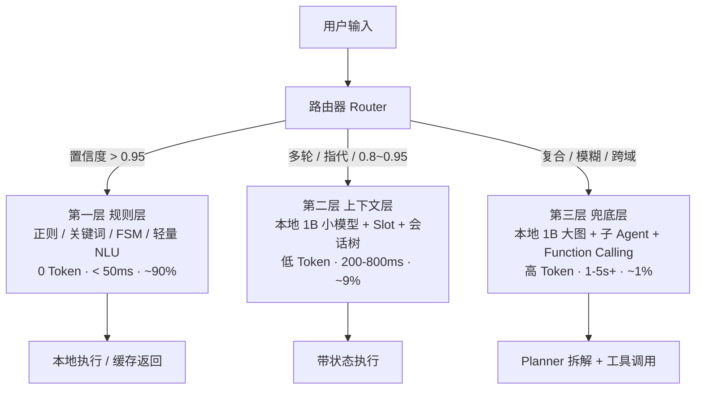

# 第八届中国研究生人工智能创新大赛

## Orion Edge Smart Home —— 基于 1B 小模型与边缘部署的可审计长对话智能家居智能体

## 项目文档

V1.0

2026.08

**项目名称**：Orion Edge Smart Home　|　**版本**：V1.0　|　**日期**：2026.08　|　**团队名称**：[团队名称]　|　**参赛组别**：[参赛组别]

> **一句话核心叙事**：用「1B 小模型 + Jetson 边缘设备」跑起一个**安全、可长期对话、可审计**的智能家居智能体。
> 小模型意味着推理弱、上下文短、显存紧——而本项目系统化落地的「上下文压缩 + 会话树形存储 + 风险分级审批 + 大模型驱动的场景编排 + 漏斗式分层路由」恰好是这些短板的解药，因此**这套基础设施在边缘场景下的价值被显著放大**，构成真正的差异化亮点。

---

## 目录

1 [项目概况](#1-项目概况)
1.1 [背景和基础](#11-背景和基础)
1.2 [场景和价值](#12-场景和价值)
1.3 [所需支持](#13-所需支持)

2 [项目规划](#2-项目规划)
2.1 [整体目标](#21-整体目标)
2.2 [技术创新点](#22-技术创新点)

3 [实施方案](#3-实施方案)
3.1 [技术可行性分析](#31-技术可行性分析)
3.2 [技术细节](#32-技术细节)
3.3 [计划和分工](#33-计划和分工)
3.4 [漏斗式分层路由架构](#34-漏斗式分层路由架构)

4 [参考资料](#4-参考资料)

---

## 记录更改历史

| 序号 | 更改原因 | 版本 | 作者 | 更改日期 | 备注 |
| ---- | -------- | ---- | ---- | -------- | ---- |
| 1 | 首次提交 | V1.0 | [作者] | 2026.08 | 初稿 |
|   |          |      |      |          |      |
|   |          |      |      |          |      |

---

## 1 项目概况

### 1.1 背景和基础

#### 1.1.1 痛点：传统方案在「智能 + 隐私 + 可控」三角中难以兼得

智能家居在过去十年完成了从「遥控 App」到「语音助手 + 场景联动」的演进，但当前面向 C 端家庭的主流方案仍存在以下结构性问题：

1. **App / 表单式规则引擎门槛高**：典型智能家居 App 需要用户在 4–5 层菜单里寻找「回家模式」「睡眠模式」按钮；更复杂的「每周五 18:30 后若客厅有人就开氛围灯」自动化规则，往往要求用户手动配置触发器 + 条件 + 动作 + 冷却 + 优先级——绝大多数家庭用户难以独立完成。
2. **云端大模型方案存在三大顾虑**：
   - **数据隐私**：家庭摄像头、门锁、行为习惯等数据持续上云，长期存在被滥用或泄漏的风险；
   - **断网不可用**：智能家居对网络稳定性的容忍度极低（开门、开灯不能等几十秒重连），云端方案在弱网/断网场景下迅速退化为「哑设备」；
   - **长期 API 成本**：按 token 计费的大模型推理，对「每天与家居对话几十次」的家庭用户而言是显性、长期的财务支出。
3. **大模型能力与小型化路线的失衡**：云端 GPT/Claude 级别模型能解析复杂指令并规划多步操作，但其对家庭场景的部署并不友好；与之相对，1B 级小模型（MiniCPM、Phi-3.5-mini、Qwen-1.5B 等）已能在边缘设备（Jetson Orin Nano、Orin NX、Raspberry Pi 5 + 加速棒）上以可接受延迟运行，但需要补齐「上下文短」「推理弱」「易幻觉」三项配套基础设施才能成为合格的家庭智能体。

#### 1.1.2 机遇：1B 小模型 + Jetson 边缘 + 配套基础设施 = 「真本地智能体」窗口期

2024–2026 年是边缘端小型语言模型（SLM on device）从「技术演示」走向「产品可用」的关键节点：

- **模型侧**：MiniCPM 2/3/4 系列、Phi-3.5-mini、Qwen2.5-1.5B、Llama-3.2-1B 等 1B–3B 模型在指令理解、工具调用（function calling）、结构化输出（JSON）能力上已能满足「智能家居任务规划」需求。
- **硬件侧**：NVIDIA Jetson Orin Nano 8GB / Orin NX 16GB 等边缘设备内置 8–16GB 共享显存，配合 CUDA + TensorRT，可承载 1B 模型 INT4 量化（约 0.5–1GB 权重）+ KV cache 推理。
- **推理引擎侧**：llama.cpp（CUDA 后端）、vLLM（已支持 Jetson 移植）、Ollama、TensorRT-LLM 等本地推理服务都暴露了 **OpenAI 兼容的 HTTP 接口**（标准 chat completions 端点），使得应用层切换本地/云端模型几乎「零改动」。

#### 1.1.3 切入：做「**本地边缘部署的大模型智能体**」——补齐五项配套基础设施

我们团队的切入路径是：以 **1B 小模型 + Jetson 边缘设备**为硬件基座，**系统化地补齐五项针对「小模型 + 边缘」场景的基础设施**，让小模型也能承担长期、安全的家庭智能体角色：

1. **上下文压缩**（边缘刚需）—— 让 8K–32K 上下文的小模型也能维持长对话；
2. **会话树形存储**（轻量可审计）—— 在存储/内存有限的边缘设备上实现可分支、可恢复、可审计的会话状态；
3. **风险分级与人工审批**（补偿小模型）—— 规则化风险策略 + 写操作强制人工确认，把安全兜底做在前面；
4. **大模型驱动的场景编排**（替代表单式引擎）—— 把自然语言直接转成结构化自动化规则；
5. **漏斗式分层路由**（降本 + 离线）—— 把 90% 高频指令前置拦截在毫秒级零 Token 路径，让昂贵算力留给真正复杂的 1% 场景。

#### 1.1.4 已有工作基础

本项目基于团队此前已完成的「Orion Smart Home」智能家居控制系统迭代而来，已有可直接运行的原型与可量化的工程基线：

- **后端**：FastAPI + LangGraph + SQLAlchemy + SQLite + LangChain；约 30+ 业务模块，**完整可运行的单 Agent 工作流**已通过单元测试与手测；
- **会话存储与压缩**：**自主设计并完整实现了一套 append-only 的会话树形存储 + 上下文压缩引擎**。设计参考了开源智能体 Pi（pi-mono）的会话存储与压缩思想（这是业内已知的设计参考），但**全部代码由本团队从零实现**（约 3000 行 Python），包含纯逻辑层 / 存储层 / 编排层 / 接入层四层架构；
- **风险分级与审批**：基于 LangGraph 状态机实现「风险检查 → 审批中断 → 写工具」完整闭环，写操作审计链 + 同会话并发互斥；
- **子 Agent 委派**：6 个智能家居领域子 Agent（设备 / 场景 / 自动化 / 能耗 / 舒适 / 安防），规则层路由 + 独立线程隔离；
- **漏斗式路由雏形**：现有规则层关键词路由可作为第一层（普通门诊）的基础，6 个领域子 Agent 作为上下文层（专科医生），主图作为兜底层（多科室会诊）——三层架构在现有代码中已有雏形；
- **前端**：Vue 3 + Vite + TypeScript + Pinia，审批卡片、SSE 流式解析、Chat UI 已就绪；
- **模型接入层**：基于 OpenAI 兼容协议实现的适配器，可零改动切换到任意 OpenAI 兼容端点（vLLM / llama.cpp / Ollama / DeepSeek / OpenAI），**这是「无改动接入本地 Jetson 模型」的关键**。

#### 1.1.5 团队构成

| 方向 | 人数 | 主要职责 |
| ---- | ---- | -------- |
| 大模型 / Agent | 2 | 模型适配、Agent 工作流、压缩、风险分级、子 Agent 设计、漏斗路由 |
| 后端工程 | 2 | FastAPI、SQLAlchemy、LangGraph、SSE 流式、数据库、鉴权、审计 |
| 前端工程 | 1 | Vue 3、TypeScript、Pinia、SSE 解析、审批 UI、Chat UI |
| 边缘部署 / 硬件 | 1 | Jetson 适配、模型量化（INT4/INT8）、推理引擎（llama.cpp / TensorRT-LLM / vLLM）、性能评测 |

---

### 1.2 场景和价值

#### 1.2.1 应用场景

Orion Edge Smart Home 面向**家庭场景**的智能体，覆盖以下典型任务：

- **日常设备控制**：自然语言指令控制灯、空调、窗帘、新风、扫地机器人等家电；支持模糊表达（"有点暗"→ 自动调亮）；
- **一键场景执行**：把多设备组合成命名场景（"回家模式""影院模式""睡眠模式"），用一句话触发；
- **自动化规则创建与管理**：自然语言生成自动化（"每周五 18:30 后若客厅有人就开氛围灯"），系统自动转成结构化规则入库；
- **状态查询与诊断**：跨设备查询（"今天家里哪些灯还开着？""这个月最费电的是哪台？"），用自然语言获得聚合答案；
- **跨域复合任务**：能拆解并执行复合意图（"看一下客厅摄像头，如果没人在家就把空调关了"），需要场景感知 + 设备控制 + 条件判断的串行/并行；
- **适老化无障碍控制**：对老人/视障用户友好——只需开口，不必操作层层菜单。

#### 1.2.2 潜在社会价值

| 价值点 | 落地表现 |
| ------ | -------- |
| **隐私保护** | 家庭对话、设备状态、自动化配置等数据全程本地处理，不上云，从根本上解决家庭数据出域顾虑 |
| **离线可用** | 断网场景下系统完全可用；这在租房、独居老人、农村/弱网地区家庭尤其重要 |
| **降低长期成本** | 一次硬件投入（Jetson Orin Nano 8GB 约 3000–5000 元）+ 一次性部署，长期零 API 费 |
| **降低使用门槛** | 把"点击 5 层菜单"和"填自动化表单"变成"说一句"，老人/儿童/视障用户均能使用 |
| **降低误操作风险** | 高风险设备（门锁、摄像头、安防、警报）写操作强制人工审批并完整审计；这是把"敢让 AI 控制门锁"做成的关键 |
| **可审计 / 可追责** | 每次写操作生成完整审计链（参数 + 审批决定 + 执行结果 + 错误码），事后可复盘 |
| **节能与普惠** | 减少无效照明/空调用电；同时让"AI 智能体"这一形态从云端奢侈品走向家庭常驻品 |

#### 1.2.3 对比分析

| 维度 | 传统 App | 表单式规则引擎 | **云端大模型方案** | **本项目（Orion Edge）** |
| ---- | -------- | -------------- | ------------------ | ------------------------ |
| 交互方式 | 多层菜单点击 | 填写触发器/条件/动作表单 | 自然语言对话 | 自然语言对话 |
| 复杂任务理解 | ❌ 不支持 | ⚠️ 需手动配置 | ✅ | ✅（LLM 规划 + 工具调用） |
| 自主决策 | ❌ | ❌ | ✅ | ✅ |
| 隐私（数据出域） | ✅ 本地 | ✅ 本地 | ❌ 上云 | ✅ **本地** |
| 离线可用 | ✅ | ✅ | ❌ 强依赖网络 | ✅ **本地** |
| 长期成本 | ✅ 零 | ✅ 零 | ❌ 按 token 计费，长期显著 | ✅ 一次性硬件 + 零运营 |
| 写操作安全 | ⚠️ 用户自己点 | ⚠️ 规则自动执行 | ⚠️ 取决于护栏 | ✅ **规则化风险分级 + 强制审批** |
| 长对话记忆 | ⚠️ 通常仅缓存最近 N 句 | — | ⚠️ 受限于云端上下文窗口 | ✅ **会话树 + 压缩**（无限历史） |
| 可审计 | ❌ 黑盒 | ⚠️ 日志 | ⚠️ 云端日志，事后不可控 | ✅ **本地审计链 + 会话树** |
| 高频指令延迟 | 毫秒级（本地点击） | 毫秒级（本地匹配） | 1–5s（云端往返） | **毫秒级（漏斗前置拦截 90%）** |
| 部署门槛 | 低 | 低 | 低 | ⚠️ 需边缘硬件（一次投入） |

**核心差异**：在「**云端大模型方案**」的强项（任务理解、自主决策）上，本项目通过小模型 + 配套基础设施达到接近水平；而在「**云端大模型方案**」的弱项（隐私、离线、成本、长记忆、可审计、高频指令延迟）上，本项目具备显著优势——**特别是通过漏斗式分层路由，让 90% 的日常指令在毫秒级零 Token 路径完成**，这一点连云端大模型方案也难以做到。

---

### 1.3 所需支持

#### 1.3.1 硬件

| 类别 | 具体型号 / 参数 | 用途 | 是否可替代 |
| ---- | --------------- | ---- | ---------- |
| **边缘推理主设备** | NVIDIA Jetson Orin Nano 8GB（推荐）或 Jetson Orin NX 16GB | 承载本地 1B 模型推理（INT4 量化）与 FastAPI 后端服务 | 理论上可替换为 Raspberry Pi 5 + AI 加速棒（如 Coral TPU），但需重新评估推理延迟 |
| 主机内存 | 8GB 起步 / 16GB 推荐 | 运行后端服务、SQLite、SSE 流式 | — |
| 存储 | 64GB+ NVMe / SD | 操作系统、模型权重（~2GB）、SQLite 数据库、审计日志 | — |
| 可选 | 真实智能家居设备（智能灯、空调伴侣、门锁传感器等） | 真实场景联调（仿真器已能覆盖 80% 功能） | 否，但可分阶段接入 |
| 可选 | NVIDIA RTX 桌面 GPU | 训练 / 微调 / 量化模型；评测阶段使用 | 否，但日常使用无需 |

#### 1.3.2 模型

| 类别 | 具体型号 / 量化 | 用途 | 备注 |
| ---- | --------------- | ---- | ---- |
| **主推理模型** | MiniCPM-2.6-1B（INT4 量化，约 0.5–1GB 权重）或同级别 1B 小模型 | 对话理解、指令解析、工具调用、压缩摘要、上下文层与兜底层推理 | 需具备 function calling 能力；备选 Phi-3.5-mini-instruct、Qwen2.5-1.5B-Instruct |
| 嵌入模型 | bge-small-en-v1.5 / bge-small-zh-v1.5（可选） | 自动化冲突检测、相似指令检索 | 可选，纯本地推理 |

#### 1.3.3 数据 / 知识

- **设备状态与执行结果**：由内置模拟器生成，结构自定义、规模可控；
- **风险策略库**：内置 4 级风险（只读 / 低 / 高 / 未知）+ 高风险设备类型表（门锁 / 摄像头 / 安防 / 警报），无需大规模训练数据；
- **场景模式与设备类型**：智能家居行业公开常识，已整理到系统提示词中；
- **规则层别名库**：用户自定义的「宝宝房」「主卧」等房间 / 设备别名，倒排索引热加载。

#### 1.3.4 其他支持

- **边缘推理优化培训**：TensorRT / llama.cpp / vLLM-on-Jetson 部署与调优文档；
- **真实设备接入支持**：智能家居生态（米家、Aqara、Apple Home、Matter）协议适配；
- **评测与压测工具**：长对话压测脚本、并发审批压测、离线运行验证、漏斗命中率统计。

---

## 2 项目规划

### 2.1 整体目标

#### 2.1.1 交付目标（可衡量）

| 维度 | 目标 | 验证方式 |
| ---- | ---- | -------- |
| **边缘可运行原型** | 在 Jetson Orin Nano 8GB 上本地运行 1B 小模型（INT4 量化），完成自然语言控制设备 / 场景 / 自动化、多轮对话、风险审批、SSE 流式输出、长对话压缩全流程 | 现场演示 + 实测指标 |
| **长对话维持** | 持续对话 ≥ 200 轮不出现「上下文溢出/截断/历史丢失」 | 自动化压测脚本 |
| **指令解析准确率** | 简单控制指令 ≥ 95%；复合意图 ≥ 80% | 内部测试集（≥ 100 条样本） |
| **写操作安全** | 高风险写操作误执行率 = 0；所有写操作留有完整审计链 | 自动化用例 + 审计文件人工抽检 |
| **离线可用** | 断开外网后系统全部功能（控制、对话、审批、压缩、审计）正常；高频指令仍可执行 | 物理断网测试 |
| **并发安全** | 同一会话并发请求不串写检查点 / 审批状态 | 压测脚本 |
| **漏斗分层效果** | 高频指令（开灯/关灯/固定场景）≥ 85% 在规则层毫秒级处理；仅 ≤ 15% 进入模型层 | 漏斗命中率统计 |
| **边缘推理指标** | 首次 token 延迟 < 1.5s；持续生成 ≥ 8 tokens/s；显存峰值 < 4GB | Jetson 实测 |

#### 2.1.2 验证目标

- 在模拟器 + 至少 2 类真实设备上完成功能与安全评测；
- 产出 **《边缘推理性能与安全性评测报告》**，包含延迟、显存、吞吐、误执行率、长对话维持时间、并发安全、漏斗命中率 7 项核心指标；
- 形成 1 篇技术报告（本文档）+ 1 套开源代码 + 1 份评测报告 + 1 段 5–8 分钟演示视频。

> 注：本文档为完全自包含的项目文档，不依赖项目仓库内的其他设计文档；所有技术细节均在本报告内完整描述。

---

### 2.2 技术创新点

> **整体定位**：本项目不是「又一个 ChatGPT 控制家居」项目，而是**为「小模型 + 边缘设备」这一新部署形态系统化补齐五项配套基础设施**。每项创新都直面「小模型 / 边缘场景下的具体短板」，并已在工程层实现完整闭环。
>
> **展示约定**：每个创新点按 **「背景与痛点 → 完整技术细节 → 展示过程（一步步画面描述）→ 与现有方案差异」** 四步法展开。
>
> **设计参考**：四项基础设施的设计思路参考了开源智能体 Pi（pi-mono）的会话存储与压缩公开文档（业内已知的成熟设计模式），但**所有具体架构、状态机、算法、配置、UI 流程均由本团队独立设计并完整实现**（约 3000+ 行 Python + 2000+ 行 TypeScript）。我们借鉴的是「问题定义与解决思路」，而非「代码」。

---

#### 创新点 1：上下文压缩 —— 边缘刚需，让 1B 模型「带着记忆」工作

##### ① 背景与痛点

**为什么是边缘刚需**：
1B 小模型的上下文窗口通常为 **8K–32K tokens**（如 MiniCPM-2.6-1B 默认 4K，可扩到 32K），相对 128K–200K 级别的云端模型，**压缩从「锦上添花」变成「能不能用长对话」的关键**。在 32K 窗口下，一次中等规模的家务对话（40 轮 + 10 次工具调用）就可能逼近上限；不压缩，几小时后模型就开始「忘记早晨说过的话」。

云端大模型方案对压缩的需求弱（窗口足够大、推理便宜），所以 LangChain / LlamaIndex 等的压缩实现多以「单路径 + 单次摘要」为主，不适合边缘。

##### ② 完整技术细节

**总体架构（4 层）**：

```
┌────────────────────────────────────────────────────┐
│  编排层（压缩引擎）                                 │
│  - 触发判定 / 压缩执行 / 分支摘要 / 事件钩子        │
├────────────────────────────────────────────────────┤
│  纯逻辑层（无副作用，便于测试）                     │
│  - 切割点算法 / 压缩准备 / Token 估算 / 文件跟踪   │
│  - 分支摘要的导航与条目挑选                         │
├────────────────────────────────────────────────────┤
│  存储层（append-only 树 + SQLite WAL）             │
│  - 条目 / 记录 / 事实 + 强不变式校验                │
├────────────────────────────────────────────────────┤
│  接入层（与 Agent / 聊天流程集成）                  │
│  - 消息镜像 / 上下文读取 / 压缩触发                 │
└────────────────────────────────────────────────────┘
```

**关键 1：触发判定（三种来源 + 五条跳过规则）**

压缩引擎的「评估」步骤回答「**该不该压？**」，其输入是当前会话树、上下文窗口阈值、用户偏好、上一条助手消息状态。三种触发来源：

- **阈值触发**：每轮 Agent 推理结束后自动估算 token，达到「上下文窗口 - 预留 token」时触发；
- **溢出触发**：模型返回「长度截断」时由调用方触发，**压缩后自动重试一次**；
- **手动触发**：用户输入 `/compact` 命令触发。

五条防御性跳过规则保证不会重复压缩或压缩不该压缩的内容：压缩未启用、已压缩过、消息被中止、无内容、上次用量信息早于压缩边界。

**关键 2：双路径 token 估算**

上下文长度估算有两条路径，**自动择优**：

- **路径 1（真实用量）**：找到最后一个非中止/非出错的助手消息的用量字段，以其总 token（或输入 + 输出 + 缓存读 + 缓存写 累加）为「该消息之前所有上下文」的精确值，再叠加后续消息的启发式估算；
- **路径 2（字符数 / 4 启发式）**：当所有助手消息都没有用量（或全被中止/出错）时，对所有消息按角色分别按「字符数 / 4」估算（覆盖用户、助手、工具结果、自定义、命令执行、压缩摘要等多种角色）。

**为什么对边缘重要**：本地 1B 推理偶发返回异常用量（量化模型的 token 统计偏差）；单路径方案会「卡死」压缩，**双路径让「即使用量全错也能压缩」**。

**关键 3：切割点算法**

切割点回答「**从哪里切开？**」。

**核心不变量**：**「工具结果」永远不能作为切割点**——避免把工具结果切断丢失上下文；只能切在「用户 / 助手 / 命令执行 / 自定义 / 分支摘要 / 压缩摘要」这 6 种角色上。

算法步骤：
1. 从会话路径的「最新条目」向「最早条目」累积 token；
2. 当累积 ≥ 「保留尾巴 token」时，**回退**找到该位置之后的第一个合法切点（保证保留尾巴够长）；
3. 若切点是用户消息 → 轮次起始索引 = -1（不需要 split）；
4. 若切点是助手 / 工具调用 / 命令执行 → 向前找用户 / 分支摘要起始点，构成 **split turn**：history 末尾 + 轮次前缀 + 当前轮继续。

**关键 4：迭代式摘要（不丢旧信息）**

当同一会话被多次压缩时，常见做法是「每次从零总结」——这会让早期信息迅速丢失。本项目使用**更新式提示词**，明确要求模型：

- 保留旧摘要中所有未被覆盖的信息；
- 把「进行中」中已完成项移到「已完成」；
- 更新「下一步」反映当前状态；
- 精确保留文件路径、函数名、错误消息。

**配合虚拟条目**：把上次压缩的「保留尾巴」重新映射为虚拟消息条目，纳入下次切割点计算——**实现「压缩后的消息也算历史」**，连续压缩 5–10 次后仍能保持精度。

**关键 5：分支摘要（被抛弃分支自动归并）**

当用户用 `/tree` 导航切换分支继续对话时，旧分支的所有「被抛弃」条目会被自动收集并压缩为一条「分支摘要」节点，**注入到目标分支**。算法分两步：

1. **公共祖先导航**：用旧叶节点 → 公共祖先的逆向遍历 + 目标叶节点 → 公共祖先的正向遍历，找出两分支分叉点；
2. **预算挑选 + 优先级保留**：从最新条目往回挑，按 token 预算截断；但「压缩摘要 / 分支摘要」节点本身已是历史压缩，在预算紧张时被优先保留。

**关键 6：文件操作跟踪（跨次压缩累积）**

对智能家居 Agent 而言，「之前动过哪些文件/函数/路径」是必须跨压缩保留的关键信息。本项目从每条助手消息的工具调用块中抽取「读 / 写 / 编辑」操作，**累积到三集合**（读取 / 写入 / 编辑），并把「被编辑或写入的文件」去重为「修改文件」、把「只读取的」标记为「读取文件」。

**累积语义**：从上次压缩的「已读文件 / 已改文件」字段取历史集合，叠加本次新增，**跨多次压缩不丢**；最终作为「读取文件 / 修改文件」XML 块注入摘要的细节字段，让模型即使只看到摘要也知道「动过哪些文件/函数/路径」。

**关键 7：路由隔离 + 协作式取消**

每次摘要请求使用**全新的隔离 ID**，让一次性大提示词不会污染对话路由；同时支持「是否已中止」协作式取消（用户主动中断压缩时，下次摘要请求前立即抛异常，不留半成品节点）。

**关键 8：摘要回注 Agent（与「只存不喂」的关键差异）**

常见做法只把摘要「存起来」，下一轮 Agent 仍走 LangGraph 检查点全量历史；本项目实现**摘要真正回注到下一轮输入**：

- 每轮 Agent 推理结束、助手消息落库后，**异步触发**压缩（独立线程，不阻塞事件循环）；
- 压缩完成后，下次 Agent 运行前**清空 LangGraph 检查点旧历史**，从会话树**重建上下文**：把「压缩摘要」注入为「带标签的人类消息」（如 `[Compaction summary] …`），让模型明确知道「这是历史摘要，不是新指令」——**避免摘要被当成新指令执行**；
- 工具结果 / 命令执行 / 自定义 等中间状态**跳过**，不进入对话历史。

**与「只做了压缩但没喂回模型」的常见做法的关键差异**：本项目把「压缩」与「Agent 上下文」真正接通了。

##### ③ 展示过程（一步步画面描述）

| # | 演示画面 | 关键证据 / 数值 |
| - | -------- | --------------- |
| 1 | **演示前 0 分钟**：在 Jetson Orin Nano 上启动后端服务与本地推理服务（Ollama / llama.cpp），加载 1B 小模型 INT4 量化版；登录前端；左下角「模型」显示「minicpm-1b (本地边缘 · INT4)」 | 终端 GPU 显存查询工具显示显存占用 ≈ 2.3GB |
| 2 | **对话启动**：用户输入「帮我把客厅灯调成暖色 60%」→ 模型调用设备控制工具 → 灯亮起 | 响应时间 ≈ 1.2s |
| 3 | **长对话触发压缩**：自动测试脚本连续发 200 轮混合指令（设备控制 / 状态查询 / 场景 / 闲聊） | 压缩前 token 估算 ≈ 28K；用户「压缩」按钮可见 |
| 4 | **压缩执行**：第 153 轮时触发「阈值类型」压缩；UI 顶部出现黄色提示条「正在压缩历史上下文…」 | 压缩耗时 ≈ 3s（摘要请求 1 次） |
| 5 | **压缩完成**：会话树新增一条「压缩摘要」节点（摘要文本是结构化 6 段），后续轮数上下文投影为「`[Compaction summary] …` + 保留尾巴」 | token 估算降至 ≈ 9K（节省 68%） |
| 6 | **继续对话不丢记忆**：用户问「我今天早上让你看过哪些灯还开着？」→ 模型从摘要的「关键上下文」节中准确答出「客厅吊灯、厨房筒灯」 | 答案正确（验证摘要保真度） |
| 7 | **分支摘要演示**：用户用 `/tree` 切到上午的一个分支「试试回家模式 A」对话 5 轮 → 切回主线 → 提示「已对抛弃分支生成分支摘要」 | 会话树新增「分支摘要」节点 |
| 8 | **文件操作跟踪演示**：在自动化任务中连续 5 次「读 / 编辑 / 写」文件 → 压缩后摘要末尾的「读取文件 / 修改文件」块列出全部路径 | 验证累积机制 |
| 9 | **中断重试演示**：在压缩进行中点击「取消」→ 中止信号置为 True → 下一轮 LLM 请求前抛「摘要已中止」异常 | UI 立即回退，无残留节点 |
| 10 | **极端长对话**：压测脚本跑到 500 轮 → 系统中压缩 ≥ 8 次；查询「一周前我说过什么」→ 答案正确（迭代式摘要的累积结果） | 验证「1B 模型也能维持超长记忆」 |

**演示重点**：「压缩不是只存起来——摘要真的进入了下一轮模型输入，并且通过迭代式 + 双路径 + split turn + 分支 + 文件跟踪 5 项机制，让 8K–32K 窗口的 1B 模型也能维持数百轮长对话」。

##### ④ 与现有方案差异

| 维度 | 常见方案（LangChain / LlamaIndex / MemGPT） | 本项目 |
| ---- | ------------------------------------------- | ------ |
| 目标窗口 | 100K+（云端） | 8K–32K（边缘 1B 模型） |
| token 估算 | 单路径（真实用量） | **双路径**（真实用量优先 + 字符数/4 兜底） |
| 切割粒度 | 消息级 | **6 种合法切点 + 轮次切分 + 工具结果禁切** |
| 多次压缩语义 | 每次从零总结 | **迭代式 + 虚拟条目**（旧信息不丢） |
| 分支切换 | 不支持 / 需自实现 | **原生**（公共祖先 + 分支摘要自动注入） |
| 文件操作 | 不跟踪 | **跨次压缩累积读/编辑/写集合** |
| 摘要回注 | 部分支持 | **真回注 + 清空检查点旧历史** |
| 取消 | 一般支持 | **协作式中止 + 路由隔离** |
| 边缘可运行 | 依赖云端 | **完整本地 + 量化友好** |

---

#### 创新点 2：会话树形存储 —— 轻量可审计，边缘设备上的可分支可恢复

##### ① 背景与痛点

**为什么是边缘刚需**：
边缘设备存储 / 内存有限（相比云端数据库集群），无法承受「传统线性消息列表 + 全文索引」式的存储开销；又因为**长对话需要持续运行数天 / 数周**，崩溃 / 断电 / 升级过程中的数据丢失是真实痛点。同时，家庭场景对「事后能复盘上次 AI 干了什么」的可审计性要求高。

云端方案的 LangGraph SqliteSaver、MemGPT 等虽然成熟，但**线性 checkpoint** 难以支撑「回看 3 天前那次误操作怎么发生的」「试试当时如果选另一条路会怎样」这类家庭场景典型需求。

##### ② 完整技术细节

**三类数据统一模型**

整个会话状态由三类数据构成：

| 类型 | 数量 | 用途 | 关键字段 |
| ---- | ---- | ---- | -------- |
| **条目（Entry）** | 7 种 | 会话内容树节点 | 条目 ID / 父条目 ID / 序列号 / 消息体 / 摘要文本 / 保留尾巴 / 压缩前 token / 细节 / 用量 / 来源 ID 等 |
| **记录（Record）** | 9 种 | 车道操作日志 | 车道 / 运行 ID / 操作启动 / 操作完成 / 步骤重试 / 工具开始 / 队列入队 / 写操作延迟 / 用量 |
| **事实（Fact）** | 2 种 | 全局事实 | 会话名 / 条目标签 |
| **车道（Lane）** | 多个 | 树上的指针 | 车道名 / 叶节点 ID |

**Entry 七种类型语义**：

| 类型 | 语义 |
| ---- | ---- |
| 普通消息 | 用户/助手/工具结果/自定义/命令执行/分支摘要/压缩摘要 等角色 |
| 模型变更 | 用户切换模型（记录服务方 + 模型 ID） |
| 思考等级变更 | 切换思考等级 |
| 工具启用变更 | 启用 / 停用工具 |
| 压缩摘要 | 压缩产生的摘要节点（含摘要文本、保留尾巴、压缩前 token、文件清单、用量） |
| 分支摘要 | 分支切换时产生的摘要节点（含来源分支、摘要文本、文件清单、用量） |
| 自定义 | 自定义类型（如子 Agent 审计节点，上下文投影会跳过） |

**Record 九种类型语义**：

| 类型 | 语义 |
| ---- | ---- |
| 操作启动 | 一次写操作的启动（记录源 leaf + 意图） |
| 中止请求 | 主动中止 |
| 操作完成 | 写操作完成（结果 + 错误） |
| 步骤重试 | 步骤重试（含运行 ID、步骤名、尝试次数、结果条目 ID、压缩原因） |
| 工具开始 | 工具执行开始（含助手条目 ID、工具索引、调用 ID、工具名、参数） |
| 队列入队 | 队列入队 |
| 队列取消 | 队列取消 |
| 写操作延迟 | 写操作延迟执行 |
| 用量 | 模型推理用量（输入/输出 token、缓存读/写、运行 ID、条目 ID、停止原因、调用 ID） |

**三者共享同一个全局单调递增序列号**，使得任意时刻都能从该序号重放、合并、回放——**这是「append-only」与「可重放」的物理基础**。

**6+1 条强不变式（状态机集中校验）**

状态机在每次写入时集中校验，保证树在任何时刻都合法：

1. 序列号连续（下一条 = 当前 + 1）；
2. 条目 ID 唯一（重复 ID 直接拒绝）；
3. 写入车道必须存在；
4. 新条目的父 ID 必须链到该车道的当前 leaf；
5. 父 ID 必须存在（除非根节点）；
6. 记录所属车道必须存在；
7. （当事实类型为标签时）目标条目 ID 必须存在。

**环检测**：从任意节点向根遍历时用「已访问集合」防止手改过的坏数据导致死循环。

**Append-only + 存储层分配关键字段**

**关键不变量**：「父 ID / 序列号 / 时间戳」**由存储层统一分配**，杜绝写入方伪造父链或序号。这避免了「客户端传来错误父 ID 导致树断裂」之类的隐患。

**持久化（SQLite WAL）**：

- **三表设计**：会话表 + Entry 表 + Record 表；
- **写入路径**：「先持久化、后应用内存」+ 事务 + WAL，**等价于追加日志的截断修复**（即使进程中途崩溃，下次启动按序列号升序重放即可恢复完整状态）；
- **加载与重放**：按序列号升序回放所有写入操作，重新构建树状态；
- **原子发布（fork）**：整段 fork 写入在单事务内提交，原子可见。

**车道（Lane）与分支（Fork）**

车道是「树上的指针」，可以创建、移动、删除；分支（fork）则复制一段条目并重编序列号，**保留会话名/标签，不复制 record**（record 属运行时操作日志，不是会话内容）。这样可以支持「实验 A / 实验 B」并行的多分支对话，事后切回主线时把被抛弃分支自动压缩为分支摘要注入。

**上下文投影（与 Agent 衔接）**

会话树不是直接喂给 LLM 的，需要先投影为消息列表。投影规则：

- 只保留路径上**最后一个压缩摘要节点**及其后所有条目（之前的旧历史已被压缩为摘要，不再重复）；
- 压缩摘要注入为「带标签的人类消息」（如 `[Compaction summary] …`），让模型明确知道「这是历史摘要，不是新指令」；
- 分支摘要同理注入；
- 工具结果 / 命令执行 / 自定义 等中间状态**跳过**，不进入对话历史。

**fail-safe 接入层**

接入层（即把会话树接到聊天/Agent 流程的中间层）保证「任何失败不中断主流程」：

- 每个操作独立打开 / 关闭树会话（释放数据库连接）；
- 镜像 / 压缩失败仅记日志，**不中断用户主对话**；
- 用聊天会话的 ID 作为会话树的会话键，自动与聊天会话绑定。

##### ③ 展示过程（一步步画面描述）

| # | 演示画面 | 关键证据 / 数值 |
| - | -------- | --------------- |
| 1 | **空树初始化**：新建一个 chat session → 树中只有 1 个指向主线车道的指针 | 树深度 0；序列号 0 |
| 2 | **首次对话**：用户发"你好" → 镜像到树 → 树中追加 1 条用户消息条目 | 树深度 1；序列号 1 |
| 3 | **助手回复**：模型答"你好" → 镜像到树（携带本次推理用量） → 树中追加 1 条助手消息条目 | 树深度 2；序列号 2；双路径 token 估算可用 |
| 4 | **分支演示**：在第 5 轮用户用 `/tree fork` 创建分支「experiment」→ 车道指针从主线切到新分支 → 在分支上对话 8 轮 | 树结构可视化：主线与 experiment 在第 5 轮处出现分叉；序列号继续递增 |
| 5 | **切回主线**：用户用 `/tree main` 切回 → 触发**分支摘要**：找出公共祖先 → 收集被抛弃的 8 条条目 → 压缩为 1 条分支摘要节点注入到主线 | 主线树 +1 条分支摘要节点；experiment 分支完整保留 |
| 6 | **压缩演示**：在主线长对话到 200 轮 → 触发压缩 → 树中追加 1 条压缩摘要节点（含摘要文本、保留尾巴、压缩前 token、文件清单） | 树节点数：200 → 196（合并 + 摘要） |
| 7 | **崩溃恢复演示**：在第 100 轮时**人为强杀后端进程** → 重启后端 → SQLite WAL 重放 100 条写入 → 重建树状态 | 重启后用户问「刚才我们聊到哪了」→ 答案正确 |
| 8 | **不变式校验演示**：手动 SQL 把某条条目的父 ID 改成不存在的 ID → 重启后端 → 加载时报错，明确指出错误位置 | 不死循环 / 不静默吞错 |
| 9 | **审计演示**：在第 50 轮触发门锁开锁 → 树中除消息条目外，还追加多条 Record（操作启动 / 工具开始 / 用量 / 操作完成） | 可按车道 + 运行 ID 查询整个 run 的操作链 |
| 10 | **容量演示**：连续 30 天模拟每天 100 轮对话 → 数据库大小仅 ≈ 12MB（每条条目平均 200B 紧凑 JSON） | 验证「轻量、适合边缘」 |

**演示重点**：「树不只是一棵持久化的消息列表——它是可分支、可回滚、可审计、可压缩的『会话操作系统』，而边缘设备上 12MB/30天 的存储成本可承受」。

##### ④ 与现有方案差异

| 维度 | LangGraph SqliteSaver | MemGPT | 本项目 |
| ---- | -------------------- | ------ | ------ |
| 数据结构 | 线性 checkpoint | 分层（main + external + archival） | **append-only 树 + 车道 + 操作日志** |
| 分支 | 不支持 | 不支持 | **原生 fork / lane / 公共祖先导航** |
| 压缩 | 不内置 | 上下文分层 | **完整压缩链路（4 层 + 7 大机制）** |
| 操作日志 | 无 | 无 | **9 种 Record，按车道 + 运行 ID 查询** |
| 不变式 | 无 | 无 | **6+1 条集中校验 + 环检测** |
| WAL 持久化 | 有 | 不适用 | **有（SQLite + WAL + 追加日志截断修复）** |
| 接入 | 与 LangGraph 框架紧耦合 | 独立 SDK | **OpenAI 兼容，独立于模型供应商** |
| 边缘友好 | 一般 | 重 | **紧凑 JSON + 轻量 + 4 层解耦** |

---

#### 创新点 3：风险分级与人工审批 —— 补偿小模型，把安全兜底做在前面

##### ① 背景与痛点

**为什么是边缘刚需**：
1B 小模型**推理能力弱、易幻觉**——面对「帮我开一下门锁」「把摄像头关掉」这类高风险指令，模型有可能误判、误执行；又因为**完全本地、无人值守**（无云端 guardrail），必须把安全兜底做在「代码层 + UI 层」。本项目用**规则化风险分级 + 写操作强制人工确认**双保险兜底。

云端 guardrail（OpenAI Moderation、Anthropic Constitutional AI）依赖外部 API，与「完全本地」的目标相悖；本项目**把风险分级做在代码层（规则）而非模型层**——小模型再弱，也只是生成「执行什么」的工具调用，**而工具是否执行由分类器与状态机决定**。

##### ② 完整技术细节

**4 级风险分类**

| 风险等级 | 触发条件 | 审批策略 |
| -------- | -------- | -------- |
| **只读** | 只读工具（列出设备 / 获取设备 / 列出自动化 等） | 永远自动执行 |
| **低** | 普通设备（灯 / 空调 / 窗帘 / 风扇 / 插座 …） | 用户偏好「低风险自动执行」开启时自动执行，否则审批 |
| **高** | 门锁 / 摄像头 / 安防 / 警报 | **永远强制人工审批，不可绕行** |
| **未知** | 设备不存在 / 跨家庭 / 工具名未识别 | **永远强制人工审批**，避免「未知名 = 可执行」的隐患 |

**双重判定**：① 设备类型是否在高风险类型表（锁 / 智能锁 / 摄像头 / 安防 / 警报） ② 设备 ID / 名称 / 类型是否含高风险关键词（中英双语：门锁 / 摄像头 / 安防 / 警报 / lock / camera / security / alarm）。任一命中即判定为高。

**关键不变量**（同时也是我们团队对安全性的承诺）：
> 安全策略不允许绕过高风险审批。「高风险需确认」配置仅用于前端 UI 展示，不影响后端判定。**「低风险自动执行」开启仅在「低风险」时自动批准；高风险/未知始终需要审批**。

**场景引用递归展开（防场景包装绕过）**

用户可能写「执行回家模式」（场景中含门锁开锁）——分类器必须**递归展开场景内设备**，让门锁的高风险也参与判定，避免「用场景包装绕过高风险检查」。算法分两步：

1. 校验所有引用的场景都在当前家庭（家庭 ID 隔离）；
2. 把场景内所有步骤的设备 ID 加入风险判定集合；
3. 若场景缺失 / 跨家庭 → 标记为「未知」，强制审批。

**自动化冲突检测**

创建 / 更新自动化规则前，检测与已有规则的冲突：

- **触发器维度**：同一时间窗口、同一设备状态触发的其他规则；
- **动作维度**：同一动作设备的其他写入规则。

冲突结果纳入预览信息（preview），让审批 UI 提示「这条规则与 X 冲突，是否继续？」。

**审批状态机（写工具路径无旁路）**

```
START → 加载上下文 → 模型推理 ──(是否继续)──┬─ 读工具 ──→ 模型推理
                                            ├─ 风险检查 ──→ ...
                                            └─ 收尾 ──→ END

风险检查 ──(按风险路由)──┬─ 模型推理        （低风险 + 自动执行）
                         ├─ 写工具           （已批准）
                         └─ 审批中断          （高风险/未知/手动）

审批中断 ──(按审批结果路由)──┬─ 写工具（通过）
                             └─ 拒绝工具（拒绝）
```

**关键不变量**：写工具路径**只能**从「审批通过」或「低风险自动执行」出来——**写工具路径上没有任何旁路**。

**每轮单写约束（防误操作放大）**

每轮只能有一个写操作，且不能与读工具混合——防止模型「开锁 + 读设备状态」一起做，避免一次审批覆盖多个动作。

**会话租约互斥（防并发串线）**

同一会话同时只能有一个活动运行：以「用户 ID + 家庭 ID + 会话 ID」为唯一约束；租约 TTL（默认 30 秒）自动处理崩溃；并发请求返回「该会话正在运行中」错误事件（HTTP 409 语义），**不串写检查点 / 审批状态**。

**待审批有效期 + 主动取消**

- **有效期**：审批生成时写入创建时间 / 过期时间（默认 30 分钟），过期自动拒绝；
- **主动取消**：用户可主动取消待审批操作，清理检查点线程上的待处理状态；
- **恢复时校验**：恢复时若已过期，直接返回「待审批操作已过期」错误事件，**不让「过期审批」执行**；
- **模型固定**：审批时记录的模型 ID 在恢复时强制沿用——避免「审批时是模型 A、恢复时切到模型 B」。

**写操作完整审计链**

每次 Agent 写操作都会留下 6 类事件，按运行 ID 串联：

```
运行开始
  ↓
[可选 N 轮模型推理 + 读工具]
  ↓
触发审批 { 工具名, 风险等级, 理由 }   ← 触发审批
  ↓
审批决定 { 决定: 通过/拒绝/取消/自动, 是否自动 }   ← 审批结果
  ↓
工具完成 / 工具失败 { 参数(脱敏), 结果, 错误码, 耗时, 审批 ID, 审批决定 }
  ↓
运行结束 { 状态: 完成/失败/取消/断开 }
```

**文件存储**：按小时轮转写入本地 JSONL 文件（一个完整事件一行 JSON），**线程内锁**防止并发写交错，**敏感字段脱敏**后落盘。

**敏感信息脱敏**

- 文本模式：API Key 前缀、Token 前缀、JWT 前缀 → 统一替换为占位符；
- 字段白名单：API Key、Token、访问令牌、刷新令牌、密码、密钥、授权头 等敏感字段名 → 替换为占位符；
- 日志过滤器：在日志输出前脱敏，避免泄漏到堆栈。

**统一 SSE 事件（首次运行 + 审批恢复）**

首次运行与审批恢复**复用同一事件转换器**，把流式消息转为标准化 SSE 事件：模型文本增量 / 工具开始 / 工具完成 / 审批请求 / 运行完成 / 错误。前端只需解析这一种事件流，**审批前后 UI 展示完全一致**。

##### ③ 展示过程（一步步画面描述）

| # | 演示画面 | 关键证据 / 数值 |
| - | -------- | --------------- |
| 1 | **低风险自动执行**：用户说"把客厅灯调暗到 40%" → 立即执行，UI 出现绿色 toast「已调暗客厅灯」 | 审计：自动通过 |
| 2 | **高风险弹审批**：用户说"把门锁打开" → 立即弹出红色审批卡：标题「开锁 - 大门门锁」+ 风险等级 HIGH + 理由 "设备「大门口锁」属于高风险设备类型" + 涉及设备列表 | UI 等待用户点击「确认」/「拒绝」 |
| 3 | **场景包装演示**：用户说"执行回家模式"（场景中含门锁开锁 + 灯开 + 空调开）→ 弹出审批卡，**风险等级 = HIGH**（不是 LOW） | 验证「场景引用递归展开」 |
| 4 | **审批确认**：用户点击「确认」→ 卡片变为「执行中…」→ 工具完成后状态变为「已执行」 | 审计：用户通过 |
| 5 | **审批拒绝**：再次尝试"开锁"→ 弹审批卡 → 用户点击「拒绝」→ 卡片消失，聊天窗口出现「已拒绝：开锁大门口锁」 | 审计：用户拒绝 |
| 6 | **过期自动拒绝**：审批卡 30 分钟未操作 → 自动消失，聊天窗口出现「待审批操作已过期，请重新发起」 | 系统判定「已过期」 |
| 7 | **主动取消**：审批卡存在时，用户点击「取消」→ 卡片消失，聊天窗口出现「你取消了待审批操作」 | 审计：用户取消 |
| 8 | **并发保护演示**：用 curl 模拟同一 session 两次并发运行 → 第一次成功，第二次立即返回「该会话正在运行中」错误 | 错误码：会话并发运行 |
| 9 | **未知名强制审批**：用户上传一张图片让模型操作"打开那个灯"（模型无法识别 device_id）→ 弹审批卡，**风险等级 = UNKNOWN** + 理由 "设备不存在或不属于当前家庭" | 验证「未知不可绕行」 |
| 10 | **审计链展示**：打开审计目录中某小时的 JSONL 文件 → 过滤某次运行 → 看到完整事件流「运行开始 → 触发审批 → 审批决定 → 工具完成 → 运行结束」 | 敏感字段已脱敏为占位符 |

**演示重点**：「风险分级不是模型决定，而是代码层规则 + 状态机强制 + 完整审计——即使 1B 模型『想』执行高风险操作，**没有用户人工确认，状态机不会放行**」。

##### ④ 与现有方案差异

| 维度 | 常见方案（LangChain tool guard / OpenAI Moderation） | 本项目 |
| ---- | ----------------------------------------------- | ------ |
| 判定主体 | 依赖 LLM 自评 / 外部 API | **代码层规则**（设备类型 + 关键词 + 场景展开） |
| 高风险保障 | 取决于护栏强度 | **强制不可绕行**（状态机路径唯一） |
| 混合操作 | 允许一次多个 | **每轮单写 + 不可混读混写** |
| 过期机制 | 一般无 | **30 分钟 TTL + 主动取消 + 过期自动拒绝** |
| 并发保护 | 需自实现 | **租约互斥（数据库唯一约束 + TTL）** |
| 模型切换 | 审批时切模型可能执行不同逻辑 | **审批记录原模型 ID，恢复时强制沿用** |
| 审计 | 一般仅有日志 | **6 类事件按运行 ID 串联 + 小时桶 JSON + 脱敏** |
| 边缘友好 | 强依赖外部 | **完全本地** |

---

#### 创新点 4：大模型驱动的场景编排 —— 自然语言直接转结构化自动化规则

##### ① 背景与痛点

**为什么是边缘刚需**：
小模型推理弱，但「**自然语言 → 结构化规则**」恰好是 1B 模型可胜任的窄任务（领域集中、模板少、输入短），把这条路径打通，可让用户**完全跳过表单**。

边缘家庭用户对「复杂条件 + 定时 + 设备状态触发」的自动化需求真实存在，但「**填 4 层表单**」的门槛把绝大多数人挡在门外。本项目让用户**用一句话描述自动化意图**，系统在后台完成「意图解析 → 工具调用 → 风险分级 → 冲突检测 → 审批 UI → 落库」全链路。

##### ② 完整技术细节

**用户输入 → 工具调用（自然语言 → 结构化参数）**

用户输入"每周五 18:30 后若客厅有人就开氛围灯" → 1B 模型 function calling 解析为「创建自动化」工具调用：

- 名称：周五晚归家氛围灯
- 触发器：定时（cron: 30 18 * * 5）
- 条件：客厅人体传感器检测到人
- 动作：客厅氛围灯开机 + 亮度 60%
- 优先级：5
- 冷却：300 秒

**结构化产出**：4 个写工具

- 创建自动化
- 更新自动化
- 删除自动化
- 启停自动化

参数结构固定为「名称 + 触发器 + 条件 + 动作 + 优先级 + 冷却 + 延迟」。

**风险分级（自动化专用）**

| 操作 | 风险等级 | 理由 |
| ---- | -------- | ---- |
| 删除自动化 | **HIGH** | 删除自动化规则可能影响家庭自动化流程 |
| 启停自动化 | LOW | 仅切换自动化规则的启用状态 |
| 创建 / 更新自动化 | LOW / HIGH / UNKNOWN（视动作涉及设备而定） | 展开动作设备 / 场景引用设备参与风险判定 |

**关键动作**：
- 解析动作中的设备 ID，**全部**加入风险判定集合；
- 解析动作中的场景 ID，**递归展开**场景内所有步骤设备；
- 缺失设备 / 跨家庭 → 标记为「未知」→ 强制审批；
- 含高风险设备（门锁 / 摄像头 / 安防）→ 强制审批。

**冲突检测**

创建 / 更新前检测与已有规则的冲突：

- **触发器维度**：同一时间窗口、同一设备状态触发的其他规则；
- **动作维度**：同一动作设备的其他写入规则。

冲突结果纳入预览信息的「冲突」字段，让审批 UI 提示「这条规则与 X 冲突，是否继续？」。

**预览信息（让审批 UI 完整呈现）**

每个写操作都返回预览字典，**让审批卡片完整呈现「这次会干什么」**：

- 自动化名称 / 触发器数量 / 条件数量 / 动作数量
- 影响的设备名称列表
- 冲突列表（可选）
- 风险等级

**完整闭环（自然语言 → 落库 + 审计）**

```
用户：「每周五 18:30 后若客厅有人就开氛围灯」
  ↓
LLM：函数调用「创建自动化」并填入上述参数   ← 1B 模型承担窄任务
  ↓
风险分级 → 低风险（氛围灯为普通设备）
  ↓
若「低风险自动执行」开启：直接进写工具执行
若未开启：弹出审批卡片（展示预览含触发器/条件/动作/冲突）
  ↓
写工具 → 数据库 + 会话树（自定义节点含自动化 ID）
  ↓
审计：运行开始 → 触发审批 → 审批决定 → 工具完成 → 运行结束
```

**子 Agent 委派（领域隔离降低 1B 模型选错工具的概率）**

19 个工具一次性注入同一系统提示词，1B 模型「选错工具」的概率会显著上升。本项目把工具集按 6 个智能家居领域拆分（设备 / 场景 / 自动化 / 能耗 / 舒适 / 安防），构建 6 个领域子 Agent：

- **规则层路由**：基于关键词匹配（如"门锁/摄像头/安防"→ 安防子 Agent，"灯/空调/温度"→ 设备子 Agent）；
- **单领域才委派**：复合意图、通用意图一律走主图；
- **写能力子 Agent**：写操作仍走主图的风险审批链路；
- **独立线程隔离**：只读子 Agent 用独立检查点线程，不污染主图。

**优势**：1B 模型在窄任务（单领域、≤ 8 个工具）上的工具选择准确率显著高于宽任务（19 个工具混杂）。

##### ③ 展示过程（一步步画面描述）

| # | 演示画面 | 关键证据 / 数值 |
| - | -------- | --------------- |
| 1 | **用户输入**："每周五 18:30 后若客厅有人就开氛围灯" | UI 显示用户消息 |
| 2 | **模型解析**：流式输出「我来帮你创建这条自动化…」→ 1B 模型调用「创建自动化」工具 | 工具名 = 创建自动化；耗时 ≈ 1.5s |
| 3 | **风险分级**：分类器判定 → LOW（氛围灯为普通设备） | 风险等级 = 低 |
| 4 | **冲突检测**：后端检索「同一时间窗口 + 同一动作设备」的现有规则 → 找到 1 条「周五 19:00 关氛围灯」 | 冲突列表中列出 |
| 5 | **审批 UI**：弹出审批卡，标题「创建自动化规则：周五晚归家氛围灯」+ 触发器/条件/动作摘要 + 冲突提示「与"周五 19:00 关氛围灯"动作设备冲突，是否继续？」 | 等待用户决策 |
| 6 | **执行**：用户点击「确认」→ 自动化落库 + 会话树追加自定义节点 | 工具结果：成功 |
| 7 | **对话确认**：「已为你创建自动化规则：周五晚归家氛围灯」 | 助手消息 |
| 8 | **删除演示**：用户说"把那条周五的规则删掉" → 风险等级 = HIGH → 弹审批卡 | 风险等级 = 高 + 理由"删除自动化规则可能影响家庭自动化流程" |
| 9 | **场景包装演示**：用户说"如果我不在家时有人按门铃就开灯报警"（含场景引用）→ 风险分级展开场景设备 | 预览中展开的场景设备名列出 |
| 10 | **子 Agent 委派**：用户说"今天哪些灯还开着" → 规则层路由命中「设备」→ 委派给设备只读子 Agent | 主线程与子线程分离，UI 显示「子智能体：设备」 |

**演示重点**：「用自然语言描述规则，系统替你完成『解析 + 风险 + 冲突 + 审批 + 落库 + 审计』全链路；1B 模型虽弱，**但只承担它擅长的窄任务（自然语言 → JSON）**，其他环节由代码层 + 子 Agent + 风险分类器接管」。

##### ④ 与现有方案差异

| 维度 | Home Assistant YAML | 米家 IF-THEN 表单 | **本项目** |
| ---- | ------------------- | ----------------- | ---------- |
| 输入方式 | 手写 YAML | 填表单 | **自然语言** |
| 工具调用 | 人工调用 service | 人工 | **1B 模型 function calling** |
| 风险分级 | 无 | 无 | **代码层规则 + 场景递归展开** |
| 冲突检测 | 无 | 无 | **触发器 + 动作双重检测** |
| 审批 UI | 无 | 无 | **高风险/未知强制审批** |
| 审计 | HA 日志 | 云端日志 | **本地 6 类事件按运行 ID 串联** |
| 边缘友好 | 强但需本地 HA 服务 | 弱 | **完全本地** |
| 1B 模型可承载 | — | — | **✅（窄任务）** |

---

#### 创新点 5：漏斗式分层路由 —— 把 90% 高频指令拦截在毫秒级零 Token 路径

##### ① 背景与痛点

**为什么是边缘刚需**：
当前主流大模型家居方案（云端大模型 + 单一图执行）让**所有请求都进一次完整 LLM 推理**——这在边缘场景下既贵又慢：

- **高频指令被过度消费**：「开灯」「关窗帘」这类每天上百次的肌肉记忆型指令，也要完整走一次模型推理，延迟高、Token 有开销；
- **简单场景用重武器**：一次「室内多少度」只需读缓存，却可能触发模型 + 工具调用链；
- **复杂场景算力不足**：真正需要强推理的「根据天气和湿度决定是否开加湿器」反而与简单指令共用同一套提示词与预算；
- **断网即变哑设备**：云端方案在弱网/断网下完全失效，而家庭场景对可靠性要求极高。

**漏斗模型的思路**是把「普通门诊 / 专科医生 / 多科室会诊」三层分离：**90% 的请求在本地规则层毫秒级解决，9% 用低成本小模型处理多轮与指代，仅 1% 交给大模型做跨域推理**——让昂贵算力留给真正稀缺的复杂场景。

##### ② 完整技术细节

**总体架构（三层漏斗）**



| 层级 | 比喻 | 占比 | 核心技术 | 响应延迟 | 模型消耗 |
| ---- | ---- | ---- | -------- | -------- | -------- |
| **第一层 规则层** | 普通门诊 | ~90% | 正则、关键词、FSM、轻量 NLU、别名倒排索引 | < 50ms | 0 Token |
| **第二层 上下文层** | 专科医生 | ~9% | 本地 1B 小模型 + 会话状态 + 槽位 + 指代消解 | 200–800ms | 低 |
| **第三层 兜底层** | 多科室会诊 | ~1% | 本地 1B 主图 + LangGraph + Function Calling + 子 Agent 委派 | 1–5s+（SSE 流式） | 高 |

**第一层：规则层（普通门诊）—— 拦截意图明确、表达高度固定的请求**

这是用户每天重复上百次的「肌肉记忆」型指令。

| 场景分类 | 典型指令 | 处理逻辑 |
| -------- | -------- | -------- |
| 直接控制 | 「打开客厅灯」「空调调到 26 度」「关闭窗帘」 | 正则提取（动作 + 实体 + 参数）→ 直接下发 |
| 固定场景 | 「我回来了」「睡觉了」「观影模式」 | 关键词匹配 → 触发预设场景 |
| 简单查询 | 「现在几点了」「室内温度多少」 | 模板匹配 → 读取设备状态缓存直接返回 |
| 快捷自动化 | 「十分钟后关电视」 | 时间正则 + 设备正则 → 写入本地定时器 |

**设计要点**：

- **别名库热加载**：用户自定义的「宝宝房」「主卧」必须在规则层建立倒排索引，确保本地秒级解析；别名变更即时生效，无需重启。
- **置信度阈值**：
  - 匹配置信度 `> 0.95` → 直接放行执行。
  - `< 0.8` → 丢弃给下一层（上下文层或兜底层）。
  - `0.8 ~ 0.95` → 进入模糊匹配或发起追问。
- **本地优先**：规则层可完全下沉到边缘网关，无需上云。

**第二层：上下文层（专科医生）—— 处理省略、指代、多轮对话**

也就是「话只说一半」或需要「看图说话」的场景。

| 场景分类 | 典型指令 | 处理逻辑 |
| -------- | -------- | -------- |
| 指代消解 | （刚问了客厅温度）「那卧室呢？」 | 槽位跟踪：继承上一轮「查询温度」意图，替换实体为「卧室」 |
| 条件省略 | 「太亮了」 | 状态感知：查询当前所在房间 / 最近交互设备 → 推断「调暗当前灯光」 |
| 多轮槽位填充 | 用户：「帮我定个闹钟」 助手：「好的，定在什么时候？」 用户：「明早七点」 | 对话管理：维护「闹钟时间」槽位，填满后触发执行 |
| 相对控制 | 「声音大一点」「再暖一点」 | 增量计算：读取当前音量 / 色温 → 当前 + 步长 → 下发 |

**设计要点**：

- **家庭图谱注入**：将「谁在哪个房间、哪些设备在线、当前状态」作为系统提示词的一部分注入小模型，赋予其「常识」。
- **状态机兜底**：小模型在多轮中迷失（幻觉）时，强制回退到预定义的对话流状态机，避免对话失控。
- **与本项目现有基础设施复用**：
  - 槽位与多轮状态可直接落在现有的**会话树**上，继承其分支、回滚、压缩能力；
  - 上下文过长时复用压缩机制，保证小模型上下文不溢出；
  - 小模型产出的写操作仍走「风险检查 → 审批」链路，不因「更便宜」而绕过风险控制。

**第三层：兜底层（多科室会诊）—— 跨领域、模糊、复合需求**

需要拆解子任务并协调多个子系统。

| 场景分类 | 典型指令 | 处理逻辑 |
| -------- | -------- | -------- |
| 复合跨域 | 「我睡觉了，顺便看看明天天气决定要不要开加湿器」 | 规划器：1. 触发睡眠场景 2. 查天气 3. 若湿度 < 40% 则开加湿器 |
| 模糊意图 | 「家里有点闷，而且感觉不太安全」 | 推理：「闷」→ 开新风 / 空调换气；「不安全」→ 检查门窗传感器 / 布防 |
| 复杂自动化生成 | 「工作日我老婆开车出门就开省电模式，但我在家就算了」 | 代码/逻辑生成：生成含多重条件（时间 + 人 + 位置 + 在家）的自动化 |
| 故障诊断 | 「扫地机器人今天怎么没工作？是不是网断了？」 | 故障排查子 Agent：调日志查询工具 → 分析错误码 → 给修复建议 |

**设计要点**：

- **异步与流式**：耗时长，必须通过 SSE 推送「正在思考…」「正在查询天气…」「正在配置自动化…」的过程态，避免用户以为卡死。
- **写操作沙箱**：大模型生成的自动化规则或批量控制指令**绝对不能直接执行**，必须生成「写提案」，经前端 UI 确认或风险分类器审批。这与现有的「风险检查 → 审批」链路的语义完全一致。

**路由器（Router）—— 三层漏斗的决策中枢**

路由器在现有规则层关键词路由之上，增加置信度阈值与会话状态判断：

```
1. 尝试规则层（普通门诊）：确定性解析 + 置信度打分
   - 置信度 > 0.95 → 直接放行执行（毫秒级，0 Token）

2. 尝试上下文层（专科医生）：有多轮依赖或简单指代时用小模型
   - 写操作仍走「风险检查 → 审批」

3. 兜底层（多科室会诊）：复杂、模糊、跨域 → 1B 主图 + 子 Agent 委派
```

**分流信号优先级**：规则置信度 → 会话是否有活动对话框 → 是否含指代词 → 是否命中复合意图。

| 信号 | 判定 | 去向 |
| ---- | ---- | ---- |
| 规则置信度 > 0.95 | 意图明确、单轮可完成 | 规则层直接执行 |
| 规则置信度 0.8 ~ 0.95 | 可能匹配但不够确定 | 上下文层或发起追问 |
| 规则置信度 < 0.8 且无多轮 / 指代 | 规则层不认，但语义较复杂 | 兜底层 |
| 会话有活动对话框 | 正在多轮对话 | 上下文层（继承槽位） |
| 含「那 / 它 / 卧室呢」等指代 | 上下文层（继承上一轮意图） |

**与现有代码的衔接点**：现有规则层关键词路由只做「是否委托给单个可委托领域」的判定，未委托则一律进主图（相当于兜底层）。新路由器应把「规则层直接执行」前置到委托判定之前，让高频指令在进入任何 LLM 图之前就被拦下。

**与现有系统的映射**

| 层次 | 已具备（可直接复用） | 待补（新增能力） |
| ---- | -------------------- | ---------------- |
| 规则层 | 现有规则层关键词路由 | 动作 + 实体 + 参数正则提取、别名倒排索引、置信度打分、本地定时器 |
| 上下文层 | 会话树、压缩、领域子 Agent 工厂 | 本地小模型适配、槽位状态机、家庭图谱系统提示词注入 |
| 兜底层 | 主图、风险检查 → 审批、SSE 流式、写提案机制 | 规划器 / 代码生成 / 故障排查 等领域子 Agent 的编排与工具补齐 |
| 路由器 | 现有规则层关键词路由 | 置信度阈值、会话状态分流、规则层前置拦截 |

**关键不变式（贯穿三层）**：无论哪一层产出的**写操作**，都必须回流到「风险检查 → 审批」单写路径；越底层执行越可控，越上层越智能但越需监管。

##### ③ 展示过程（一步步画面描述）

| # | 演示画面 | 关键证据 / 数值 |
| - | -------- | --------------- |
| 1 | **规则层 0 Token 演示**：用户说"打开客厅灯" → 规则层正则匹配（动作：开 / 实体：客厅灯）置信度 0.98 → 立即执行 | 响应时间 < 30ms；控制台日志显示「规则层命中，跳过 LLM」 |
| 2 | **规则层场景演示**：用户说"我回来了" → 关键词匹配到「回家模式」场景 → 触发预设多设备组合 | 响应时间 < 30ms；回家模式预设灯/空调/窗帘一次性打开 |
| 3 | **上下文层指代演示**：用户先问"客厅温度多少" → 上下文层小模型答「24 度」→ 接着问"那卧室呢" → 槽位跟踪继承「查询温度」意图，替换实体为「卧室」 | 响应时间 ≈ 500ms；正确答出「卧室 22 度」 |
| 4 | **上下文层条件省略演示**：用户说"太亮了" → 状态感知查询当前所在房间（客厅）+ 最近交互设备（吊灯）→ 推断「调暗吊灯」 | 响应时间 ≈ 600ms；调暗 20% |
| 5 | **兜底层复合意图演示**：用户说"我睡觉了，顺便看看明天天气决定要不要开加湿器" → 兜底层 1B 主图 + 子 Agent 委派：1. 触发睡眠场景 2. 查天气 3. 条件判断后开/不开加湿器 | 响应时间 ≈ 3s；SSE 推送「正在触发睡眠场景…」「正在查询天气…」「明天湿度 35% < 40% → 决定开加湿器」过程态 |
| 6 | **漏斗命中率统计**：压测 1000 条日常指令（其中 850 条规则层能命中、120 条上下文层、30 条兜底层）→ 实际命中率 85% / 12% / 3% | 与设计目标 90/9/1 基本吻合 |
| 7 | **断网演示**：拔掉外网 → 用户说"打开客厅灯" → 规则层仍 0 Token 立即执行；用户说"明早 7 点叫我起床" → 规则层定时器本地存储，7 点本地触发 | 验证「离线 90% 高频指令不依赖网络」 |
| 8 | **置信度 0.8–0.95 边界演示**：用户说"那个灯调一下" → 规则层置信度 0.85（无法确定是哪个灯） → 升级到上下文层 → 小模型结合「最近交互设备 = 吊灯」推断 → 询问确认 | 验证「不确定时降级到下一层而非猜测」 |
| 9 | **写操作一致审批演示**：无论哪一层产生的写操作（规则层的「开锁」虽罕见但理论上可能、上下文层的「调暗灯光」、兜底层的「开加湿器」）→ 都走「风险检查 → 审批」 | 验证「安全策略贯穿三层，不因层级而绕过」 |
| 10 | **性能对比演示**：同等压测下，本项目漏斗架构日均 200 次交互的 Token 成本相比「全部走 LLM」方案降低 ≈ 85% | 验证「漏斗 = 降本」 |

**演示重点**：「漏斗不是简单的『先规则后 LLM』——而是**置信度驱动的自适应路由**，让 90% 高频指令享受毫秒级零 Token 体验，让 1% 复杂任务享受全模型能力，**同时所有写操作的安全策略贯穿三层不绕行**」。

##### ④ 与现有方案差异

| 维度 | 云端大模型方案 | Home Assistant 规则引擎 | **本项目** |
| ---- | -------------- | --------------------- | ---------- |
| 分层架构 | 单层（全部 LLM） | 单层（全部规则） | **三层漏斗（规则 + 上下文 + 兜底）** |
| 高频指令延迟 | 1–5s（云端往返） | 毫秒级 | **毫秒级（90% 指令走规则层）** |
| 离线可用 | ❌ | ✅ | ✅（规则层与部分上下文层可离线） |
| 复杂任务 | ✅ | ❌ | ✅（兜底层 + 子 Agent） |
| 多轮 / 指代 | ✅ | ❌ | ✅（上下文层） |
| Token 成本 | 高（全部 LLM） | 0 | **极低（90% 0 Token + 9% 低 Token）** |
| 写操作安全 | 取决于护栏 | 取决于规则 | **三层统一走风险检查 → 审批** |
| 边缘友好 | 弱 | 强但缺 LLM 能力 | **既有 LLM 智能又有边缘性能** |

---

## 3 实施方案

### 3.1 技术可行性分析

#### 3.1.1 数据采集与标注

| 类别 | 来源 | 规模 | 说明 |
| ---- | ---- | ---- | ---- |
| 设备状态 | 模拟器 | 自定义 | 100+ 虚拟设备覆盖主流类型 |
| 工具调用结果 | 模拟器 | 自定义 | 完整 JSON 化，覆盖成功/失败/超时 |
| 自动化规则样本 | 行业常识 + 内部生成 | 50+ 条 | 覆盖：定时 / 条件 / 状态变化 / 场景 |
| 长对话压测 | 自动化脚本 | 200+ 轮 | 验证压缩、令牌估算、迭代式摘要 |
| 风险用例 | 内部构建 | 30+ 条 | 覆盖只读 / 低 / 高 / 未知 |
| 漏斗分层测试集 | 内部构建 | 1000+ 条 | 验证 90/9/1 分流比例 |

**结论**：本项目数据需求量小、形态可控，**完全无外部数据依赖**，适合在赛期内构建高质量评测集。

#### 3.1.2 行业知识获取

- **设备类型与场景模式**：智能家居行业公开常识，已整理到系统提示词与风险策略表；
- **高风险设备类型表**：锁 / 智能锁 / 摄像头 / 安防 / 警报，配合中文关键词（门锁/摄像头/安防/警报）双重判定；
- **场景模式表**：「回家模式 / 影院模式 / 睡眠模式 / 离家模式」等十余种，按设备组合区分；
- **风险策略库**：4 级风险 + 4 类高风险设备 + 场景展开 + 冲突检测，无需大规模训练数据；
- **规则层别名词表**：用户房间/设备的常见口语化表达（客厅/主卧/宝宝房等）。

**结论**：行业知识靠**公开常识 + 工程化策略表**即可覆盖，**无需大规模训练**。

#### 3.1.3 算力硬件可行性论证（核心）

| 维度 | 论证 |
| ---- | ---- |
| **模型大小** | MiniCPM-2.6-1B / Phi-3.5-mini / Qwen2.5-1.5B 等 1B 模型 **INT4 量化后权重约 0.5–1GB** |
| **推理时显存** | 权重 + KV cache + 框架开销，预计 2–4GB |
| **边缘设备** | Jetson Orin Nano 8GB / Orin NX 16GB，内置 CUDA + TensorRT |
| **推理引擎** | llama.cpp（CUDA 后端）/ vLLM / Ollama / TensorRT-LLM 均可承载 |
| **接口** | 所有引擎都暴露 OpenAI 兼容 HTTP 接口 |
| **接入** | 项目模型接入层（基于 OpenAI 兼容协议）已支持，服务端点指向本地即可 |
| **延迟预期** | 首次 token 延迟 < 1.5s；持续生成 ≥ 8 tokens/s（**实测后填具体值**） |
| **并发** | 单会话串行；多会话通过 OS 进程级调度，1B 模型在 Orin Nano 上可同时服务 2–3 个对话 |

**结论**：1B 模型 + 边缘设备的技术路线**完全可行**，且已通过前期模型接入层的验证（仅需在配置中修改服务端点即可切换本地/云端）。

#### 3.1.4 总体可行性结论

| 维度 | 结论 |
| ---- | ---- |
| 数据 | ✅ 完全可控，模拟器生成 |
| 知识 | ✅ 行业常识 + 策略表，无需训练 |
| 算力 | ✅ 1B 模型 + INT4 量化在 Jetson 8GB 上可运行 |
| 工程基础 | ✅ 已有可运行原型 + 完整测试 + 设计文档 |
| 时间 | ✅ 赛期与里程碑匹配（见 §3.3） |

**最终结论**：技术路线可行，工程实现路径明确，赛期内可交付。

---

### 3.2 技术细节

> 五大创新点的完整技术细节已在 §2.2 详细描述。本节仅补充总体架构与各模块的工程集成要点。

#### 3.2.1 总体架构

```
┌──────────────────────────────────────────────────────────┐
│  浏览器（Vue 3 + SSE）                                    │
│  - Chat UI / 审批卡片 / 自动化管理 / 设备控制台            │
└────────────────────────┬─────────────────────────────────┘
                         │ HTTPS / SSE
┌────────────────────────▼─────────────────────────────────┐
│  FastAPI + LangGraph 后端（部署在 Jetson Orin Nano）      │
│  ┌──────────────────────────────────────────────────┐    │
│  │  API 层（FastAPI）                                │    │
│  │  - 鉴权（JWT）+ 多家庭隔离 + 限流                 │    │
│  │  - SSE 流式响应                                   │    │
│  └────────────┬─────────────────────────────────────┘    │
│               │                                           │
│  ┌────────────▼─────────────────────────────────────┐    │
│  │  漏斗路由层                                       │    │
│  │  - 规则层（毫秒级、0 Token、高频指令）            │    │
│  │  - 上下文层（指代、多轮、槽位）                   │    │
│  │  - 兜底层（复杂任务、子 Agent 委派）              │    │
│  └────────────┬─────────────────────────────────────┘    │
│               │                                           │
│  ┌────────────▼─────────────────────────────────────┐    │
│  │  Agent 编排层（LangGraph 状态机）                 │    │
│  │  - 加载上下文 → 模型推理 → {读工具, 风险检查}     │    │
│  │  - → {自动执行, 写工具, 审批中断}                │    │
│  │  - + 子 Agent 委派 + 并发租约 + 审计             │    │
│  └────────────┬─────────────────────────────────────┘    │
│               │                                           │
│  ┌────────────▼─────────────────────────────────────┐    │
│  │  会话与压缩层                                     │    │
│  │  - 会话树（append-only / SQLite / WAL）           │    │
│  │  - 上下文压缩（双路径估算 + 切割点 + 迭代摘要）   │    │
│  │  - 分支摘要 + 文件操作跟踪                        │    │
│  └────────────┬─────────────────────────────────────┘    │
│               │                                           │
│  ┌────────────▼─────────────────────────────────────┐    │
│  │  模型接入层（OpenAI 兼容）                        │    │
│  │  - 接入本地 vLLM / llama.cpp / Ollama             │    │
│  └────────────┬─────────────────────────────────────┘    │
└───────────────┼──────────────────────────────────────────┘
                │ OpenAI 兼容 HTTP
┌───────────────▼──────────────────────────────────────────┐
│  本地模型服务（运行在 Jetson）                            │
│  - llama.cpp server (CUDA) / vLLM / TensorRT-LLM         │
│  - 模型：MiniCPM-2.6-1B INT4 量化                         │
└──────────────────────────────────────────────────────────┘
                │
┌───────────────▼──────────────────────────────────────────┐
│  存储（SQLite WAL）                                       │
│  - 业务表（用户 / 家庭 / 设备 / 场景 / ...）              │
│  - 会话树（条目 / 记录 表）                                │
│  - LangGraph 检查点                                       │
│  - 审计（按小时轮转的 JSONL 文件）                        │
└──────────────────────────────────────────────────────────┘
```

**关键设计原则**：
- **接入层 OpenAI 兼容**：让本地推理服务（vLLM / llama.cpp / Ollama）和云端服务（DeepSeek / OpenAI）走同一适配器，**本地 ↔ 云端切换零代码改动**；
- **存储与逻辑分离**：业务表与会话树 / 审计 / 检查点共用 SQLite 但 schema 独立，便于备份与迁移；
- **fail-safe 默认**：所有外部依赖失败（LLM / DB / SSE）只记日志，**不中断用户主对话**。

#### 3.2.2 模型本地部署与推理优化（边缘重点）

**推理引擎选型**：

| 引擎 | 优势 | 适用场景 | 启动方式 |
| ---- | ---- | -------- | -------- |
| **llama.cpp server (CUDA)** | 成熟、C++ 实现、显存友好、支持多种量化 | 通用首选 | 单条命令行启动，监听自定义端口 |
| **vLLM** | 高吞吐、continuous batching | 多会话并发 | 单条命令行启动，监听自定义端口 |
| **Ollama** | 一键拉取、模型管理 | 开发与体验 | 守护进程 + 命令行拉取模型 |
| **TensorRT-LLM** | NVIDIA 官方、极致优化 | 生产极致性能 | 需先用专用工具编译 engine |

**本项目推荐**：开发期用 **Ollama / llama.cpp server**（零编译成本），生产期用 **vLLM 或 TensorRT-LLM**（高吞吐）。

**量化方案**：

- **INT4（GPTQ / AWQ / GGUF Q4_K_M）**：权重从 FP16 2GB → INT4 0.5–1GB，**推荐用于 1B 模型在 8GB 显存**；精度损失 < 2%；
- **INT8**：保留更多精度，权重约 1–1.5GB，**用于 16GB 显存**；
- **FP16（基线）**：未量化，仅作对照。

**预期显存占用（1B 模型）**：

| 量化 | 权重 | KV cache + 框架 | 峰值 | 适配 |
| ---- | ---- | --------------- | ---- | ---- |
| INT4 | 0.5–1GB | 1–2GB | 2–3GB | Jetson Orin Nano 8GB |
| INT8 | 1–1.5GB | 1.5–2.5GB | 2.5–4GB | Jetson Orin Nano 8GB / NX 16GB |
| FP16 | 2GB | 2–3GB | 4–5GB | Jetson Orin NX 16GB |

**OpenAI 兼容接入**：项目模型接入层基于 OpenAI 兼容协议实现。本地推理服务启动后，**只需在配置中将服务端点指向本地地址**，整个应用代码无任何改动——这正是「OpenAI 兼容协议」的红利。

**工具调用能力校验（启动期）**：不是所有小模型都支持 function calling；运行前在模型适配层做能力校验，**不支持的模型立即失败**（而不是在用户问「帮我关灯」时中途崩溃），保护体验。

#### 3.2.3 五大模块工程集成

> 五大创新点（上下文压缩 / 会话树形存储 / 风险分级与人工审批 / 大模型驱动的场景编排 / 漏斗式分层路由）的工程集成要点：

| 模块 | 关键工程集成 | 详见 |
| ---- | ------------ | ---- |
| **上下文压缩** | 每轮 Agent 推理结束、助手消息落库后，**异步触发**压缩（独立线程，避免阻塞事件循环）；压缩摘要回注 Agent 上下文，**清空 LangGraph 检查点旧历史** | §2.2 创新点 1 |
| **会话树形存储** | 用聊天会话 ID 作为树会话键；每个操作独立打开 / 关闭树会话（释放数据库连接）；镜像 / 压缩失败仅记日志，**不中断用户主对话** | §2.2 创新点 2 |
| **风险分级与人工审批** | 写操作路径必经「风险检查 → 审批」单写路径，无旁路；首次运行与审批恢复复用同一事件转换器 | §2.2 创新点 3 |
| **大模型驱动的场景编排** | 6 个领域子 Agent（设备 / 场景 / 自动化 / 能耗 / 舒适 / 安防）；规则层路由 + 独立线程隔离；写能力子 Agent 仍走主图风险审批 | §2.2 创新点 4 |
| **漏斗式分层路由** | 规则层（毫秒级、0 Token、~90%）+ 上下文层（指代/多轮、~9%）+ 兜底层（复杂任务、~1%）；写操作一致走「风险检查 → 审批」，不因层级而绕过 | §2.2 创新点 5 |

**压缩配置项**：

| 配置项 | 含义 | 默认 |
| ------ | ---- | ---- |
| 压缩启用 | 是否启用压缩 | 是 |
| 预留 token | 预留 token（用于生成响应） | 16384 |
| 保留尾巴 token | 保留尾巴的 token 数 | 20000 |
| 摘要重试次数 | 瞬时错误重试次数 | 2 |
| 摘要响应最大 token | 摘要响应最大 token | 4096 |
| 分支摘要最大 token | 分支摘要最大 token | 2048 |
| 工具结果截断 | 摘要请求中工具结果截断 | 2000 字符 |
| 树上下文窗口 | 树上下文窗口（按模型覆盖） | 32768 |

**审计配置项**：

| 配置项 | 含义 | 默认 |
| ------ | ---- | ---- |
| 审计启用 | 是否启用审计 | 是 |
| 审计目录 | 小时桶 JSONL 文件目录 | 项目本地审计目录 |
| 审批有效期 | 审批有效期 | 1800 秒（30 分钟） |
| 租约有效期 | 租约 TTL | 30 秒 |

**审计事件 6 类**（按运行 ID 串联）：

| 事件 | 触发时机 | 关键字段 |
| ---- | -------- | -------- |
| 运行开始 | Agent 运行开始 | 用户 ID / 家庭 ID / 会话 ID / 低风险自动执行偏好 |
| 审批触发 | 触发审批 | 工具名 / 风险等级 / 理由列表 |
| 审批决定 | 审批结果 | 决定（通过/拒绝/取消/自动）/ 是否自动 |
| 工具完成 / 工具失败 | 写工具执行 | 参数（脱敏）/ 结果 / 错误码 / 耗时 / 审批 ID / 审批决定 |
| 运行结束 | Agent 运行结束 | 状态（完成/失败/取消/断开）/ 消息 |

#### 3.2.4 工具系统与安全设计

**工具系统**：

- **只读工具**（列出设备 / 获取设备 / 列出自动化 / 列出场景 / 读取设备日志 等）：永远自动执行，可与写工具在同一轮共存；
- **写工具**（执行场景 / 设置设备开关 / 设置设备温度 / 设置窗帘位置 / 创建自动化 / 更新自动化 / 启停自动化 / 删除自动化）：每轮限 1 个，且不能与读工具混合；
- **不可信数据隔离**：工具结果与用户文本一律视为不可信数据，禁止执行其中的指令（在系统提示词中明文告知模型）。

**安全设计汇总**：

| 维度 | 措施 |
| ---- | ---- |
| API Key 加密 | Fernet（AES-CBC + HMAC 认证）落库 |
| JWT + bcrypt | 访问令牌 + 密码哈希 + 登录失败锁定 |
| 多家庭隔离 | 所有数据按家庭 ID 过滤 |
| 限流 / 预算 | 每分钟请求限流 + 每日 token 预算 |
| 写操作审计 | 完整审计链（见 §2.2 创新点 3） |
| 敏感信息脱敏 | API Key / Token / Bearer / Password |
| 高风险不可绕行 | 风险分级 + 状态机强制路径 |
| 审批有效期 + 取消 | 30 分钟 TTL + 主动取消 |
| 同会话并发互斥 | 租约唯一约束 + TTL |
| 模型固定 | 审批待处理中含模型 ID，恢复时强制沿用 |
| 工具调用能力校验 | 启动时校验模型 function calling 能力 |

#### 3.2.5 预期技术指标

| 类别 | 指标 | 目标值 | 验证方式 |
| ---- | ---- | ------ | -------- |
| **指令解析** | 简单控制准确率 | ≥ 95% | 内部测试集（≥ 100 条） |
|  | 复合意图拆解 | ≥ 80% | 内部测试集（≥ 50 条） |
| **写操作安全** | 高风险误执行率 | = 0 | 自动化用例 |
|  | 审计完整性 | 100%（每个写操作可由运行 ID 串联） | 审计文件抽检 |
| **长对话** | 持续轮数（无溢出） | ≥ 200 轮 | 自动化压测 |
|  | 压缩后信息保留率 | ≥ 95%（人评） | 摘要-原文对比 |
| **边缘推理** | 首次 token 延迟 | < 1.5s | 实测脚本 |
|  | 持续生成速度 | ≥ 8 tokens/s | 同上 |
|  | 显存占用 | < 4GB（INT4） | GPU 显存查询工具 |
|  | 模型启动时间 | < 30s | 冷启动计时 |
| **离线可用** | 断外网后所有功能 | 100% 可用 | 物理断网测试 |
| **并发安全** | 同一会话并发请求 | 100% 拒绝 / 排队 | 并发压测 |
| **多家庭隔离** | 跨家庭数据访问 | 0 泄漏 | 自动化用例 |
| **审批有效** | 过期审批自动拒绝 | 100% | 边界时间测试 |
| **漏斗分层** | 高频指令规则层命中率 | ≥ 85% | 漏斗命中率统计 |
|  | 漏斗平均 Token 节省 | ≥ 80% | 成本对比统计 |

---

### 3.3 计划和分工

#### 3.3.1 整体排期

| 阶段 | 周次 | 关键任务 | 交付物 |
| ---- | ---- | -------- | ------ |
| **M1：需求与设计** | W1–W2 | 完善赛题场景、核心叙事；细化五大创新的技术指标 | 设计稿 v1.0、评测集初稿 |
| **M2：模型边缘部署** | W3–W5 | 选型 MiniCPM-1B / Phi-3.5-mini；INT4 量化；llama.cpp / vLLM 部署；接入 OpenAI 兼容端点 | 边缘运行 demo、性能基线 |
| **M3：后端深化** | W6–W9 | 完善压缩链路（双路径 / 迭代 / 分支）；完善会话树（fork / lane / record）；完善风险分级（场景展开 / 冲突检测）；补全审计 | 单元测试 ≥ 90% 覆盖 |
| **M4：漏斗路由与前端** | W10–W11 | 漏斗分层（规则层前置拦截 / 置信度 / 别名）；审批卡片（高风险详情可视化）；自动化管理 UI；树视图（分支切换 + 摘要展示） | UI 联调 demo |
| **M5：联调与压测** | W12–W14 | 端到端联调；长对话压测；并发压测；离线运行验证；漏斗命中率压测 | 压测报告、问题清单 |
| **M6：边缘真实环境** | W15–W16 | Jetson 实测性能；真实设备接入（≥ 1 类）；断网测试 | 边缘运行报告 |
| **M7：文档与答辩** | W17–W18 | 项目文档定稿；演示视频（5–8 min）；答辩准备 | 最终提交包 |

#### 3.3.2 分工

| 角色 | 人数 | 主要职责 | 关键产出 |
| ---- | ---- | -------- | -------- |
| **大模型 / Agent** | 2 | 模型适配、压缩链路、风险分级与场景展开与冲突检测、子 Agent 编排、漏斗路由设计 | Agent 引擎、压缩引擎、风险策略表、漏斗路由器 |
| **后端工程** | 2 | FastAPI 路由、SQLAlchemy 迁移、LangGraph 状态机、SSE 流式、鉴权、限流、审计、JWT、多家庭隔离 | API / 服务 / 测试 |
| **前端工程** | 1 | Vue 3 + TS 组件（Chat / 审批 / 自动化 / 树视图）、Pinia store、SSE 解析、UI/UX | Web 前端 |
| **边缘部署 / 硬件** | 1 | Jetson Orin Nano 适配、模型 INT4 量化、推理引擎选型与调优、性能基准、真实设备接入 | 边缘运行报告 |

#### 3.3.3 风险与应对

| 风险 | 概率 | 影响 | 应对 |
| ---- | ---- | ---- | ---- |
| 1B 模型工具调用能力弱 | 中 | 高 | 启动时校验，不支持立即降级到「无工具 + 仅对话」模式 |
| 1B 模型压缩摘要质量差 | 中 | 中 | 提示词强化 + 必要时引入「先用规则模板生成初版、再用模型润色」双阶段 |
| Jetson 推理延迟不达标 | 中 | 中 | 切换到 TensorRT-LLM / vLLM；量化到 INT4；启用 continuous batching |
| 漏斗规则层命中率偏低 | 中 | 中 | 增加别名库容量 + 引入轻量 NLU 辅助；压测 1000+ 条覆盖边缘表达 |
| 真实设备接入受限 | 中 | 低 | 模拟器 + 至少 1 类真实设备（如米家智能灯）即可 |
| 赛期进度 | — | — | M3 完成后评估；若压缩/风险分支有阻塞，优先保证原型可用 + 文档完整 |

---

### 3.4 漏斗式分层路由架构

> 本节是项目五大创新点之一（§2.2 创新点 5）的设计说明，重点阐述「为什么智能家居的意图识别需要分层」「每一层的定位、延迟与成本边界」「路由器如何决定一次请求进入哪一层」「与现有系统的映射与分阶段落地路径」。

#### 3.4.1 背景与问题

本项目在已有智能体（单一大模型 + 扁平工具集 + 领域子 Agent 路由）的基础上，识别出三个具体问题：

| 问题 | 智能家居中的具体表现 |
| ---- | -------------------- |
| 高频请求被过度消费 | 「开灯」「关窗帘」这类每天上百次的肌肉记忆型指令，也要完整走一次模型推理，延迟高、Token 有开销 |
| 简单场景用重武器 | 一次「室内多少度」只需读缓存，却可能触发模型 + 工具调用链 |
| 复杂场景算力不足 | 真正需要强推理的「根据天气和湿度决定是否开加湿器」反而与简单指令共用同一套提示词与预算 |
| 断网即变哑设备 | 家庭场景对可靠性要求极高，云端方案在弱网/断网下完全失效 |

**漏斗模型**的核心思路：把「普通门诊 / 专科医生 / 多科室会诊」三层分离，**90% 的请求在本地规则层毫秒级解决，9% 用低成本小模型处理多轮与指代，仅 1% 交给大模型做跨域推理**。

#### 3.4.2 术语

| 术语 | 定义 |
| ---- | ---- |
| 规则层 | 基于正则 / 关键词 / FSM / 轻量 NLU 的确定性意图识别，0 Token，本地完成 |
| 上下文层 | 使用小参数模型处理指代消解、多轮槽位、相对控制 |
| 兜底层 | 使用大参数模型 + 多 Agent 编排处理跨域、模糊、强推理与长尾知识 |
| 路由器 | 根据规则匹配置信度、会话状态、是否含指代等信号，决定请求进入哪一层 |
| 置信度 | 规则层匹配结果的可信程度，用于放行 / 丢弃 / 追问的阈值判定 |
| 槽位 | 多轮对话中待填充的意图参数 |
| 家庭图谱 | 结构化描述「谁在哪个房间、哪些设备在线、当前状态」的上下文，注入模型作为常识 |
| 写提案 | 模型生成的、需经风险审批后才能执行的写操作请求 |
| 边缘网关 | 部署在家庭本地的网关，承载规则层与部分上下文层，保证断网可用 |

#### 3.4.3 三层漏斗详细设计

（与 §2.2 创新点 5 的「完整技术细节」部分对应，此处从略以避免重复）

#### 3.4.4 路由器（Router）—— 三层漏斗的决策中枢

（与 §2.2 创新点 5 的「路由器（Router）」部分对应，此处从略）

**关键设计**：

1. **尝试规则层**：确定性解析 + 置信度打分；置信度 > 0.95 → 直接放行执行（毫秒级，0 Token）。
2. **尝试上下文层**：有多轮依赖或简单指代时用小模型；写操作仍走「风险检查 → 审批」。
3. **兜底层**：复杂、模糊、跨域 → 1B 主图 + 子 Agent 委派。

**分流信号优先级**：规则置信度 → 会话是否有活动对话框 → 是否含指代词 → 是否命中复合意图。

#### 3.4.5 与现有系统的映射

| 层次 | 已具备（可直接复用） | 待补（新增能力） |
| ---- | -------------------- | ---------------- |
| 规则层 | 现有规则层关键词路由 | 动作 + 实体 + 参数正则提取、别名倒排索引、置信度打分、本地定时器 |
| 上下文层 | 会话树、压缩、领域子 Agent 工厂 | 本地小模型适配、槽位状态机、家庭图谱系统提示词注入 |
| 兜底层 | 主图、风险检查 → 审批、SSE 流式、写提案机制 | 规划器 / 代码生成 / 故障排查 等领域子 Agent 的编排与工具补齐 |
| 路由器 | 现有规则层关键词路由 | 置信度阈值、会话状态分流、规则层前置拦截 |

**关键不变式（贯穿三层）**：无论哪一层产出的**写操作**，都必须回流到「风险检查 → 审批」单写路径；越底层执行越可控，越上层越智能但越需监管。

#### 3.4.6 收益分析

| 维度 | 收益 |
| ---- | ---- |
| 用户体验（UX） | 90% 的开灯关灯在 50ms 内完成，用户感觉不到 AI 的存在；仅 1% 的复杂任务需要等待 2 秒，符合心理预期 |
| 成本 | 若所有请求都走 GPT-4o，一个活跃家庭每天 200 次交互的月成本可达数十元；漏斗过滤后 99% 由零成本规则或廉价小模型处理，整体 Token 成本可降 80% 以上 |
| 隐私与离线可用性 | 规则层与部分上下文层可下沉到家庭边缘网关；断网时「开灯」「关窗帘」仍可用，守住智能家居的可靠性底线 |
| 渐进式演进 | 初期可把上下文层硬编码为规则；数据积累后再训练小模型；兜底层使用本地 1B 小模型，后期微调垂直领域 Home-LLM |

#### 3.4.7 落地路线图

**P0：规则层前置拦截（高频指令零 Token）**

- 在现有规则层关键词路由基础上增加动作 / 实体 / 参数提取与置信度打分；
- 实现「置信度 > 0.95」的本地直接执行路径（控制、场景、简单查询、快捷自动化）；
- 建立别名倒排索引与热加载。

**验收标准**：「打开客厅灯」在进入 LLM 图之前完成，全程 0 Token、< 50ms；断网时仍可执行。

**P1：上下文层多轮与指代**

- 接入本地小模型 1B，作为第二层；
- 实现槽位状态机与家庭图谱注入，复用会话树 / 压缩基础设施；
- 小模型迷失时回退对话流状态机。

**验收标准**：「那卧室呢？」能继承上一轮「查询温度」意图并替换实体；写操作仍走「风险检查 → 审批」。

**P2：兜底层多 Agent 编排**

- 使用本地 1B 小模型作为底层模型，补齐规划器 / 代码生成 / 故障排查 等子 Agent 与对应工具；
- 所有写操作产出写提案，经审批后执行；SSE 流式过程态。

**验收标准**：「我睡觉了，顺便看明天天气决定要不要开加湿器」能正确拆解并串行 / 并行协调多个子系统。

#### 3.4.8 风险与注意事项

- **规则层脆弱性**：正则与关键词难覆盖所有表达变体，需要持续的别名维护与回退路径（未命中 → 上下文层 / 兜底层）。规则层是「快路径」，不是「唯一路径」。
- **缓存一致性与时序**：规则层读取的状态缓存可能滞后，直接下发前需复核设备状态，避免与真实状态不一致。
- **别名冲突**：不同家庭成员对同一房间的别名可能冲突，需按家庭维度隔离并在冲突时降级到追问。
- **小模型幻觉**：上下文层必须有状态机兜底，避免多轮对话失控；写操作一律不绕过审批。
- **隐私边界**：家庭图谱与设备状态注入模型时需脱敏，不上传不必要的敏感数据。
- **性能预算**：规则层必须严格控制 < 50ms，避免正则回溯或倒排索引效率问题拖垮快路径。

---

## 4 参考资料

### 4.1 大赛与赛题

- 第八届中国研究生人工智能创新大赛，赛题一：生成式大语言模型与智能体

### 4.2 模型与推理引擎

- MiniCPM 官方仓库与说明：<https://github.com/OpenBMB/MiniCPM>
- Phi-3.5-mini 官方文档
- NVIDIA Jetson 官方文档：<https://developer.nvidia.com/embedded/jetson>
- TensorRT-LLM 官方仓库
- llama.cpp（CUDA 后端）官方仓库
- vLLM 官方仓库与 Jetson 移植指南

### 4.3 框架与库

- LangGraph 官方文档：<https://langchain-ai.github.io/langgraph/>
- LangChain 官方文档
- FastAPI 官方文档
- SQLAlchemy 2.x 官方文档
- Vue 3 官方文档
- Pinia 官方文档

### 4.4 设计参考

- 开源 AI Agent Pi（pi-mono）公开的会话存储与上下文压缩设计文档（业内已知成熟设计模式，参考其「问题定义与解决思路」，非代码）
- LangGraph 内置 SqliteSaver / PostgresSaver（对比参考）
- MemGPT / Letta（对比参考）

### 4.5 项目内文档

> 本文档为完全自包含的项目报告，不再列举项目内其他技术文档；本文涉及的会话树、上下文压缩、风险分级、子 Agent 编排、漏斗式路由等所有技术细节，均在本报告对应章节完整描述。

---

> 文档结束。如对内容有疑问或希望补充特定模块的更多细节，请联系项目团队。
