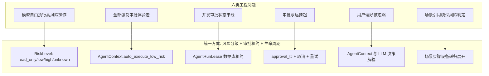
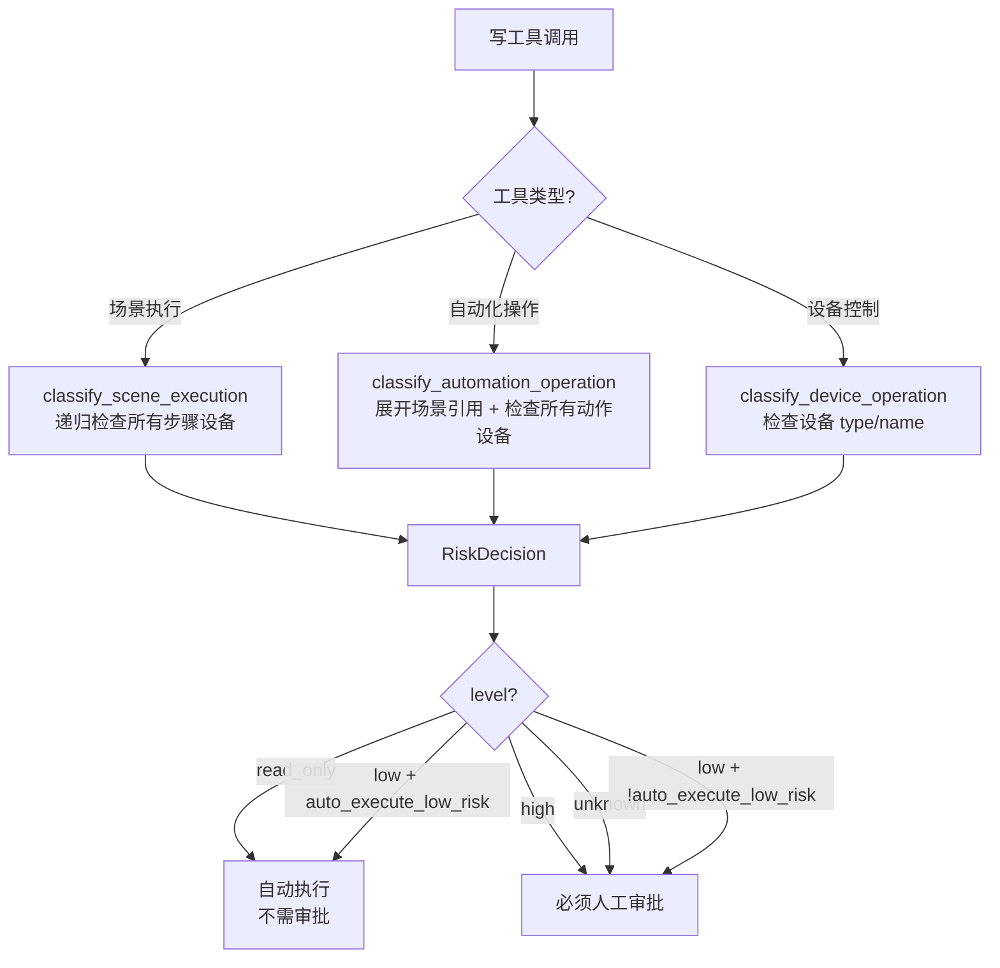
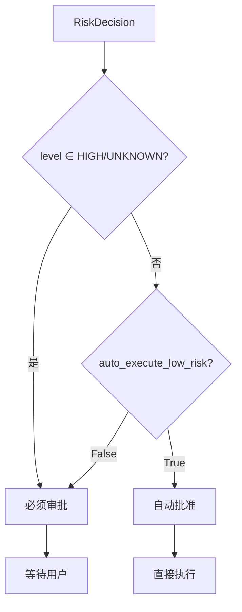
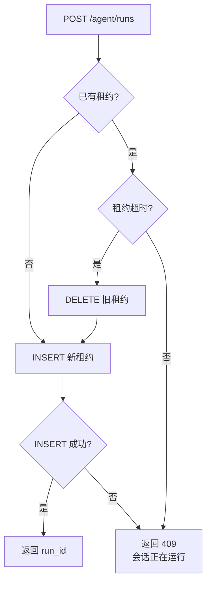
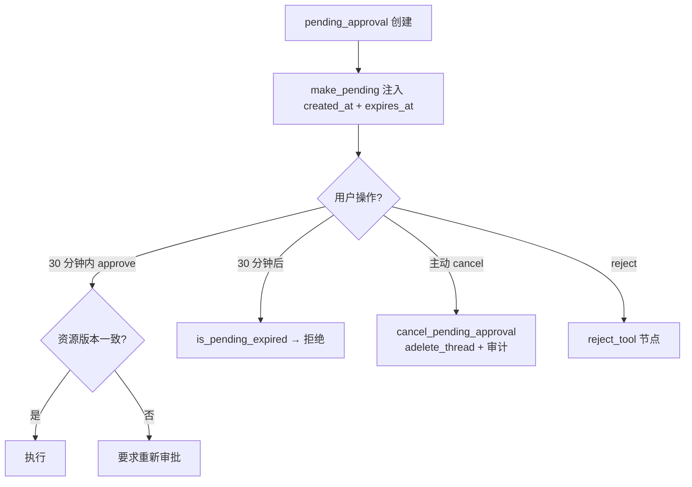
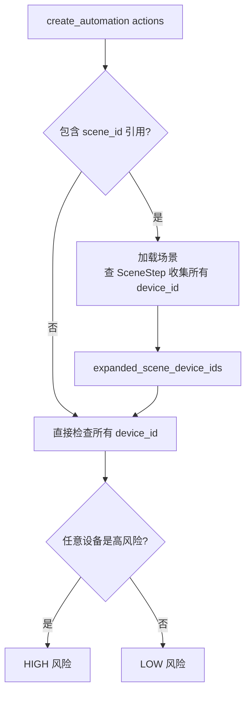
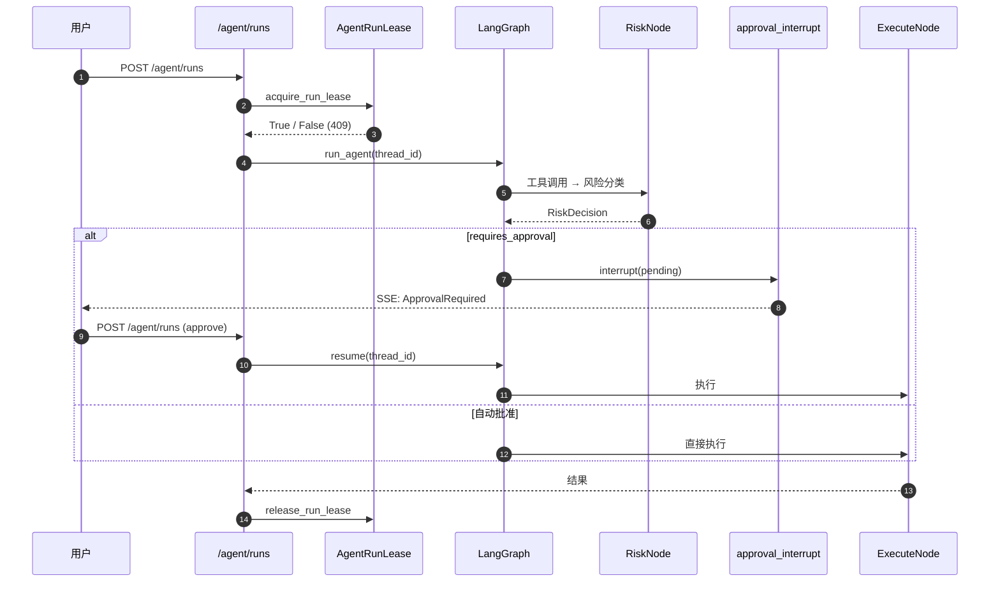

# 风险分级与人工审批：问题、方案与实现

> 本文按"**原有方式的问题 → 新方式如何解决 → 实现细节**"的对照结构，介绍 Orion Smart Home 项目中 AI Agent 写操作的风险分级、人工审批与并发保护机制的设计与实现。

---

## 0. 概述

### 0.1 整体思路

智能家居 Agent 的写操作（执行场景、修改自动化、控制门锁摄像头等）天然存在**安全风险**。传统做法是"由模型自由决定"或"全部强制人工确认"——前者不安全，后者体验差。本项目把风险判定从模型层下沉到**独立的分类器层**，结合**用户偏好**、**审批租约**、**操作生命周期**三类机制，在"安全"与"体验"之间取得平衡。

### 0.2 一图看全



下文每节按"**问题 → 方案 → 实现**"三段式展开。

---

## 1. 问题一：模型自由执行高风险操作

### 1.1 原有方式的问题

让 LLM 自由决定"开锁"、"关安防"、"启动摄像头录像"等高风险操作，存在三类问题：

- **模型幻觉导致误操作**：LLM 可能基于错误的设备识别或意图理解执行"解锁"操作，造成物理安全隐患。
- **责任边界模糊**：发生事故时无法定位"是模型决定、还是用户授权、还是系统 bug"——审计链路缺失。
- **缺乏统一拦截点**：每个写工具各自实现"安全检查"会导致规则不一致、出现漏洞。

更深层的问题：**风险判定应当是一个独立的、可审计的、与 LLM 决策解耦的组件**。把"安不安全"混在"怎么执行"里，会让两层关注点纠缠。

### 1.2 方案：独立的 `RiskLevel` 分类器层

引入**风险分类器层**（`app/agents/risk/`），与 LLM 决策、工具实现完全解耦：

- **4 级风险枚举**：`RiskLevel.READ_ONLY`（只读）、`LOW`（低风险）、`HIGH`（高风险）、`UNKNOWN`（未知）。
- **3 个分类器**：
  - `classify_device_operation`：设备控制（开关、温度、窗帘位置）。
  - `classify_scene_execution`：场景执行（含步骤展开）。
  - `classify_automation_operation`：自动化增删改查（含场景引用递归展开）。
- **统一产物**：`RiskDecision(level, requires_approval, reasons, preview, resource_version)`——风险等级、是否需要审批、原因列表、前置预览、资源版本号。

**关键设计**：`requires_approval` 由分类器**预先**判定，**LLM 不参与**这个判定。模型只负责"决定调什么工具"，"该操作是否需要审批"由系统级组件决定。

### 1.3 实现细节

#### 1.3.1 风险等级判定



#### 1.3.2 高风险设备识别

```python
HIGH_RISK_DEVICE_TYPES = {
    "lock", "door_lock", "camera", "security", "alarm",
}
HIGH_RISK_KEYWORDS = {
    "lock", "camera", "security", "alarm",
    "门锁", "摄像头", "安防", "警报",
}

def _is_high_risk_device(device):
    values = (device.device_id.lower(),
              device.name.lower(),
              device.type.lower())
    return device.type.lower() in HIGH_RISK_DEVICE_TYPES or any(
        keyword in value for keyword in HIGH_RISK_KEYWORDS for value in values
    )
```

判定逻辑采用**类型白名单 + 关键词扫描**双重机制：前者覆盖结构化数据，后者兜底非标准命名。

#### 1.3.3 资源版本号

每个 `RiskDecision` 携带 `resource_version`——在审批恢复时与当前资源版本比对，**若资源已变更则强制要求用户重新确认**。这避免了"审批通过的是场景 A，但实际执行时场景 A 已被修改为场景 B"的安全漏洞。

---

## 2. 问题二：全部强制审批体验差

### 2.1 原有方式的问题

如果为了"绝对安全"对所有写操作都强制人工确认：

- **低风险操作也要审批**："开客厅灯"、"把空调调到 24°C"——用户每说一句话都要点确认，体验灾难。
- **用户被迫频繁操作**：从"自然语言控制"退化为"逐条指令确认"，失去 Agent 的核心价值。
- **审批疲劳导致麻木**：用户最终会"全部确认"而不看内容，反而**降低**安全性。

更深层的问题：**风险是连续的，不是二元的**。"开灯"和"开锁"风险差异巨大，但"全部审批"或"全部不审批"只给了两个端点。

### 2.2 方案：`auto_execute_low_risk` 用户偏好

引入 `AgentContext.auto_execute_low_risk`——**用户级的低风险自动执行偏好**：

- `True`：低风险操作自动执行，高风险 / 未知风险仍需审批。
- `False`：低风险操作也需审批（适合"高安全偏好"用户）。

**关键不变量**：**`HIGH` / `UNKNOWN` 风险始终强制审批，不受偏好影响**。

```python
requires_approval = (
    level in {RiskLevel.HIGH, RiskLevel.UNKNOWN}
    or not context.auto_execute_low_risk
)
```

这一行代码实现了"安全是底线，体验是上层"的分层策略：底线不可逾越，体验可由用户调节。

### 2.3 实现细节

#### 2.3.1 审批决策的三个来源



`A` 走 `approval_interrupt` 节点（LangGraph `interrupt`）；`E` 走直接执行路径，**LLM 继续看到工具成功结果**。

#### 2.3.2 自动批准的 audit 记录

即使自动批准，审计日志也必须完整记录——`audit.record_approval_decision(decision="approve", automatic=True)`。**审计与体验优化正交**：自动批准是体验优化，审计是合规要求。

#### 2.3.3 `confirm_high_risk` 的边界

`AgentContext.confirm_high_risk` 仅用于**前端 UI 展示**（"是否在执行高风险操作时弹额外确认"），**不影响后端审批逻辑**。这是一个有意的设计：**安全策略不允许绕过高风险审批**——任何前端配置都不应削弱后端安全边界。

---

## 3. 问题三：并发审批状态串线

### 3.1 原有方式的问题

同一会话在审批挂起期间，用户又发新消息——传统实现面临：

- **方案 A：拒绝**——"上一次操作还没确认，不能发新消息"。体验差。
- **方案 B：覆盖**——新消息触发新的 Agent run，把 pending approval 覆盖掉。用户回来看发现审批对象已变。
- **方案 C：排队**——新消息进队列，等审批完成后再处理。响应延迟。
- **方案 D：分叉**——新消息开新会话，与原审批脱钩。上下文断裂。

更深层的问题：**"检查会话是否在跑"与"占用会话开始跑"是两个操作，不是原子的**。如果两个请求同时进入，第一个检查到"没在跑"，第二个也检查到"没在跑"，两个都开始写 checkpoint——结果**两个 run 共享同一个 `thread_id`**，checkpoint 状态互相覆盖。

### 3.2 方案：数据库租约 + 单一 thread_id

引入 **`AgentRunLease`**（`app/agents/agent_service/lease.py`）：

- **唯一约束**：`UNIQUE (user_id, household_id, session_id)`——同一会话同时只能有一个活动租约。
- **TTL 机制**：租约创建时间超过 `agent_lease_ttl_seconds`（默认 600 秒）视为失效，进程崩溃后自动可接管。
- **乐观抢占**：若租约已存在但超时，删除旧租约并写入新租约。

**关键设计**：租约的"获取"和"使用"分离——获取租约成功**不等于**能成功执行，但能成功执行的请求**必然**先获取了租约。这让"会话并发保护"从应用层加锁转为数据库层唯一约束。

### 3.3 实现细节

#### 3.3.1 租约获取流程



#### 3.3.2 关键代码

```python
def acquire_run_lease(db, *, user_id, household_id, session_id, run_id, thread_id):
    lease = db.scalar(select(AgentRunLease).where(...))
    if lease is not None:
        # 租约未超时 → 拒绝
        if now - lease.created_at < timedelta(seconds=ttl):
            return False
        # 租约超时 → 清理
        db.execute(delete(AgentRunLease).where(AgentRunLease.id == lease.id))
        db.commit()
    # 写入新租约
    db.add(AgentRunLease(...))
    try:
        db.commit()
        return True
    except IntegrityError:
        # 并发竞争: 另一个请求已写入
        db.rollback()
        return False
```

**`IntegrityError` 兜底**：如果两个请求同时通过"无租约"检查并都尝试 `INSERT`，数据库唯一约束保证只有一个成功——第二个收到 `IntegrityError`，返回 409。

#### 3.3.3 释放语义

`release_run_lease` 是**幂等的**（多次释放不会报错），且**失败仅记录日志**——释放失败不应中断主流程。运行结束、失败、取消、断连四个路径都必须释放。

#### 3.3.4 审批挂起与租约的关系

**审批挂起期间租约仍持有**——这是有意的设计：用户可能 10 分钟才确认，期间任何新请求都应被拒掉。租约 TTL（默认 600 秒）作为"如果用户永远不确认"的兜底，超时后下一次请求可抢占。

---

## 4. 问题四：审批永远挂起

### 4.1 原有方式的问题

传统审批系统常见三个挂起类问题：

- **永不过期**：用户关闭浏览器、忘记确认，pending approval 永远卡在那里，阻塞后续操作。
- **无法取消**：用户意识到操作不对，想撤回，但系统不支持主动取消。
- **资源已变仍可审批**：用户审批的是"修改自动化 A"，但 30 分钟后回来点确认时，自动化 A 已经被别人改了——**审批对象与执行对象不一致**，安全漏洞。

更深层的问题：**审批是一个有时效的、需要主动维护的状态**。它不像普通数据可以"放在那里等查询"——它需要明确的过期、取消、版本比对三件套。

### 4.2 方案：approval_ttl + 取消 + 资源版本

三件套缺一不可：

- **`approval_ttl_seconds`**：默认 1800 秒（30 分钟），由 `make_pending` 在创建时写入 `expires_at`。
- **`cancel_pending_approval`**：用户主动取消，清理 checkpoint 线程 + 写审计。
- **`resource_version`**：审批时记录资源版本号，执行前再次比对。



### 4.3 实现细节

#### 4.3.1 TTL 注入

```python
def make_pending(state: dict) -> dict:
    now = datetime.now(timezone.utc)
    ttl = get_settings().approval_ttl_seconds  # 默认 1800
    state["created_at"] = now.isoformat()
    state["expires_at"] = now.timestamp() + ttl
    return state
```

**约定**：`risk_node` 在构建 pending dict 后调用 `make_pending` 完成设置——这一约定由代码 review 保证（不是自动调用）。

#### 4.3.2 过期判定（向后兼容）

```python
def is_pending_expired(pending):
    if pending is None:
        return True
    expires_at = pending.get("expires_at")
    if expires_at is None:
        return False  # 旧记录，向后兼容
    return datetime.now(timezone.utc).timestamp() > float(expires_at)
```

**关键设计**：旧 checkpoint（无 `expires_at`）仍可审批——避免升级时让所有进行中的 pending 全部失效。

#### 4.3.3 主动取消

```python
async def cancel_pending_approval(saver, thread_id, *, context, pending):
    # 1. 记录取消到审计
    audit.record_approval_decision(
        run_id=pending["run_id"],
        approval_id=pending["approval_id"],
        decision="cancelled",
        automatic=False,
    )
    # 2. 记录 run 结束
    audit.record_run_end(run_id, status="cancelled",
                         message=f"用户于 {now.isoformat()} 主动取消了待审批操作")
    # 3. 删除 checkpoint 线程
    try:
        await saver.adelete_thread(thread_id)
    except Exception:
        logger.warning("清理 checkpoint 线程失败", exc_info=True)
```

**`adelete_thread` 不会丢失数据**：Agent 消息历史由会话树管理（带压缩），下次 `run_agent` 会从会话树重建并自动 `adelete_thread`——删除线程只是清理 LangGraph 的运行状态。

#### 4.3.4 资源版本比对

`RiskDecision.resource_version` 在审批时记录资源的 `version`（自动化）或 `updated_at`（场景）。执行前**应当**再次比对，若不一致则要求重新审批。这一比对在执行节点的入口处完成，**不在 `risk_node` 内部**——保持分类器的纯粹性。

---

## 5. 问题五：用户偏好被忽略 / 配置冗余

### 5.1 原有方式的问题

用户偏好（语言、详细程度、安全等级）在传统实现中常被混在多处：

- **配置散落**：`session.model`、运行时 env、数据库字段、用户设置表——同一个"是否自动执行低风险"在多处定义。
- **运行时不可变**：偏好一旦在某次 run 开始时确定，中途无法动态调整。
- **缺乏上下文注入**：模型推理时看不到完整偏好，只能依赖系统提示词中的静态描述。

更深层的问题：**用户偏好应当是一个清晰的、不可变的、与 LLM 决策解耦的上下文对象**。把它混在配置、env、消息历史里，会让"修改偏好"变成改动全系统的工程。

### 5.2 方案：`AgentContext` 数据类

`AgentContext`（`app/agents/context.py`）是一个**不可变的数据类**，封装了单次 Agent run 所需的所有上下文：

- `user_id`、`household_id`、`session_id`：身份与作用域。
- `auto_execute_low_risk`：低风险自动执行偏好。
- `confirm_high_risk`：前端 UI 用，**不影响后端审批**。
- 其他偏好（语言、详细程度等）。

`AgentContext` 由请求入口（API 路由）构建，在 run 期间**只读不写**——这保证"同一次 run 的偏好一致"，避免"中途修改偏好导致决策混乱"。

### 5.3 实现细节

#### 5.3.1 上下文对象的不可变性

```python
@dataclass(frozen=True)
class AgentContext:
    user_id: int
    household_id: int
    session_id: int
    auto_execute_low_risk: bool
    confirm_high_risk: bool
    # ...
```

`@dataclass(frozen=True)`——任何修改都抛 `FrozenInstanceError`，强迫调用方创建新实例而非修改原对象。

#### 5.3.2 上下文注入

`AgentContext` 通过 LangGraph 的 state 注入到所有节点：

```python
# risk_node 接收 state 后立即提取 context
context = state["context"]
decision = classify_device_operation(
    db=db, context=context,
    operation=tool_name, device_id=device_id, args=args
)
```

**所有分类器都通过 `context` 参数访问偏好**——不直接读 env 或全局配置。这让分类器**完全可测试**：传入 mock context 即可控制偏好。

#### 5.3.3 偏好与决策的解耦

| 偏好字段 | 决策位置 | 可绕过？ |
|---------|---------|---------|
| `auto_execute_low_risk` | `risk_node`（低风险是否自动执行） | 否（高风险不受其影响） |
| `confirm_high_risk` | 前端 UI 展示 | **是**（不影响后端审批） |
| `reply_language` | 提示词构造 | 否（用户期望） |
| `detail_level` | 提示词构造 | 否（用户期望） |

`confirm_high_risk` **可被绕过**是有意的——它的语义是"前端要不要弹额外确认卡片"，不是"后端要不要审批"。后端审批由 `RiskLevel` 决定，与前端 UI 解耦。

---

## 6. 问题六：场景引用绕过风险判定

### 6.1 原有方式的问题

如果 Agent 创建一条自动化规则"触发：晚上 10 点 → 动作：执行『回家模式』场景"——朴素实现只检查这条规则**直接**控制的设备，**不展开场景步骤**。

**这造成严重漏洞**：

- 用户对模型说"创建一个晚上 10 点执行『回家模式』的自动化"——模型创建的规则**直接控制**的场景在表面上"无高风险设备"。
- 但"回家模式"场景**本身**包含"解锁前门"、"关闭安防"、"打开摄像头录像"等高风险步骤。
- 自动化规则创建时被判定为 `LOW` 风险（因为看起来只引用了一个普通场景），自动执行。
- 晚上 10 点触发时，**间接执行了所有高风险操作**——完全绕过了审批。

更深层的问题：**风险传播是递归的**。一个操作可能引用另一个抽象（场景 → 场景、设备组 → 设备），只看直接引用是不足的。

### 6.2 方案：场景引用递归展开

`classify_automation_operation` 在判定风险时，**递归展开 actions 中的 `scene_id` 引用**，把所有场景步骤中的设备纳入风险判定：



**关键设计**：场景步骤设备的展开**只在风险判定时进行**——创建/执行自动化规则时，规则本身仍按原样存储，**风险判定与执行分离**。

### 6.3 实现细节

#### 6.3.1 场景引用展开

```python
scene_refs = [a for a in (actions or []) if a.get("scene_id")]
if scene_refs:
    scene_rows = db.scalars(
        select(Scene).where(
            Scene.household_id == context.household_id,
            Scene.id.in_({str(a["scene_id"]) for a in scene_refs}),
        )
    ).all()
    # 关键: 数量必须一致 — 防止引用不存在的场景
    if len(scene_rows) != len({str(a["scene_id"]) for a in scene_refs}):
        level = RiskLevel.UNKNOWN
        reasons.append("动作包含不存在或不属于当前家庭的设备或场景")
    else:
        steps = db.scalars(
            select(SceneStep).where(
                SceneStep.scene_id.in_([s.id for s in scene_rows])
            )
        ).all()
        expanded_scene_device_ids = {
            int(step.device_id)
            for step in steps
            if step.device_id is not None
            and str(step.device_id).lstrip("-").isdigit()
        }
        requested_device_ids.update(expanded_scene_device_ids)
```

**两处安全防御**：

1. **场景数量比对**：`len(scene_rows) != len(unique_scene_refs)` 时直接判定为 `UNKNOWN`——防止"引用了不存在的场景"绕过风控。
2. **家庭隔离**：`Scene.household_id == context.household_id`——防止跨家庭引用其他家庭的高风险场景。

#### 6.3.2 缺失设备的兜底

```python
if missing_device_ids:
    level = RiskLevel.UNKNOWN
    reasons.append("动作包含不存在或不属于当前家庭的设备或场景")
```

**任何设备查不到都判定为 UNKNOWN**——按"宁严勿松"原则，不允许"未知设备 + 普通设备"被判定为 LOW。

#### 6.3.3 冲突检测的额外保障

```python
if operation in ("create_automation", "update_automation") and args:
    try:
        conflicts = detect_automation_conflicts(
            db=db, context=context,
            automation_id=automation_id,
            proposed_triggers=args.get("triggers"),
            proposed_actions=args.get("actions"),
        )
        if conflicts:
            preview["conflicts"] = conflicts
    except Exception:
        logging.getLogger(__name__).warning("冲突检测失败", exc_info=True)
```

冲突检测**不影响风险等级**——只把检测结果放进 `preview.conflicts`，让用户在审批卡片中看到"这条规则与已有规则可能冲突"。

**冲突检测失败不影响主流程**——`except Exception` 兜底，失败仅写日志，不阻断审批。

---

## 7. 实现细节汇总

### 7.1 风险等级枚举

```python
class RiskLevel(StrEnum):
    READ_ONLY = "read_only"
    LOW = "low"
    HIGH = "high"
    UNKNOWN = "unknown"
```

`StrEnum` 让 `RiskLevel.HIGH == "high"` 为真，便于 JSON 序列化与 Pydantic 校验。

### 7.2 `RiskDecision` 数据结构

```python
class RiskDecision(BaseModel):
    level: RiskLevel
    requires_approval: bool
    reasons: list[str]            # 人类可读的风险原因
    preview: dict[str, Any]       # 前置预览（设备名、步骤、冲突等）
    resource_version: str         # 资源版本（审批时记录, 执行时比对）
```

### 7.3 高风险设备识别

| 维度 | 识别方式 |
|------|---------|
| 设备 `type` | 白名单（`lock`/`door_lock`/`camera`/`security`/`alarm`） |
| 设备 `name` / `device_id` | 关键词扫描（中英文双语） |

### 7.4 写工具分类

| 工具名 | 分类器 | 备注 |
|--------|--------|------|
| `execute_scene` | `classify_scene_execution` | 检查所有场景步骤设备 |
| `create_automation` | `classify_automation_operation` | 展开场景引用 + 冲突检测 |
| `update_automation` | 同上 | 同上 |
| `set_automation_enabled` | 同上 | 仅切换启用状态，**始终 LOW** |
| `delete_automation` | 同上 | **始终 HIGH** |
| `set_device_power` | `classify_device_operation` | — |
| `set_device_temperature` | 同上 | — |
| `set_curtain_position` | 同上 | — |

### 7.5 审批租约（`AgentRunLease`）

```sql
CREATE TABLE agent_run_leases (
    id INTEGER PRIMARY KEY AUTOINCREMENT,
    user_id INTEGER NOT NULL,
    household_id INTEGER NOT NULL,
    session_id INTEGER NOT NULL,
    run_id VARCHAR(64) NOT NULL,
    thread_id VARCHAR(128) NOT NULL,
    created_at DATETIME NOT NULL,
    UNIQUE (user_id, household_id, session_id)
);
```

唯一约束保证同会话同时只有一个活动租约。

### 7.6 端到端流程



### 7.7 错误码与边界条件

| 场景 | 行为 |
|------|------|
| 工具参数校验失败 | 写 `ToolMessage(error)` 返回，不创建 pending |
| 工具名称不在白名单 | `_classify_operation` 抛 `ValueError` |
| `device_id` / `scene_id` 不存在 | 分类器返回 `UNKNOWN` |
| 同 lane 已有开放 operation | `append_record` 抛 `SessionError("storage")` |
| 租约冲突 | `acquire_run_lease` 返回 `False`，API 返 409 |
| 审批过期 | `is_pending_expired` 返回 `True`，resume 时拒绝 |
| 用户取消 | `cancel_pending_approval` 清理 checkpoint + 写审计 |

---

## 8. 六类问题—方案对照速查

| # | 失效模式 | 原方案代价 | 本方案解法 | 关键机制 |
|---|---------|----------|----------|---------|
| 1 | 模型自由执行高风险操作 | 误操作 + 责任模糊 | 独立的 `RiskLevel` 分类器层 | 4 级枚举 + 3 个分类器 + `RiskDecision` 统一产物 |
| 2 | 全部强制审批体验差 | 审批疲劳导致麻木 | `auto_execute_low_risk` 用户偏好 | HIGH/UNKNOWN 始终审批；LOW 由用户偏好决定 |
| 3 | 并发审批状态串线 | 共享 thread_id 导致 checkpoint 覆盖 | 数据库租约 + 唯一约束 | `UNIQUE (user_id, household_id, session_id)` + TTL |
| 4 | 审批永远挂起 | 资源已变仍可审批 | approval_ttl + 取消 + 资源版本 | 三件套缺一不可 |
| 5 | 用户偏好被忽略 | 配置散落 / 运行时不可变 | `AgentContext` 不可变数据类 | frozen dataclass + 所有分类器通过参数访问 |
| 6 | 场景引用绕过风险判定 | 间接执行高风险操作 | 场景引用递归展开 | 加载 `SceneStep` 收集所有 device_id |

---

## 9. 关键不变量（10 条硬约束）

修改或扩展本模块时，**任意一条被破坏都意味着安全或体验的基础被破坏**：

1. **`HIGH` / `UNKNOWN` 风险始终审批**，不受 `auto_execute_low_risk` / `confirm_high_risk` 影响。
2. **资源版本号必须在审批时记录**，执行前必须比对。
3. **租约唯一约束**：同 `(user_id, household_id, session_id)` 同时只能有一个活动租约。
4. **TTL 失效后允许接管**：租约超时不删除会卡死新运行。
5. **`AgentContext` 不可变**：偏好一旦确定，整个 run 内不可修改。
6. **场景引用必须展开**：含 `scene_id` 的 actions 必须递归收集所有步骤设备。
7. **缺失设备判定为 UNKNOWN**：宁严勿松。
8. **冲突检测失败不影响主流程**：仅记日志。
9. **`adelete_thread` 不丢失数据**：消息历史在会话树而非 checkpoint。
10. **审计与体验优化正交**：自动批准也要写审计。

---

## 10. 边界与已知限制

- **`auto_execute_low_risk` 在 run 期间不可变**：若用户在审批期间修改偏好，已挂起的 pending 仍按创建时的偏好执行。
- **资源版本仅在分类器层面记录**：实际比对依赖执行节点的实现，必须确保比对逻辑到位。
- **冲突检测仅展示不阻断**：用户即使看到冲突也可点"通过"。
- **租约 TTL 是兜底**：默认 600 秒，进程崩溃后这段时间内新请求会被拒。
- **场景引用展开不缓存**：每次风险分类都重新查数据库——对性能敏感场景可考虑加入缓存。
- **高风险关键词扫描是兜底**：对"门锁"等中文名有效，对生僻表达可能漏判，需结合设备 `type` 字段交叉验证。

---

## 11. 参考

- 模块代码：`app/agents/risk/`、`app/agents/agent_service/`、`app/agents/graph/`
- README 中对应章节：[`README.md`](../README.md) "核心亮点 3：LangGraph Agent 编排 — 安全可控的自动化"
- 会话树相关：[`docs/session-tree-storage.md`](session-tree-storage.md)
- 上下文压缩相关：[`docs/session-tree-compaction-review.md`](session-tree-compaction-review.md)
- 移植来源：Pi 的会话存储模型 + LangGraph `interrupt` 模式
