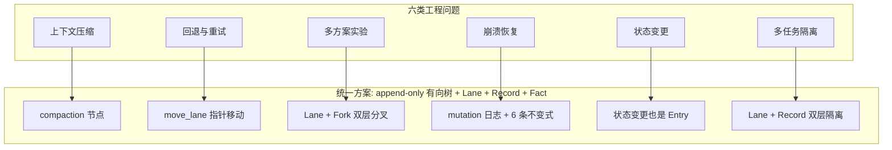
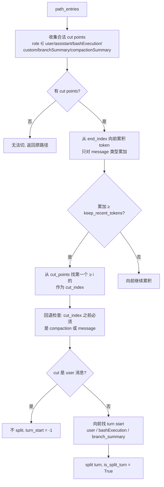
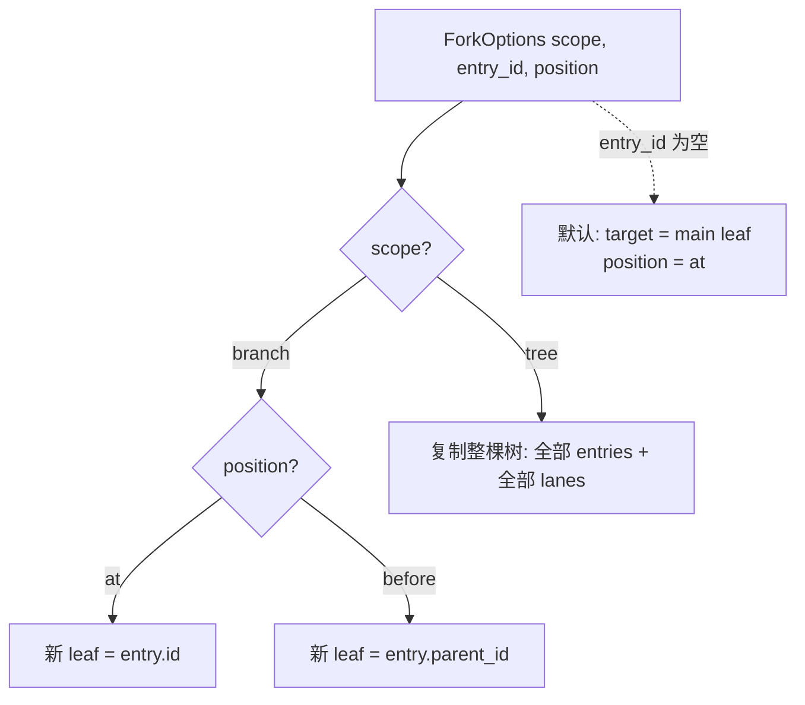
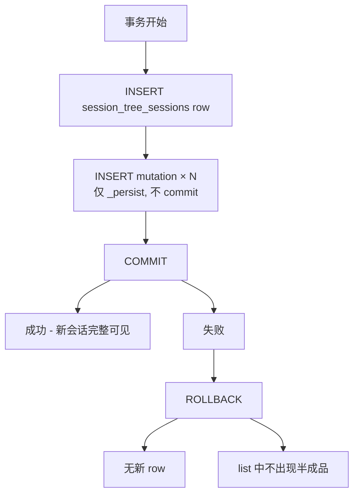
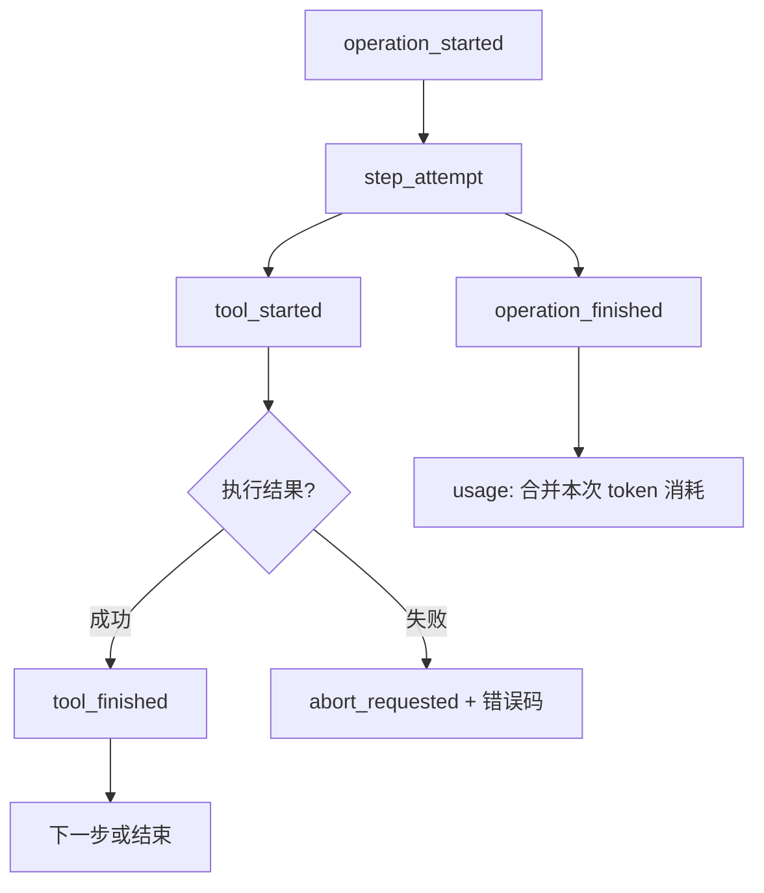
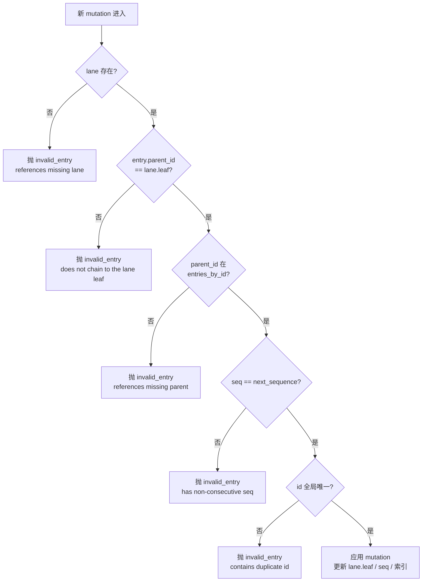
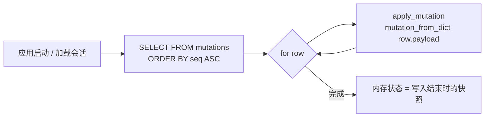
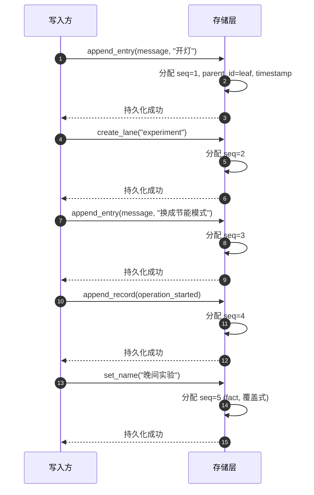
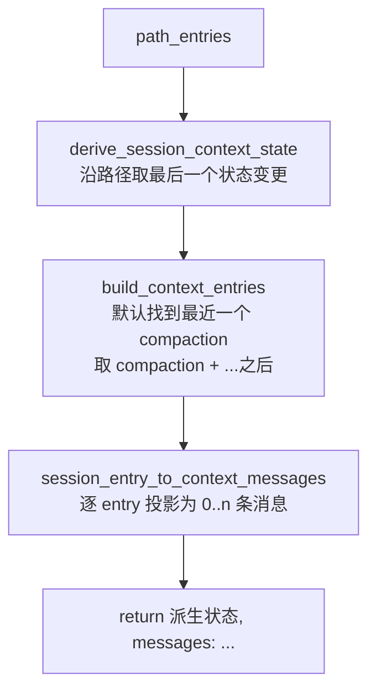

# 会话树形存储：问题、方案与实现

> 本文按"**原有方式的问题 → 新方式如何解决 → 实现细节**"的对照结构，介绍 Orion Smart Home 项目中会话存储引擎的设计与实现。聚焦技术细节，面向需要修改或扩展该模块的工程师。

---

## 0. 概述

### 0.1 整体思路

会话存储的根本变化是**抽象层级的提升**：把"对话"从一维线性日志重构为一棵 append-only 有向树。这一变化不是局部优化，而是把六类长期存在的工程难题——上下文压缩、回退与重试、多方案实验、崩溃恢复、状态变更、多任务隔离——统一映射为同一种原子操作：**"追加新节点 + 移动指针"**。

### 0.2 一图看全



下文每节按"**问题 → 方案 → 实现**"三段式展开。

---

## 1. 问题一：上下文压缩与原历史脱节

### 1.1 原有方式的问题

线性消息列表在压缩时面临两难：

- **截断旧消息** → 历史永久丢失，无法回滚，无法审计。
- **另存摘要** → 摘要与原消息流在两个数据结构中维护，**多轮压缩的链式管理崩溃**：
  - 无法定位"哪些原消息已被压缩、哪些未压缩"；
  - 无法在摘要与原消息之间做 diff；
  - 若摘要错了想重做，无法回退到压缩前的原始状态。

更深层的问题：**压缩破坏了"消息是同一类数据"这一假设**。消息与摘要属于不同语义层级，但线性结构迫使二者共享同一个 list，**没有结构化的载体表达"这段是摘要，那段是原文"**。

### 1.2 方案：压缩是树上的一个 `compaction` 节点

将压缩重构为"在树上追加一个 `compaction` 节点"，使压缩后的原文与摘要**共存于同一持久化结构**：

- `compaction` 节点携带 `summary`（摘要）、`retained_tail`（保留尾）、`tokens_before`、`details`（如文件操作清单）、`usage`（本次压缩自身消耗）。
- 原文**不被删除**——它仍在树中，作为 `compaction` 节点的祖先。审计、调试、回滚都能找到原文。
- 投影层（`build_session_context`）默认找到最近一个 `compaction` 节点后，**只把 `[compaction, ...之后]` 送入 LLM 上下文**——压缩替换在投影阶段完成，不修改树本身。

**跨压缩信息保留**：`prepare_compaction` 在做本次切割点计算时，**把上一次 `compaction` 的 `retained_tail` 映射为虚拟条目纳入计算**——`retained_tail` 在下一次压缩中"仍然在场"。文件操作清单（`readFiles` / `modifiedFiles`）也通过 `details` 字段跨压缩累积。

### 1.3 实现细节

#### 1.3.1 `compaction` 节点结构

```sql
-- Entry 的特殊类型: compaction
-- 字段: summary, retained_tail, tokens_before, details, usage
-- 投影为: compactionSummary 角色消息 + retained_tail
```

#### 1.3.2 切割点算法（绝不切在工具结果上）



**工具结果（`toolResult`）不在切割点白名单**——任何 tool 消息之间的切割都会被跳过。这是"绝不切碎工具调用"的硬约束。

#### 1.3.3 三段产物

| 产物 | 含义 | 触发条件 |
|------|------|---------|
| `messages_to_summarize` | 待摘要历史（不含 split turn 的 turn prefix） | 总是产生 |
| `turn_prefix_messages` | split turn 触发轮的 user 消息，留在压缩之外 | 仅 `is_split_turn == True` |
| `retained_tail` | cut 之后到 end，进入压缩节点 | 总是产生 |

#### 1.3.4 跨压缩的文件操作累积

```python
# _extract_file_operations 的两步累积
file_ops = empty()
if prev_compaction.details 存在:
    file_ops.read ⊇ prev.details.readFiles
    file_ops.edited ⊇ prev.details.modifiedFiles
for message in messages_to_summarize:
    extract_file_ops_from_message(message, file_ops)
if cut_point.is_split_turn:
    for message in turn_prefix_messages:
        extract_file_ops_from_message(message, file_ops)
```

---

## 2. 问题二：回退与重试破坏历史

### 2.1 原有方式的问题

模型选错方案时，"回到第 5 轮"在传统实现中意味着 `messages = messages[:5]`——**破坏性删除**。带来三重问题：

- **历史不可信**：用户问"昨天你说的那个方案呢？"——系统答"已被删除"。
- **审计与调试不可能**：工程师无法复现"模型选错的中间过程"。
- **并发冲突**：用户在另一窗口看这条历史时，删除会让"看到的消息数"产生不一致。

更深层的问题：**回退不是消息的反操作，而是"撤销一系列后续变更"**。线性结构无法表达"哪些消息属于同一回退单元"，回退粒度只能精确到单条消息或粗暴到全清。

### 2.2 方案：回退 = 移动车道指针

引入**车道（Lane）**机制：每个车道维护一个 `leaf_id` 指针，指向该车道当前所处的树节点。

- `create_lane(name, at)` 从 `at` 节点开新分支。
- `move_lane(name, to)` 把指针移到 `to`——**"导航"在底层就是一次指针移动**。

回退的实现：**"回到第 5 轮"等价于 `move_lane("main", entry_5.id)`**——不删除任何数据，只改变 main 车道指向的 leaf。

**多任务隔离自然涌现**：审批中断时用户又发新消息：

- `main` 车道保持原 leaf 不动（挂起的任务仍在原位）；
- 新建 `interrupt` 车道，从 main 当前 leaf 之前的位置开新分支；
- 新消息写入 `interrupt`，新任务的 leaf 推进；
- 审批恢复时，**只需把 `main` 车道指针移回原 leaf**——不删除 `interrupt` 的任何内容。

### 2.3 实现细节

#### 2.3.1 内存中的 lane 状态

```python
# SessionState 内 lane 指针
self._lanes: dict[str, str | None] = {"main": None}
#                                  ↑  lane 名   ↑ 当前 leaf id

# 写入时强制:
parent_id = self._lanes[lane]  # 必须存在
entry.parent_id = parent_id    # 存储层分配
```

#### 2.3.2 `move_lane` 的不变量校验

```python
def move_lane(self, lane, to):
    self._state.require_lane(lane)     # lane 必须存在
    self._state.validate_target(to)    # to 必须存在（或 None）
    self._append_mutation({
        "kind": "lane",
        "seq": self._state.next_sequence,
        "lane": lane,
        "leaf_id": to
    })
```

**关键**：`to` 可以是 `None`（空车道指针），但非 `None` 必须存在于 `entries_by_id`——防止把指针指到不存在的节点。

#### 2.3.3 同车道并发强制

```python
# append_record 在 operation_started 时强制去重
if record.type == "operation_started":
    open_ops = self._state.find_open_operations(record.lane, 1)
    if open_ops:
        raise SessionError("storage",
            f"Lane {record.lane} already has an open operation {open_ops[0].id}")
```

并发请求被存储层拒掉，免去外部加锁。

---

## 3. 问题三：多方案实验的分叉代价

### 3.1 原有方式的问题

"同一对话尝试两种方案"在线性日志下意味着：

- **方案 A**：保留主消息列表，方案 A 的回复写进去；
- **方案 B**：复制整段历史开新会话，方案 B 的回复写进去。

**复制整段历史**带来三方面代价：

- **存储成本翻倍**：N 个实验需要 N 份上游历史。
- **同步问题**：上游某条消息被修改（哪怕是 typo 修正）时，所有下游分叉都需要重放。
- **引用断裂**：分叉后的消息无法引用上游具体某条消息。

更深层的问题：**"分叉"应当是会话的一等公民**。在调试 agent、对比 prompt、对比模型时，分叉是日常操作——任何让分叉变贵的方案都会让这些工作流难以前进。

### 3.2 方案：会话内 Lane + 跨会话 Fork

**两层分叉机制**：

- **会话内 Lane 分叉**：`create_lane("experiment", at=entry_5.id)` 在原会话开新分支，**不复制任何数据**——`experiment` 车道从 entry_5 开始推进自己的 leaf，与 `main` 共享 entry_5 之前的所有节点。
- **跨会话 Fork**：`repo.fork(source, ForkOptions(scope="branch", entry_id=at))` 在新会话中只复制从 target 开始的分支路径，**labels 随内容复制、records 不复制**。

**零冗余合并**：方案 A 与方案 B 的共同祖先是 entry_5，**两份历史只差 entry_5 之后的节点**——把 B 的新节点引用进来即可。

### 3.3 实现细节

#### 3.3.1 Fork 的语义决策



#### 3.3.2 Fork 不复制什么

| 复制 | 不复制 |
|------|--------|
| 选中的 entries（重新编 seq） | 任何 `Record`（操作日志） |
| labels（按 entry id 复制） | `_open_operations_by_lane` |
| `name` fact（仅当源 `_name` 非空） | `_log` |
| | `_stats` |

**关键设计**：`labels` 是"内容事实"应随内容走；`records` 是"过程"不应污染新会话。

#### 3.3.3 Fork 在 SQLite 中的原子发布



中途崩溃只留"空的新会话 row + 一组未提交的 mutations"——通过 `list()` 可见但 `open()` 时重放得到空状态，**不会出现半成品分叉**。

---

## 4. 问题四：崩溃恢复无检查点

### 4.1 原有方式的问题

Agent 跑到一半崩溃（OOM、用户关闭浏览器、服务器重启）后，线性结构无法回答：

- 上次执行到哪一步？
- 调用了哪些工具、结果是什么？
- 消耗了多少 token？
- 当前消息列表是否完整？

传统方案是"定期落库整个消息列表"——但有两个问题：

- **落库间隔内的丢失**：间隔若为 5 分钟，则崩溃可能丢失 5 分钟工作。
- **并发写竞争**：落库时另一线程修改了列表，会得到不一致快照。

更深层的问题：**检查点不是"消息列表的副本"**——它是"操作的过程记录"。线性结构只能表达"消息有哪些"，无法表达"哪些工具被调用、结果如何、是否重试、错误码是什么"。

### 4.2 方案：append-only mutation 日志 + Record 链

**持久化层**：所有写操作通过统一的 `_append_mutation`：

1. `_persist(mutation)`：INSERT row + flush。
2. `db.commit()`：真正落盘。
3. `apply_mutation(mutation)`：更新内存 `SessionState`。

关键不变量是**"内存状态永远不超前于磁盘"**——崩溃后重放可得到与崩溃前完全一致的状态。

**操作日志**：每一次 `Record` 都是一颗时间胶囊，9 种类型覆盖完整生命周期：



**`find_open_operations` 启动决策**：

| 开放操作数 | 状态 | 启动策略 |
|----------|------|---------|
| 0 | 空闲 | 正常启动新操作 |
| 1 | 挂起 | 恢复上次操作（resume） |
| ≥ 2 | 数据损坏 | 抛错，提示人工介入 |

### 4.3 实现细节

#### 4.3.1 写入路径：先持久化后应用内存

```python
def _append_mutation(self, mutation):
    self._persist(mutation)        # INSERT + flush
    self._db.commit()              # 真正落盘
    self._state.apply_mutation(mutation)  # 更新内存
```

#### 4.3.2 6 条不变式：树的合法性保证



**完全局部化**：每条规则仅依赖当前 mutation 与当前内存状态，校验 O(1)，适合流式应用。

#### 4.3.3 加载路径：崩溃后的重放



`mutation_from_dict` 在反序列化时执行 codec 校验：未知 entry/record 类型、record 缺 `lane`、字段类型错误等都会抛错——**坏数据在加载阶段就被显式拒绝**。

#### 4.3.4 `_open_operations_by_lane` 维护规则

```python
# state.py apply_mutation
if record.type == "operation_started":
    self._open_operations_by_lane[record.lane][record.id] = record
elif record.type == "operation_finished" and record.run_id is not None:
    self._open_operations_by_lane.get(record.lane, {}).pop(record.run_id, None)
# 注意: abort_requested 不移除 -- 必须等 operation_finished 兜底
```

**`abort_requested` 不移除**——必须等 `operation_finished` 兜底，否则留下"挂死"的开放操作。

#### 4.3.5 `usage` 累加到 `SessionStats`

```python
if record.type == "usage" and isinstance(record.usage, dict):
    self._stats.cached_tokens   += int(record.usage.get("cacheRead", 0) or 0)
    self._stats.uncached_tokens += int(record.usage.get("input", 0) or 0) \
                                  + int(record.usage.get("cacheWrite", 0) or 0)
    self._stats.total_tokens    += int(record.usage.get("totalTokens", 0) or 0)
    cost = record.usage.get("cost") or {}
    self._stats.cost_total      += float(cost.get("total", 0) or 0)
```

**如果 `usage` 不是 dict，该条记录不参与累加**——统计层失败不影响持久化数据。

#### 4.3.6 环检测

```python
def _walk_to_root(self, start, stop_at_id=None, stop_at_type=None):
    visited = set()
    current = self._entries_by_id.get(start)
    while current is not None:
        if current.id in visited:
            raise SessionError("invalid_entry",
                f"Session branch contains a cycle at {current.id}")
        visited.add(current.id)
        yield current
        if (current.id == stop_at_id
            or current.type == stop_at_type
            or current.parent_id is None):
            break
        current = self._entries_by_id.get(current.parent_id)
```

手改过的会话文件若出现循环父链，会被 `SessionError` 明确拒绝，而非陷入死循环。

---

## 5. 问题五：状态变更无载体

### 5.1 原有方式的问题

切换 provider / 调整 thinking level / 激活不同工具集——这些"状态变更"在线性结构中如何表达？

传统做法是"另存一份配置"——`session.model = "gpt-4"`、`session.thinking_level = "high"`。这带来：

- **历史不可追溯**：用户问"为什么中间用过 deepseek？"——因为 `session.model` 当前是 `gpt-4`，没有记录显示中间切到过 deepseek。
- **回放不可能**：调试 agent 时无法"重放到切模型前的状态"。
- **状态与消息脱钩**：消息流描述了对话内容，配置描述了系统状态——**二者关系靠时间戳维系**。

更深层的问题：**状态变更本身是会话内容的一部分**。在长生命周期 agent 中，状态变更往往与决策强相关，**没有载体的状态变更无法参与决策的因果链**。

### 5.2 方案：状态变更也是 Entry 节点

**把状态变更提升为树的节点**：

| Entry 类型 | 字段 | 派生效果 |
|-----------|------|---------|
| `model_change` | `provider`, `model_id` | 切换 LLM 供应商/模型 |
| `thinking_level_change` | `thinking_level` | 调整思考等级 |
| `active_tools_change` | `active_tool_names` | 激活/停用工具集 |

这些节点与 `message` 节点**共享同一种抽象**，享有同一种不变式保证。`build_session_context` 沿路径取**最后一个**状态变更节点作为派生状态，**不进入消息流但影响 LLM 行为**。

**因果链自然涌现**：切模型之前发生了什么、为什么切、切之后发生了什么——`model_change` 节点的 `parent_id` 链完整保留因果关系。

**回放能力**：调试 agent 时可"重放到切模型前的状态"——`move_lane` 到 `model_change` 之前的节点即可，**所有状态变更在 LLM 看来"不存在"**。

### 5.3 实现细节

#### 5.3.1 派生状态的覆盖规则

```python
def derive_session_context_state(path_entries):
    thinking_level = "off"
    model = None
    active_tool_names = None
    for entry in path_entries:
        if entry.type == "thinking_level_change":
            thinking_level = entry.thinking_level or "off"
        elif entry.type == "model_change":
            model = {"provider": entry.provider, "modelId": entry.model_id}
        elif (entry.type == "message"
              and entry.message
              and entry.message.get("role") == "assistant"):
            model = {"provider": entry.message.get("provider"),
                     "modelId": entry.message.get("model")}
        elif entry.type == "active_tools_change":
            active_tool_names = list(entry.active_tool_names or [])
    return {"thinkingLevel": thinking_level,
            "model": model,
            "activeToolNames": active_tool_names}
```

**两者并存时 `model_change` 总是后写后覆盖赢**——assistant 消息只在无 `model_change` 时作为 model 来源。

#### 5.3.2 统一抽象的力量

- 不变式只需为 `Entry` 设计一套（6 条），状态变更无需额外约束。
- 状态变更自然获得"崩溃一致 + 可重放 + 可分支"的全部能力。
- 派生状态的计算（取最后一个相关节点）极简——O(path length)。

---

## 6. 问题六：多任务隔离混乱

### 6.1 原有方式的问题

Agent 审批中断（高风险操作需用户确认）时，用户又发新消息——线性结构如何处理？

- **方案 A：阻塞**——等待审批，不响应新消息。用户等待，体验差。
- **方案 B：新开会话**——新消息归属新会话，与审批完全脱钩。
- **方案 C：插队**——新消息插到审批消息之后。审批结果回来时插到哪？中断语义模糊。

更深层的问题：**"会话"应当是用户与系统交互的完整轨迹**，而非"消息的容器"。审批、子任务、并发请求都是这一轨迹的不同侧面，**没有抽象能区分它们**。

### 6.2 方案：Lane + Record 双层隔离

**Lane 层**（粗粒度）：每个独立任务占用一条 lane。

- 主对话走 `main` 车道。
- 审批中的写操作可在独立 lane 上挂起，记录状态变更。
- 用户的并发新消息可开 `interrupt` 车道，与 `main` 互不干扰。
- 任务结束后，**`move_lane` 把 `main` 重新对齐到完整历史**——主对话流重新连贯。

**Record 层**（细粒度）：每一次操作的完整生命周期被记录。

- `operation_started` 标识操作开始。
- `step_attempt` 标识重试。
- `tool_started` 标识工具调用起点。
- `operation_finished`（带 `run_id`）清理开放操作状态。

**同车道并发强制不允许**：`append_record` 在写入 `operation_started` 前先检查同 lane 已有开放操作——**并发请求被存储层拒掉**。

### 6.3 实现细节

#### 6.3.1 Lane 与 Record 的职责分离

| 层 | 解决 | 数据结构 |
|---|------|---------|
| Lane | "哪些消息属于同一任务" | `dict[lane, leaf_id]` |
| Record | "任务执行到哪一步" | `_open_operations_by_lane` |

**二者结合**：多任务场景下的恢复、并发、审计都能从结构化数据中直接得到——无需在应用层维护额外的状态机。

#### 6.3.2 恢复语义的入口

```python
def find_open_operations(self, lane, limit=None):
    ops = list(self._open_operations_by_lane.get(lane, {}).values())
    ops.reverse()  # 最新追加在前
    return ops if limit is None else ops[:limit]
```

反序返回——方便上层按"最近的开放操作"做决策。

---

## 7. 实现细节汇总

### 7.1 数据模型速查

#### Entry（7 种类型，树上节点）

| 类型 | 必含字段 | 专属字段 |
|------|---------|---------|
| `message` | `type`, `id` | `message: dict`, `terminate: bool` |
| `model_change` | `type`, `id` | `provider: str`, `model_id: str` |
| `thinking_level_change` | `type`, `id` | `thinking_level: str` |
| `active_tools_change` | `type`, `id` | `active_tool_names: list[str]` |
| `compaction` | `type`, `id` | `summary`, `retained_tail`, `tokens_before`, `details`, `usage` |
| `branch_summary` | `type`, `id` | `from_id: str`, `summary`, `details`, `usage` |
| `custom` | `type`, `id` | `custom_type: str`, `data` |

通用字段（存储层在追加时**强制覆盖**）：`seq`、`parent_id`、`timestamp`。

#### Record（9 种类型，挂在 lane 上）

| 类型 | 关键字段 |
|------|---------|
| `operation_started` | `source_leaf_id`, `intent: dict` |
| `operation_finished` | `run_id`, `outcome`, `error` |
| `abort_requested` | `run_id` |
| `step_attempt` | `run_id`, `step`, `attempt`, `result_entry_id`, `compaction_reason` |
| `tool_started` | `run_id`, `tool_name`, `effective_args`, `replay` |
| `queue_enqueued` / `queue_cancelled` / `write_deferred` | `queue`, `run_id`, `target` |
| `usage` | `usage: dict`, `cause`, `stop_reason` |

#### Fact（2 种，全局 set 语义）

- `name` —— 会话名。
- `label` —— 条目标签，必须挂在已存在 entry 上。

### 7.2 错误码速查（8 个 code）

| code | 含义 | 触发场景 |
|------|------|---------|
| `not_found` | 资源不存在 | `Entry not found`、`Session not found` |
| `already_exists` | 唯一约束冲突 | lane 已存在、id 重复、session_key 已占用 |
| `invalid_entry` | mutation 违反 6 条不变式 | seq 不连续、parent 链非法、id 重复、环 |
| `invalid_lane` | lane 不存在 | `require_lane` 失败 |
| `invalid_query` | 查询参数不合法 | `limit <= 0`、`after_seq < 0`、`operationKind` 与 `type` 冲突 |
| `invalid_fork_target` | fork 目标不合法 | 目标不是 `message` 类型 |
| `storage` | 存储层错误 | 同 lane 已有开放 operation、SQLite 写入失败 |

### 7.3 共享 seq 写入时序



**单一游标 `after_seq` 即可拉取整个会话的全部变更**——消息、压缩、工具事件，按真实发生顺序拼接。

### 7.4 投影：从树到 LLM 上下文



| Entry 类型 | 投影结果 |
|-----------|---------|
| `message` | `[message]`；`stopReason == "deferred"` 时返回 `[]` |
| `compaction` | `[compactionSummary, *(retained_tail or [])]` |
| `branch_summary` | `[branchSummary]` |
| `custom` | `[]` 或 `entry_projectors[custom_type](...)` 返回值 |
| 其他（`model_change` 等） | `[]`（已通过派生状态消化） |

### 7.5 双路径 token 估算

```python
def estimate_context_tokens(messages):
    # 1. 从最新 message 向前找第一个满足条件的 assistant 消息
    for i in range(len(messages) - 1, -1, -1):
        usage = _get_assistant_usage(messages[i])  # role=assistant, usage 存在,
                                                  # stop_reason not in aborted/error,
                                                  # calculate_context_tokens(usage) > 0
        if usage is not None:
            usage_tokens = calculate_context_tokens(usage)
            trailing = sum(estimate_tokens(messages[j]) for j in range(i+1, len(messages)))
            return usage_tokens + trailing  # 真实路径

    # 2. 兜底: 全部按 chars/4 启发式
    return sum(estimate_tokens(m) for m in messages)
```

**关键设计**：即使持续收到错误响应（无 `usage`），压缩仍可用——退化路径不依赖任何外部返回值。

### 7.6 SQLite 表结构

```sql
CREATE TABLE session_tree_sessions (
    id INTEGER PRIMARY KEY AUTOINCREMENT,
    session_key VARCHAR(64) NOT NULL UNIQUE,
    parent_session_key VARCHAR(64),
    created_at INTEGER NOT NULL
);

CREATE TABLE session_tree_mutations (
    id INTEGER PRIMARY KEY AUTOINCREMENT,
    session_id INTEGER NOT NULL REFERENCES session_tree_sessions(id) ON DELETE CASCADE,
    seq INTEGER NOT NULL,
    kind VARCHAR(16) NOT NULL,        -- entry / record / lane / fact
    payload JSON NOT NULL,             -- 完整 mutation JSON
    created_at INTEGER NOT NULL,
    UNIQUE (session_id, seq)           -- seq 连续由数据库层保证
);

CREATE INDEX ix_session_tree_mutations_session_seq
    ON session_tree_mutations (session_id, seq);
```

**设计要点**：

- **`UNIQUE (session_id, seq)`** —— 把"seq 连续"提升到数据库层，应用层 bug 写入 gap/重复会被 SQLite 拒绝。
- **`ondelete="CASCADE"`** —— 删除会话时自动清理 mutations。
- **`payload: JSON`** —— 走 SQLAlchemy 通用 JSON 类型，迁 PostgreSQL 无需改代码。
- **不规范化** —— 刻意保持单表设计；代价是失去 SQL 字段查询，收益是无 schema migration 负担。

---

## 8. 六类问题—方案对照速查

| # | 失效模式 | 原方案代价 | 本方案解法 | 关键机制 |
|---|---------|----------|----------|---------|
| 1 | 压缩与原历史脱节 | 摘要与原文在两处维护，多轮链式管理崩溃 | 压缩是树上的 `compaction` 节点 | 树形结构 + `retained_tail` 跨压缩累积 |
| 2 | 回退破坏历史 | `messages = messages[:5]` 不可逆 | `move_lane("main", entry_5.id)` | 指针移动而非删除 |
| 3 | 分叉代价高 | 复制整段历史，N 个实验需 N 份上游 | Lane 同会话内 / Fork 跨会话，只复制分支路径 | 引用而非拷贝 |
| 4 | 崩溃无检查点 | 定期落库完整快照，间隔内丢失 | append-only mutation 日志 + `Record` 链 | 先持久化后应用内存 |
| 5 | 状态变更无载体 | 另存 `session.model` 等配置，与消息脱钩 | 状态变更也是 `Entry` 节点 | 统一 Entry 抽象 |
| 6 | 多任务隔离混乱 | 阻塞/新开会话/插队各有缺陷 | Lane（粗粒度）+ Record（细粒度） | 双层隔离 + 同车道并发强制 |

---

## 9. 关键不变量（12 条硬约束）

修改或扩展本模块时，**任意一条被破坏都意味着设计前提被破坏**：

1. **共享 seq**：entry / record / lane / fact 的 `seq` 来自**同一个**全局计数器，**单调递增 + 1**。
2. **存储层分配**：`seq` / `parent_id` / `timestamp` 由存储层在 `append_*` 时强制覆盖；调用方提供被丢弃。
3. **lane leaf 强制链**：`entry.parent_id` 必须等于 `lane.leaf_id`，杜绝非法父链。
4. **id 全局唯一**：entry 与 record 共用 `_used_ids`。
5. **record 必须有 lane**：codec 校验，缺则抛 `invalid_entry`。
6. **同 lane 不并发**：`append_record(operation_started)` 与 `_open_operations_by_lane` 双重保障。
7. **find_open_operations 决策**：0/1/≥2 → 启动 / 恢复 / 数据损坏。
8. **payload JSON 字段白名单**：codec 丢弃 `Entry` / `Record` 之外的字段——前向兼容基础。
9. **find_entries_on_branch 的边界语义**：oldestFirst 包容 stop、newestFirst 排除 stop。
10. **压缩产物三段**：`messages_to_summarize` / `turn_prefix_messages` / `retained_tail`；split turn 时才出现 `turn_prefix_messages`。
11. **跨压缩文件操作累积**：`_extract_file_operations` 把前次 `compaction.details` 的 readFiles / modifiedFiles 预填。
12. **接入层独立事务**：每个 `mirror_*` / `build_context_messages` / `compact_if_needed` 都在 `finally: session.close()` 兜底。

---

## 10. 边界与已知限制

- **重放无增量**：每次 `open()` 都重放所有 mutation 行，深会话下首屏加载成本 = O(mutations)。目前没有 checkpoint 化重放。
- **payload JSON 字段过滤单向**：codec 丢弃**未声明**字段，但**不剔除**声明字段的"非预期类型"——靠反序列化端的字段类型注解 + 上层 `validate_target` 等做最终校验。
- **lane 名字符串自由**：`create_lane` 接受任意字符串，**不限制长度 / 字符集**。建议上层规范化为 `^[a-z][a-z0-9_-]{0,31}$`。
- **`stopReason == "deferred"` 跳过**：投影时跳过，但不从树中删除——审计 / 调试仍可查到。
- **fork 不复制 record**：意味着新会话看不到源会话的"操作过程"，但 `parent_session_key` 保留了血统。**审计查询按 `parent_session_key` 跨会话串联**。
- **`build_context_messages` 不解析 `toolCall` 内容**：仅把 `compactionSummary` / `branchSummary` 转为带前缀的 `HumanMessage`，其他 role 透传。

---

## 11. 参考

- 模块设计参考（详细 API、SQLite schema、不变式证明）：[`docs/session-tree-storage.md`](session-tree-storage.md)
- 项目总体介绍：[`README.md`](../README.md) 中"核心亮点 1：会话树形存储"
- 上下文压缩配套设计：[`docs/session-tree-compaction-review.md`](session-tree-compaction-review.md)
- 移植来源：Pi 的会话存储模型
