# 会话树形存储

> 把「对话」当作一棵可分支、可回放、可审计的树，而不是一条只增不减的线性日志。

---

## 背景：为什么需要「会话树」

在 AI Agent 系统里，「会话」是模型理解世界、调用工具、记住历史的唯一载体。一个传统实现通常是一条 **append-only 线性 list**：

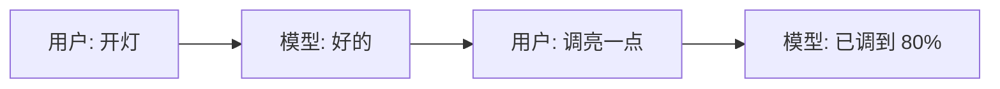

这在「一问一答」场景下没问题，但当 Agent 真正落地智能家居这种**长生命周期 + 强状态**的业务时，线性结构会迅速遇到天花板：

| 场景 | 线性结构的问题 |
|------|----------------|
| 上下文超长，需要压缩 | 没有「原内容」可指代，要么截断丢失，要么在另一处另存摘要，结构与历史脱节 |
| 模型选错了，想重试 | 「回到第 5 轮」需要破坏性地删除后续消息，审计与调试都不可信 |
| 同一对话尝试两种方案 | 必须复制整段历史开新会话；分叉、合并不优雅 |
| Agent 跑到一半崩溃 | 不知道上次执行到哪一步、用了多少 token、调用了哪些工具 |
| 切换模型 / 调整思考等级 | 没有任何「状态变更」的概念，只能在系统里另存一份 |
| 多任务并发（审批中断时用户又发新消息） | 全部混在同一条主线，无法区分"前台会话"和"挂起任务" |

本项目把 **Pi 的会话存储模型**移植到后端，把每一次会话都存储为一棵 **append-only 的有向树**——任何「分支 / 导航 / 回滚 / 压缩」都是**追加新节点 + 移动指针**，历史永远不被改写。

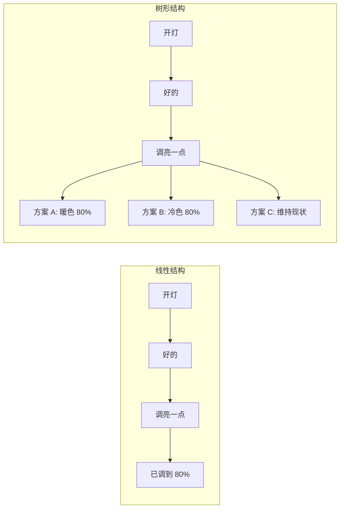

---

## 核心抽象

### 1. 三类数据共享一个 `seq`

会话中所有持久化单元（条目、记录、车道、事实）共用一个**全局单调递增的序列号 `seq`**，写入方只提供 `id` 与类型专属字段，`seq / parent_id / timestamp` 一律由存储层在落盘时分配。

| 类别 | 挂在树上？ | 用途 | 例子 |
|------|-----------|------|------|
| **Entry（条目）** | ✅ 树节点，带 `parent_id` | 会话内容本身 | `message` / `compaction` / `branch_summary` / `model_change` / `thinking_level_change` / `active_tools_change` / `custom` |
| **Record（记录）** | ❌ 挂在 lane 上的日志 | 操作生命周期 | `operation_started` / `abort_requested` / `operation_finished` / `step_attempt` / `tool_started` / `usage` / `queue_*` / `write_deferred` |
| **Fact（事实）** | ❌ 全局 `set` 语义 | 会话名 / 条目标签 | `name` / `label`（最新写入生效） |

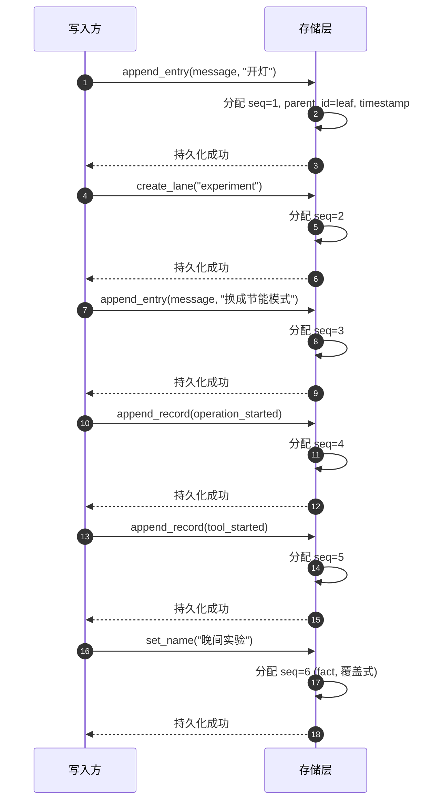

`seq` 共享意味着查询时可以用单一游标（`after_seq`）**拉取整个会话的全部变更**——消息、压缩、工具事件，按真实发生顺序拼接。

### 2. Lane（车道）= 树上的指针

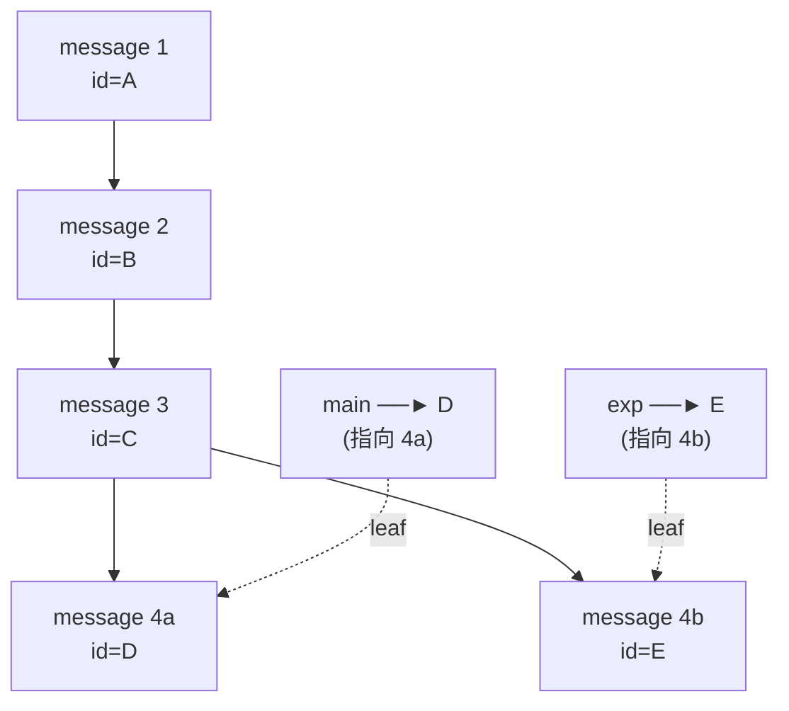

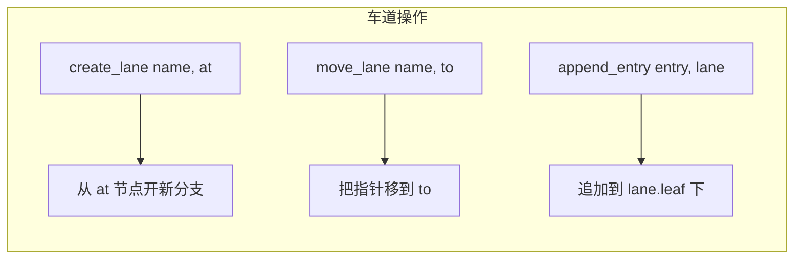

- `main` 是默认车道，始终存在。
- `create_lane(name, at)` 从 `at` 节点开新分支；`move_lane(name, to)` 把指针移到 `to`——**「导航」在底层就是一次指针移动**。
- 同一会话可以有多条 lane，**互不干扰、独立推进**，非常适合「主对话 + 实验分支」或「主对话 + 挂起任务」共存。

### 3. 6 条不变式保证树永远合法

`SessionState.apply_mutation` 在每次写入时统一校验：

1. `seq` 必须连续（`next_sequence + 1`）
2. `id` 全局唯一
3. lane 必须存在
4. **新节点的 `parent_id` 必须等于目标 lane 的当前 leaf**（树形存储的灵魂）
5. 父节点必须存在
6. record 的 lane 与 label 的 target 必须存在

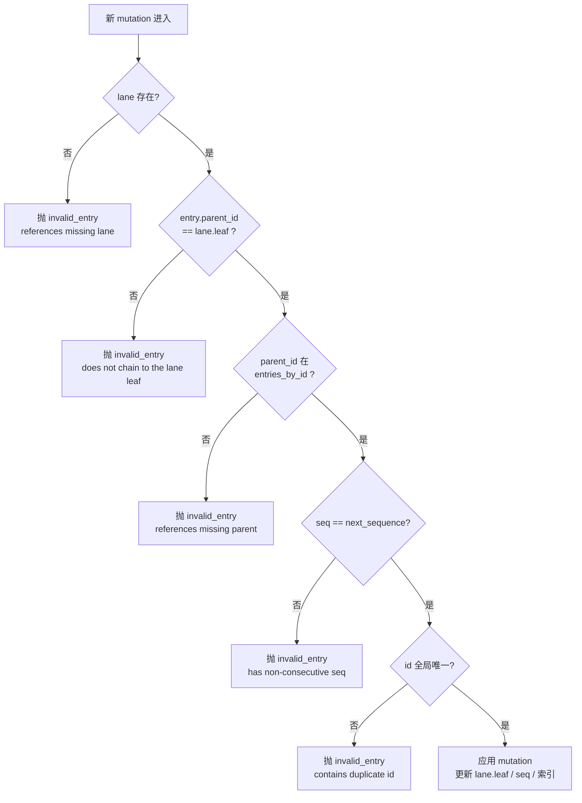

加上 `walk_to_root` 路径上的**环检测**——任何被手改坏的会话文件都会被明确拒绝，而不是死循环或静默吞掉。

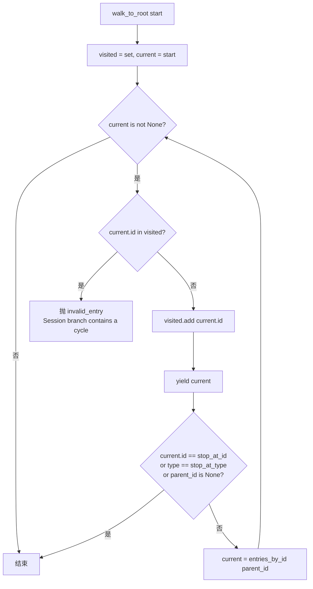

---

## 与传统线性日志的对比

| 操作 | 线性日志 | 会话树 |
|------|----------|--------|
| **新增内容** | `append`，总在末尾 | `append_entry(entry, lane)`，挂到指定 lane leaf |
| **分支/实验** | 复制整段历史，开销与歧义都大 | `fork` 在任意节点生成新会话；或同会话内 `create_lane` |
| **上下文回溯** | 重新扫描全文 | `find_entries_on_branch(start)` 沿 `parent_id` O(depth) |
| **导航 / 切换主题** | 破坏性删除 | `move_lane`，历史只增不改 |
| **压缩** | 无结构化表达 | `compaction` 节点 + `retained_tail`，摘要与原文同处一棵树 |
| **崩溃恢复** | 追加损坏即报废 | SQLite 事务 + WAL + `find_open_operations` 恢复挂起操作 |
| **审计 / 用量** | 没有载体 | `Record` 全程留痕（启动 / 重试 / 工具 / 退出码 / token） |
| **多任务隔离** | 全部混在同一条线 | 每 lane 独立树支 + 独立操作记录 |

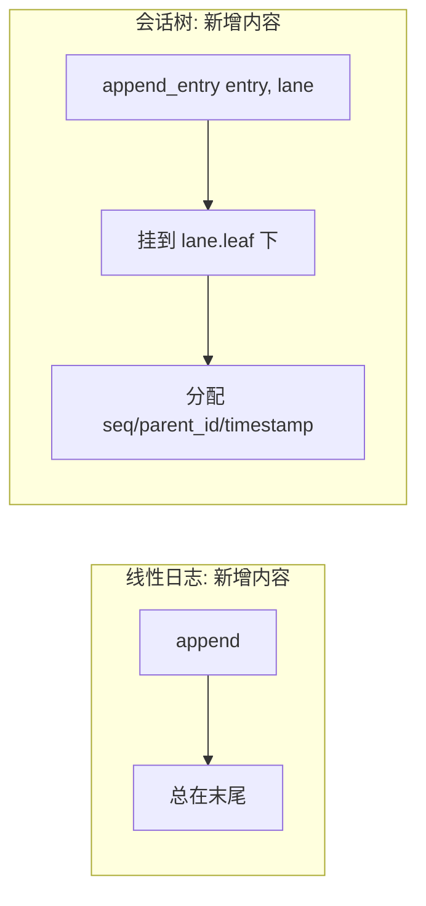

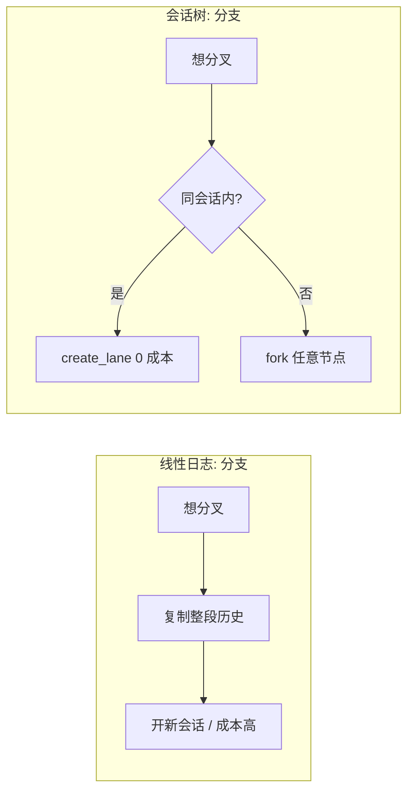

---

## 关键能力

### 可分支（Fork）

#### Fork 的语义决策

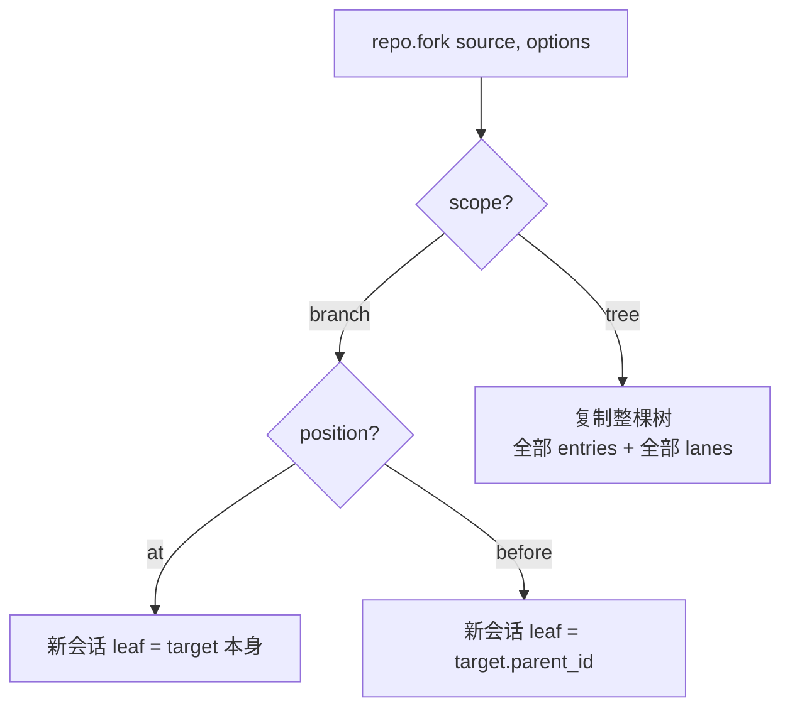

#### Fork 的处理流程

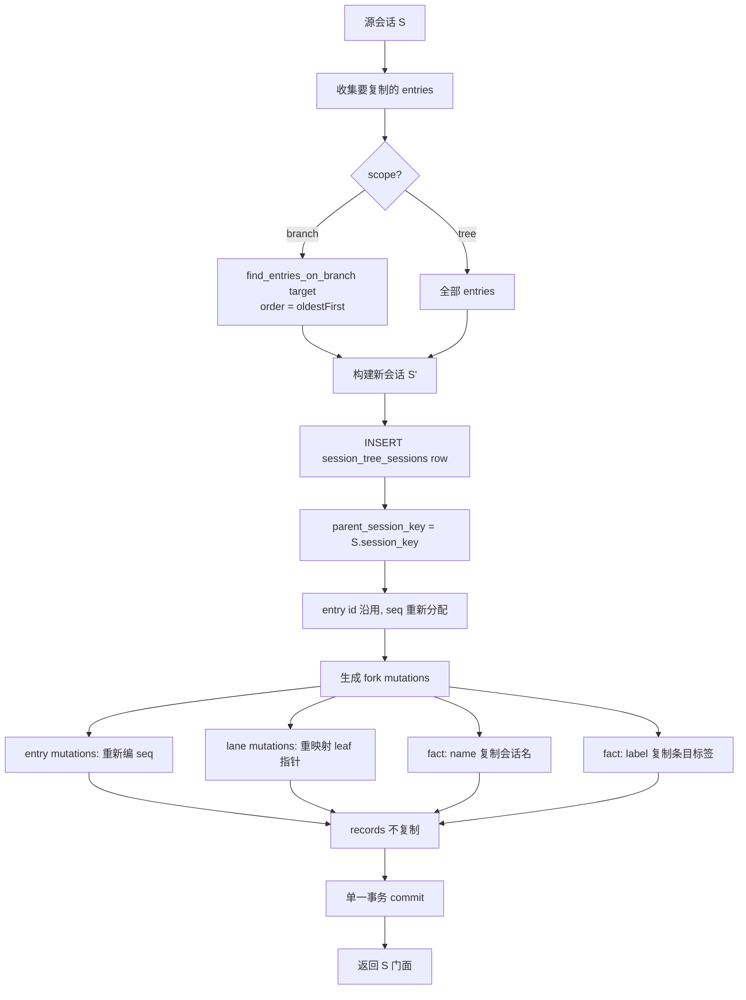

**labels 随条目复制、records 不复制**——这是刻意的：标签是"内容事实"应随内容走，操作日志是"过程"不应污染新会话。

#### 单一事务的崩溃语义

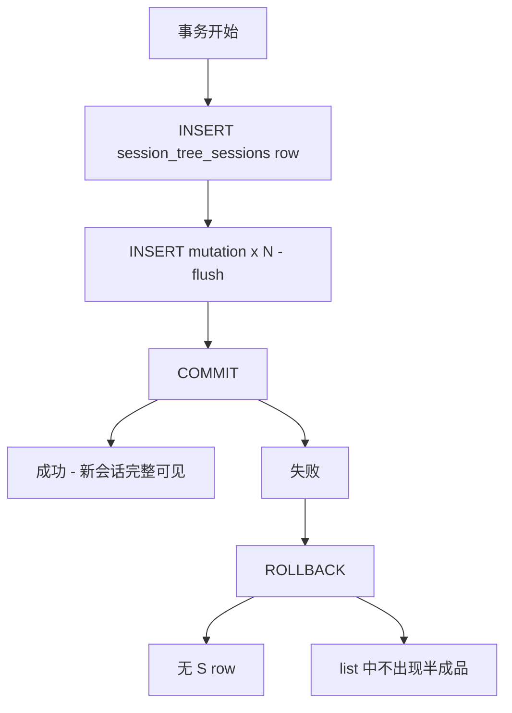

### 可恢复（先持久化，后应用内存）

#### 写入路径

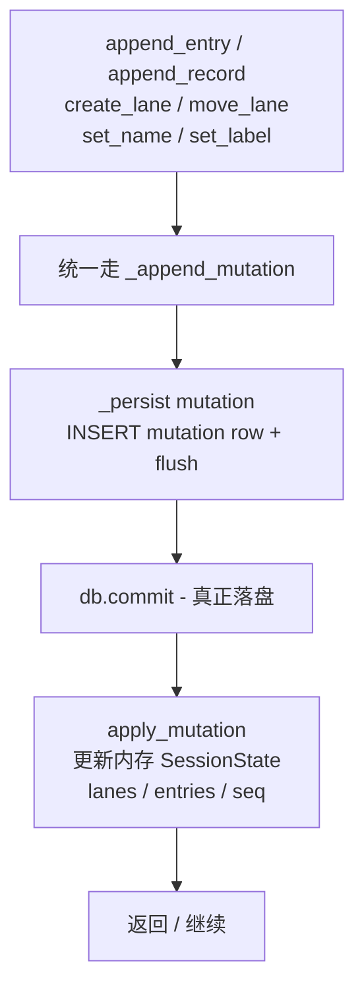

- 所有写操作走**同一条 `_append_mutation`** 路径，天然串行化。
- 内存状态永远不超前于磁盘——「崩溃一致性」从口头承诺变成可证明的不变式。

#### 加载路径（崩溃后的恢复）

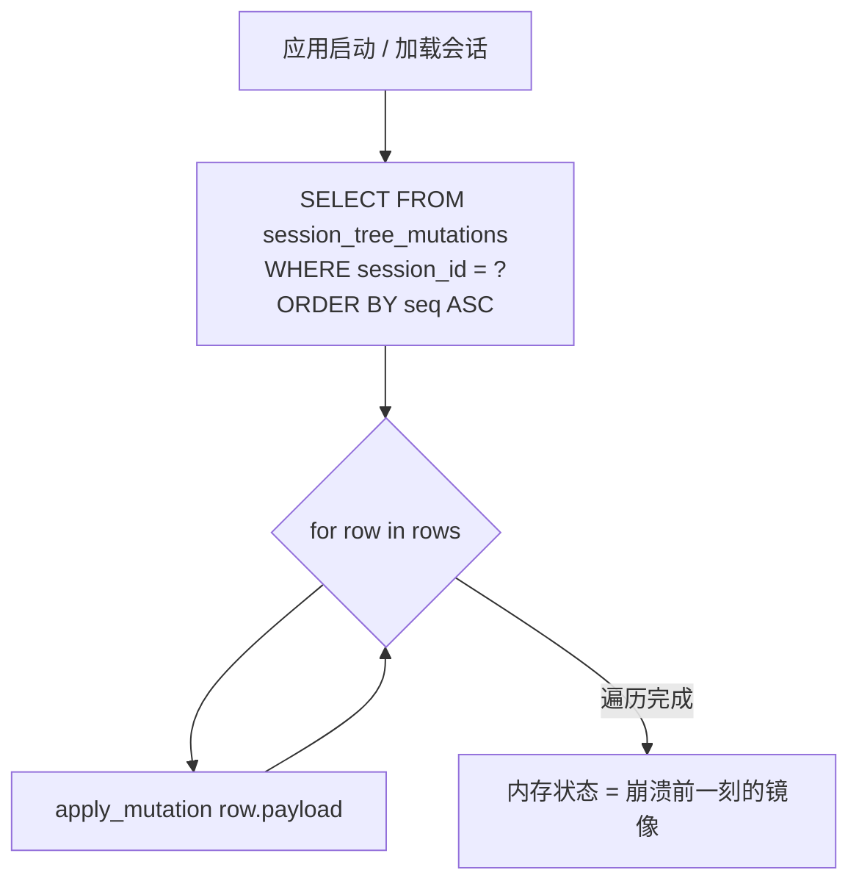

SQLite 事务 + WAL 帮你处理了 torn-tail——重放在最后一个 commit 边界处停止，不需要应用层做任何修补。

### 可审计（Operation Lifecycle）

#### 单次操作的 record 链

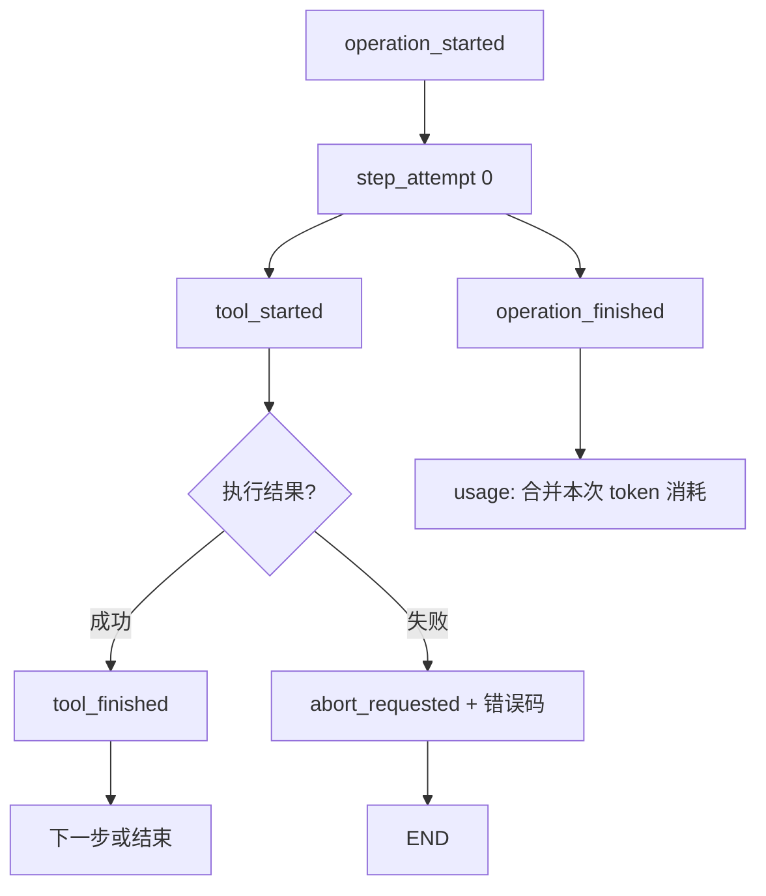

#### `find_open_operations` 启动决策

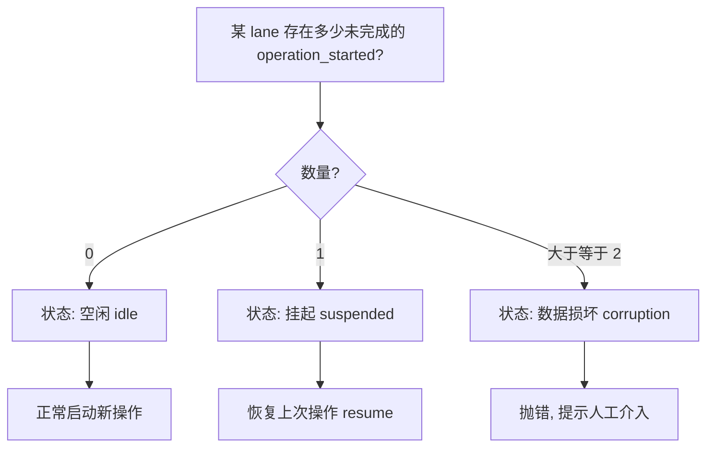

`operation_started` 的去重在 `append_record` 里就强制执行——同一 lane 不可能同时存在两个未完成操作，**并发请求会自动被存储层拒掉**，免去外部加锁。

### 可压缩（Compaction 是一等公民）

压缩不是把旧消息"删掉再用 LLM 总结一下"——而是在树上**追加一个 `compaction` 节点**。

#### 压缩前后的树形变化

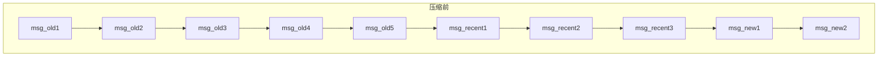

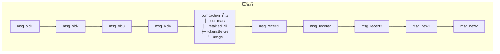

- 压缩后的原文**并未删除**——继续做审计、做分支、做恢复都能拿到。
- 多次压缩的链条天然形成"摘要的摘要的摘要"，对长会话友好。
- `retainedTail` 是保留在摘要之后的"近 N 轮原文"，避免模型忘记刚才在做什么。

#### 分支摘要（Branch Summary）

当车道从一个分支切换到另一个分支时，被抛弃的分支会被压成一条 `branch_summary` 节点挂到目标位置。

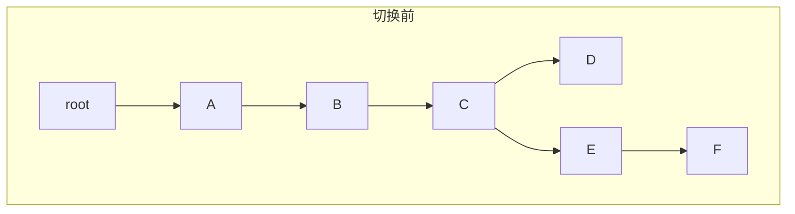

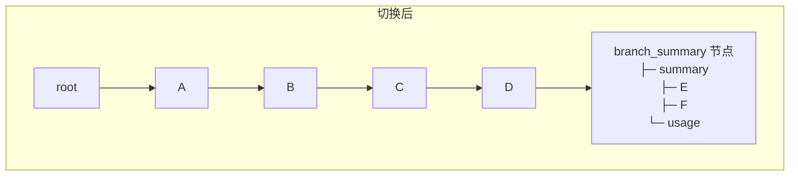

**公共祖先计算**是这里的精髓：

```mermaid
flowchart TD
    S["old_leaf_path = D, C, B, A, root<br/>走到 root 的 Set"]
    T["target_path = D, C, B, A, root<br/>从 leaf 走到 root"]
    S --> L[for node in target_path]
    T --> L
    L --> C{node in old_leaf_path?}
    C -- 否 --> NEXT[继续遍历]
    C -- 是 --> HIT["common_ancestor = node<br/>break"]
    NEXT --> L
    HIT --> OUT["摘要 = old_path 上 A 之后的条目 E, F 的压缩结果<br/>挂载到目标位置 D 之后"]
```

共享公共祖先意味着**不重复存储**——两份历史只差一条 `branch_summary`，而非整段重复。

---

## 从树到 LLM 上下文：`build_session_context`

会话树本身不是直接喂给 LLM 的内容，需要做一次投影：

```mermaid
flowchart TD
    L[当前 lane leaf] --> W["walk_to_root leaf<br/>沿 parent_id 走到根"]
    W --> F{找到最近一个<br/>compaction 节点 K?}
    F -- 否 --> ALL[上下文 = leaf 路径上全部条目]
    F -- 是 --> SLICE["上下文 = K 节点, K.retained_tail,<br/>K 之后的所有新消息"]
    ALL --> PROJ[派生状态投影]
    SLICE --> PROJ
    PROJ --> P1[最后一个 thinking_level_change → thinkingLevel]
    PROJ --> P2[最后一个 model_change → model]
    PROJ --> P3[最后一个 active_tools_change → activeTools]
    P1 --> TRANS[条目 → LLM 消息 转换]
    P2 --> TRANS
    P3 --> TRANS
    TRANS --> M1["message → 原样转<br/>stopReason=deferred 的占位消息 跳过"]
    TRANS --> M2["compaction → compactionSummary 角色消息"]
    TRANS --> M3["branch_summary → branchSummary 角色消息"]
    TRANS --> M4["model_change → 不产生消息 已计入派生状态"]
    TRANS --> M5["custom → 不产生消息 可由扩展投影"]
    M1 --> R["return 派生状态, messages: ..."]
    M2 --> R
    M3 --> R
    M4 --> R
    M5 --> R
```

支持扩展点 `entry_transforms` / `entry_projectors`——Agent 可以注入自己的投影逻辑（例如"把工具结果统一截断到 N KB"），而无需修改核心代码。

---

## 与上层模块的协作

会话树**只负责存储 + 投影**，不绑定任何具体模型或业务。

```mermaid
flowchart TD
    AG["Agent Service LangGraph<br/>每轮结束: 把本轮 message / model_change / usage 镜像成节点"]
    AG --> SV["SessionTreeService 接入层<br/>append_message / append_record / fork / move_lane"]
    SV --> ST["SessionStorage 存储协议"]
    ST --> SQ[SqliteSessionStorage 生产]
    ST --> IM[InMemorySessionStorage 测试 / 原型]
    SQ -.上下文超限 / 切分支 / 手动 /compact.-> CE["CompactionEngine 压缩编排<br/>触发判定 → 切割点 → LLM 摘要 → 回写为 compaction 节点"]
    CE --> CL["session_tree/compaction 纯逻辑<br/>prepare_compaction · collect_entries_for_branch_summary<br/>find_cut_point · estimate_context_tokens · split turn"]
```

**关键不变量**：

- `app.compaction` 编排 LLM 摘要，但**切割点、token 估算、split turn、压缩-尾巴** 都在 `app.session_tree.compaction` 纯逻辑里——可独立测试，不依赖任何模型供应商。
- Agent 每轮结束 → `SessionTreeService` 镜像消息 → 若超限 → `CompactionEngine` 触发 → 摘要结果作为新 `compaction` 节点追加进树 → 下一轮 Agent 看到的就是「压缩后上下文」。
- 换模型 / 切车道 / 取消操作都不需要改存储代码，全部映射为「写新节点 + 移动指针」。

#### 一轮 Agent 运行的端到端流程

```mermaid
flowchart TD
    U[用户输入] --> AR[Agent Runner]
    AR --> BC["读上下文 build_session_context"]
    BC --> LLM["LLM 看到:<br/>压缩摘要 + 保留尾 + 近期消息"]
    LLM --> TOOL[工具调用 / 模型回复]
    TOOL --> END[本轮结束]
    END --> MIR["SessionTreeService 镜像到树<br/>entry: message user / assistant<br/>record: operation_started / step_attempt / tool_started / tool_finished / usage"]
    MIR --> CK[压缩触发判定]
    CK --> OK[未超限 - 结束]
    CK --> TR["超限 - CompactionEngine<br/>切割点算法 → LLM 生成摘要<br/>追加 compaction 节点 含 retained_tail<br/>下一轮 Agent 看到的 = 摘要 + 尾巴 + 新消息"]
```

---

## 存储模型

```sql
-- 会话目录
session_tree_sessions
  id, session_key, parent_session_key, created_at

-- append-only 变更日志
session_tree_mutations
  id, session_id, seq, kind, payload(JSON), created_at
  UNIQUE (session_id, seq)
```

刻意**不做关系型规范化**——一张 mutation 表 + JSON payload 正是这种"事件溯源"风格的最简实现：

- 写入路径只有 `INSERT`，没有 `UPDATE` / `DELETE`，没有 schema migration 的负担。
- 唯一索引 `(session_id, seq)` 让"seq 连续"在数据库层就得到保证。
- 加载路径只是 `ORDER BY seq ASC` 后的顺序重放。

#### 数据写入与读取的对称性

```mermaid
flowchart LR
    subgraph write[写入时 在线]
        W1[用户操作] --> W2[序列化 mutation]
        W2 --> W3[INSERT row]
        W3 --> W4[commit]
        W4 --> W5[内存状态更新]
    end
    subgraph read[读取时 崩溃后 / 重启]
        R1[应用启动 / 加载会话] --> R2["SELECT ORDER BY seq ASC"]
        R2 --> R3["for row: apply_mutation"]
        R3 --> R4[内存状态 = 写入结束时的快照]
    end
    W5 -.等价.-> R4
```

崩溃恢复等价于「在最后一个 commit 边界处停止重放」——不需要应用层做任何修补。

---

## 适合什么样的产品

把会话当成"树"而不是"列表"，是这套设计的核心选择。它不是为所有 AI 产品都值得，但对以下场景收益尤其明显：

- **长生命周期 + 高价值会话**（智能家居、运维助手、代码 agent）：值得为「不丢历史」付出一份存储代价。
- **多实验 / 多方案并存**（A/B prompt、模型对比、agent 编排调试）：分支即第一公民。
- **强可解释性需求**（金融、医疗、审计敏感场景）：完整 record 链 + 树形因果链。
- **会跨轮跑很久的 agent**（审批中断、挂起、resume）：用 lane + record 天然表达"前台对话"和"后台任务"。

反过来，对**纯聊天、单轮问答、轻量客服**等场景，线性列表 + 定时清理就足够了——这是过度设计。

```mermaid
flowchart LR
    subgraph good[适合]
        G1[长生命周期 + 高价值会话] --> V[会话树]
        G2[多实验 / 多方案并存] --> V
        G3[强可解释性需求] --> V
        G4[跨轮跑很久的 agent] --> V
    end
    subgraph bad[过度设计]
        B1[纯聊天] --> L[线性列表]
        B2[单轮问答] --> L
        B3[轻量客服] --> L
    end
```

---

## 参考

- 模块设计参考（实现细节、API、SQLite schema、不变式证明）：[`docs/session-tree-storage.md`](session-tree-storage.md)
- 与之配套的上下文压缩设计参考：[`docs/session-tree-compaction-review.md`](session-tree-compaction-review.md)
- 移植来源：Pi 的会话存储模型
