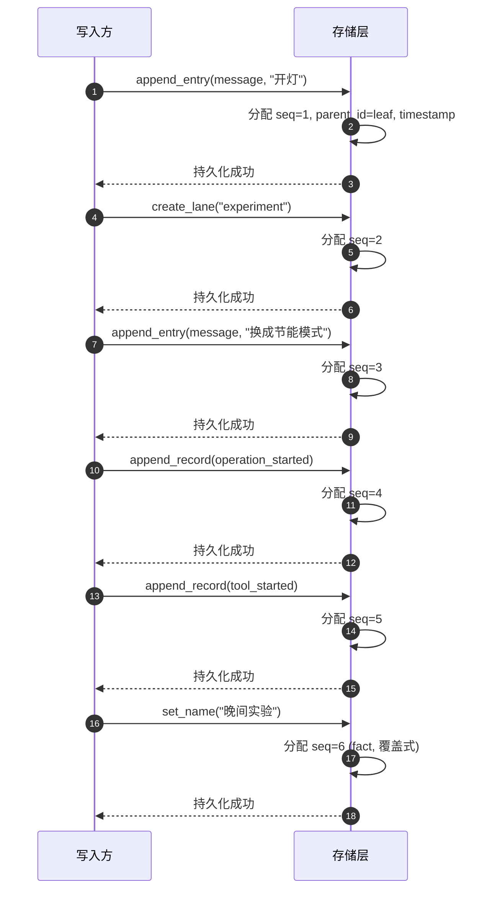
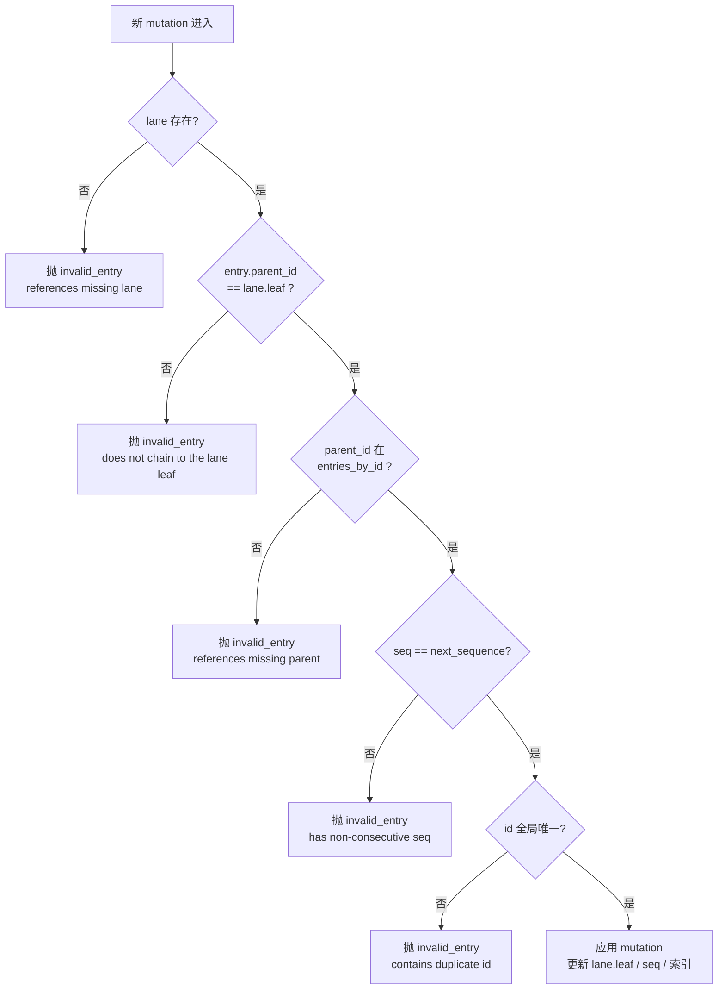
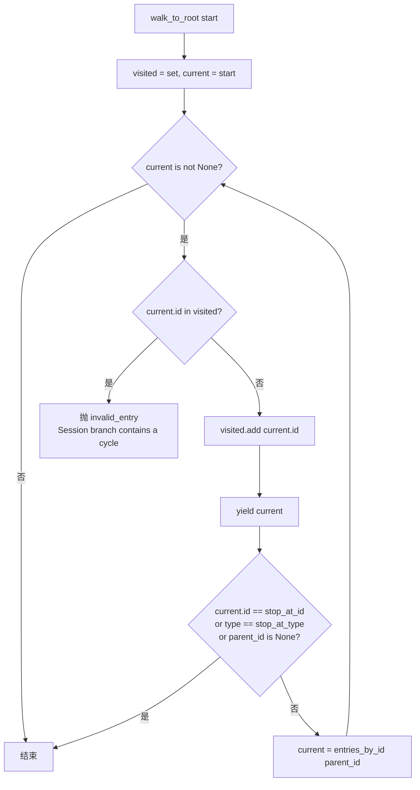
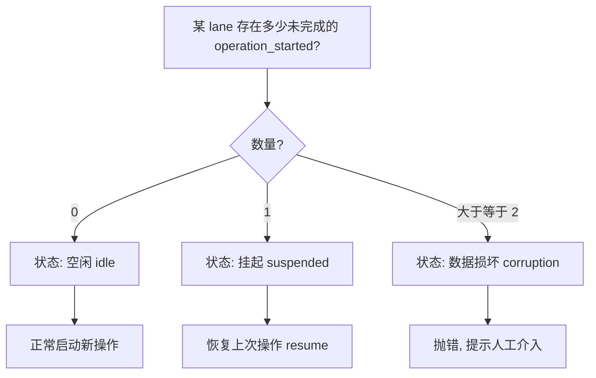
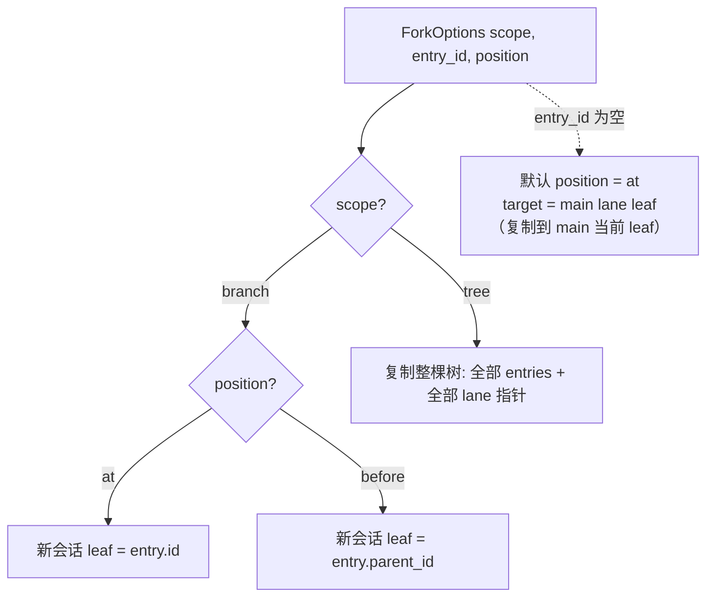
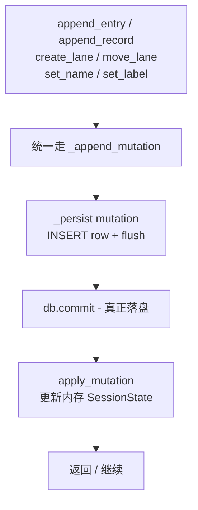
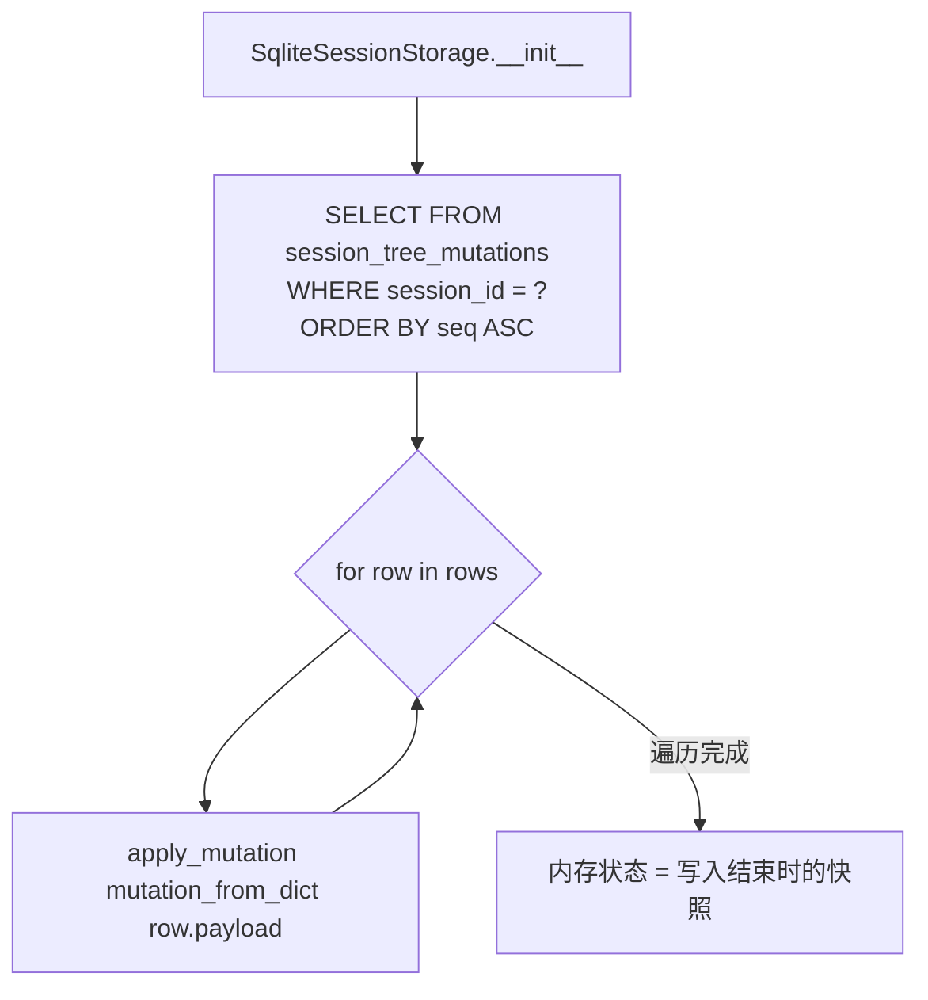
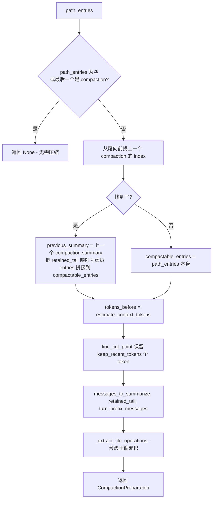
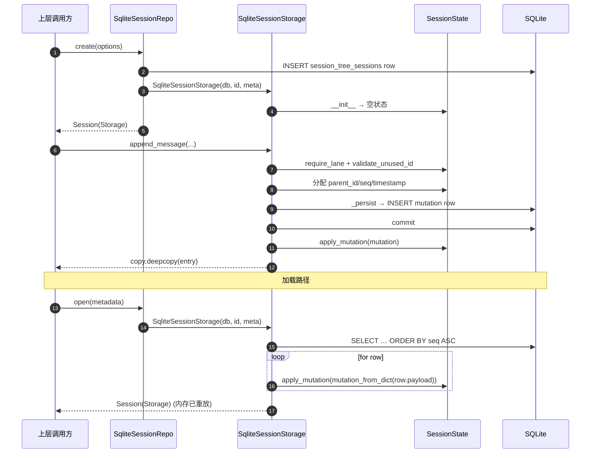

# 会话树存储模块（`session_tree`）— 完整技术细节

> 本文面向需要修改或扩展会话树存储的工程师：在「概述」之上，逐层交代数据模型、内存状态机、SQLite 持久化、上下文投影、压缩与分支摘要的算法、错误码与边界条件，以及上层接入方式。

## 1. 模块定位

`session_tree` 是智能家居后端的**会话存储引擎**，基于 Pi 的开源「会话树形结构」设计，使用 **Python + SQLAlchemy + SQLite** 实现。与传统的线性日志不同，本模块把一个会话存储为一棵**有向树**，配合**车道（Lane）**、**操作记录（Record）** 与**全局事实（Fact）**，构成一套**可分支、可恢复、可审计**的会话状态系统。

会话不是简单的消息列表，而是可以分支、导航、压缩和恢复的结构化知识图。

### 1.1 目录与职责

```
app/session_tree/
├── __init__.py                    # 顶层门面，统一导出全部公 API
├── errors.py                      # SessionError（8 个稳定 code）
├── messages.py                    # 消息辅助：content_text、create_*_summary_message
├── session/                       # 会话存储核心
│   ├── types.py                   # Entry / Record / 查询 / 选项 / 统计
│   ├── codec.py                   # dataclass ↔ JSON 字典的编解码与字段白名单校验
│   ├── state.py                   # SessionState 内存状态机与 6 条不变式
│   ├── storage.py                 # SessionStorage 协议、Session 门面、InMemorySessionStorage
│   ├── repo.py                    # SessionRepo 协议、InMemorySessionRepo
│   ├── sqlite.py                  # SqliteSessionStorage、SqliteSessionRepo
│   └── context.py                 # 从树构建 LLM 上下文（压缩替换、扩展投影）
├── compaction/                    # 压缩与分支摘要（纯逻辑，不含 LLM 调用）
│   ├── compaction.py              # 切割点、token 估算、prepare_compaction
│   └── branch_summary.py          # 公共祖先计算、collect_entries_for_branch_summary
└──（无 models/）                  # ORM 模型位于 app/models/session_tree.py，由 db.create_tables() 自动建表
```

模块对外不暴露任何 SQLAlchemy 类型——所有持久化细节都封装在 `sqlite.py`，调用方只接触 `Session` 门面。

### 1.2 顶层门面（`__init__.py`）

`app.session_tree` 是聚合门面，**直接 `from app.session_tree import ...` 即可使用全部公 API**：

- **存储类**：`SqliteSessionRepo`、`SqliteSessionStorage`、`InMemorySessionRepo`、`InMemorySessionStorage`、`Session`、`SessionState`、`SessionStorage`（协议）、`SessionRepo`（协议）。
- **数据模型**：`Entry`、`Record`、`EntryQuery`、`RecordQuery`、`LogItem`、`LanePointer`、`SessionMetadata`、`SessionStats`、`CreateOptions`、`ForkOptions`、`CompactionSettings`。
- **错误**：`SessionError`。
- **压缩 / 分支纯逻辑**：`BranchPreparation`、`CollectEntriesResult`、`CompactionPreparation`、`CutPointResult`、`FileOperations`、`collect_entries_for_branch_summary`、`estimate_tokens`、`find_cut_point`、`prepare_branch_entries`、`prepare_compaction`、`should_compact`。
- **上下文**：`build_session_context`。

---

## 2. 核心数据模型

### 2.1 三类数据共享一个 `seq`

会话里存放三类截然不同的数据，但**共享同一个全局单调递增的 `seq` 序列号**。这是查询能用单一游标（`after_seq`）拉取"消息 + 压缩 + 工具事件"全量变更的前提。

| 类别 | 是否属于树 | 作用 | 类型枚举 |
|------|-----------|------|---------|
| **Entry（条目）** | 是，带 `parent_id` | 会话内容本身 | `message` / `model_change` / `thinking_level_change` / `active_tools_change` / `compaction` / `branch_summary` / `custom` |
| **Record（记录）** | 否，挂在 lane 上 | 操作的执行日志 | `operation_started` / `abort_requested` / `operation_finished` / `step_attempt` / `tool_started` / `queue_enqueued` / `queue_cancelled` / `write_deferred` / `usage` |
| **Fact（事实）** | 否，全局 `set` 语义 | 会话名 / 条目标签 | `name` / `label`（最新写入生效） |

`EntryType` / `RecordType` 在 `types.py` 中以 `Literal[...]` 声明；`codec.py` 在反序列化时按这两个枚举白名单校验，未知类型会抛 `SessionError("invalid_entry", "unknown entry/record type: ...")`。

#### 共享 seq 的写入时序



### 2.2 Entry 的字段表

`Entry` 是 7 种条目的**判别联合体**——`type` 为判别字段，其余字段按类型可选。`codec.py` 在写入时调用 `asdict` + 字段白名单过滤 `None`，读出时只接受 `_ENTRY_FIELDS` 子集，**未声明字段会被丢弃**（这是与上游 TypeScript 实现的兼容约定）。

| 类型 | 必含字段 | 专属字段 | 说明 |
|------|---------|---------|------|
| `message` | `type`, `id` | `message: dict`, `terminate: bool` | `message` 是 LangChain 兼容消息字典；`stopReason == "deferred"` 的占位消息会被 `build_session_context` 跳过 |
| `model_change` | `type`, `id` | `provider: str`, `model_id: str` | 不进入消息流，但被 `derive_session_context_state` 用作当前 `model` |
| `thinking_level_change` | `type`, `id` | `thinking_level: str` | 同样不进入消息流，被 `derive_session_context_state` 取最后一个作为 `thinkingLevel`，默认 `"off"` |
| `active_tools_change` | `type`, `id` | `active_tool_names: list[str]` | 同上，派生为 `activeToolNames` |
| `compaction` | `type`, `id` | `summary`, `retained_tail: list[Message]`, `tokens_before: int`, `details`, `usage` | 压缩节点：摘要 + 保留尾 + 元数据；投影时产出 `compactionSummary` 角色消息 + `retained_tail` |
| `branch_summary` | `type`, `id` | `from_id: str`, `summary`, `details`, `usage` | 分支摘要：挂到目标位置，记录"被抛弃的分支"压缩自哪个 leaf；投影时产出 `branchSummary` 角色消息 |
| `custom` | `type`, `id` | `custom_type: str`, `data` | 扩展点。默认不进入消息流；可由 `build_session_context` 的 `entry_projectors` 字典提供投影器 |

所有 Entry 通用字段（由存储层在追加时**强制覆盖**）：

- `seq: int` —— 共享序列号，全局递增。
- `parent_id: str \| None` —— 父节点 id；`None` 表示根（事实上只有初始化时是 `None`，因为 `append_entry` 强制把 `parent_id` 设为 lane.leaf）。
- `timestamp: int` —— Unix ms，由 `now_ms()` 分配。

### 2.3 Record 的字段表

Record 全部挂在 lane 上，**不形成树**。其 `lane` 字段必填；同样由 `codec.py` 做字段白名单校验，且 `record.lane` 缺失或非字符串时直接抛 `SessionError("invalid_entry", "record is missing a lane")`。

| 类型 | 关键字段 | 用途 |
|------|---------|------|
| `operation_started` | `source_leaf_id`, `intent: dict` | 操作开始；同一 lane 不允许并发（`find_open_operations` 与 `append_record` 双重保障） |
| `abort_requested` | `run_id` | 中止请求，配合 `operation_finished.outcome` 判断 |
| `operation_finished` | `run_id`, `outcome`, `error` | 结束；`outcome` ∈ `{"completed", "aborted", "error", ...}`；`run_id` 用于从 `_open_operations_by_lane` 移除 |
| `step_attempt` | `run_id`, `step`, `attempt`, `result_entry_id`, `compaction_reason` | 单步重试；`compaction_reason` 标识是否触发压缩 |
| `tool_started` | `run_id`, `assistant_entry_id`, `tool_index`, `tool_call_id`, `tool_name`, `effective_args`, `result_entry_id`, `replay` | 工具调用起点；`replay` 标识"重放"语义 |
| `queue_enqueued` | `queue`, `run_id`, `target` | 把目标入队（如延迟写、审批挂起） |
| `queue_cancelled` | `run_id`, `entry_id` | 取消队列项 |
| `write_deferred` | `run_id`, `target` | 写操作被延迟（审批中），等用户决定后重放 |
| `usage` | `usage: dict`, `cause`, `run_id`, `entry_id`, `attempt`, `stop_reason`, `tool_call_id`, `details` | token / 费用合并；`state.py` 解析此 record 时同步累加 `_stats` |

#### `usage` record 累加到 `SessionStats` 的规则

`state.apply_mutation` 在处理 `usage` 记录时，按以下公式累加（**只读 `usage` 字典中已知字段，缺失视为 0**）：

```
stats.cached_tokens   += usage.cacheRead
stats.uncached_tokens += usage.input + usage.cacheWrite
stats.total_tokens    += usage.totalTokens
stats.cost_total      += (usage.cost.total if isinstance(cost, dict) else 0)
```

如果 `usage` 不是 dict，该条 `usage` 记录**不参与累加**（但仍落盘与重放）。`cost_total` 用 `float()`，非数值会抛 `TypeError`——上层负责保证 `cost.total` 是数值。

### 2.4 辅助类型

- `LanePointer(lane: str, leaf_id: str \| None)` —— 内存中的车道指针；`leaf_id is None` 表示空车道（尚未追加过任何 entry）。
- `SessionStats(message_count, cached_tokens, uncached_tokens, total_tokens, cost_total)` —— 由 `message` / `usage` 记录累加得出，`get_stats()` 返回 `deepcopy`。
- `SessionMetadata(session_key, parent_session_key, created_at)` —— 会话目录表里的元信息；`session_key` 全局唯一（`UNIQUE` 约束）。
- `EntryQuery / RecordQuery / LogItem` —— 见 §4 查询系统。
- `ForkOptions(scope="branch"\|"tree", entry_id, position)` —— fork 的语义配置。
- `CreateOptions(session_key, parent_session_key)` —— `session_key` 不传则用 `uuid4().hex`。
- `CompactionSettings(enabled, reserve_tokens=16384, keep_recent_tokens=20000)` —— 压缩参数，`DEFAULT_COMPACTION_SETTINGS` 是单例。

### 2.5 错误码（`SessionError` 8 个 code）

`errors.py` 把所有业务错误收敛到 `SessionError(code, message)`，调用方**按 `code` 分支处理**而非匹配字符串：

| code | 含义 | 触发场景 |
|------|------|---------|
| `not_found` | 资源不存在 | `Entry not found`、`Session not found`、记录父节点缺失 |
| `already_exists` | 唯一约束冲突 | lane 已存在、entry/record id 重复、`session_key` 已被占用 |
| `invalid_entry` | mutation 违反 6 条不变式 | 详见 §3.1 |
| `invalid_payload` | payload 字段不合法 | 保留位（暂未在主路径抛出） |
| `invalid_lane` | lane 不存在 | `require_lane` / `_get_leaf_id_for_lane` |
| `invalid_query` | 查询参数不合法 | `limit <= 0`、`after_seq < 0`、`operationKind` 与 `type` 冲突 |
| `invalid_fork_target` | fork 目标不合法 | 目标不是 `message` 类型 |
| `storage` | 存储层错误 | 同 lane 已有开放 operation、SQLite 写入失败 |

---

## 3. 内存状态机：`SessionState`

`SessionState` 是**纯内存的状态机**——所有 6 条不变式、所有查询、`create_fork_mutations` 都在这一层实现。SQLite 与内存两个存储实现都**共用同一个 `SessionState`**，因此不变式不依赖任何后端。

### 3.1 6 条不变式（`apply_mutation` 统一校验）



完整规则列表：

1. `seq` 必须连续（`seq == self._sequence + 1`）。
2. entry / record 的 `id` 全局唯一。
3. lane 必须存在。
4. **新节点的 `parent_id` 必须等于目标 lane 的当前 leaf**（树形存储的灵魂）。
5. 父节点必须存在。
6. record 的 lane 必须存在；`label` fact 的 `target_id` 必须存在。

`apply_mutation(mutation, invalid=None)` 还接受一个 `invalid` 回调（仅测试使用），让宿主可以在不抛错的情况下收到失败信息。生产路径**全部走 `raise SessionError("invalid_entry", ...)`**。

### 3.2 副作用

成功应用一条 mutation 时，`SessionState` 会同步更新以下内部结构：

- `_sequence` —— 单调递增。
- `_used_ids: set[str]` —— 全局 id 索引。
- `_entries: list[Entry]` 与 `_entries_by_id: dict[str, Entry]` —— 顺序与按 id 两种视图。
- `_records: list[Record]` —— 仅 record 追加。
- `_open_operations_by_lane: dict[lane, dict[run_id, Record]]` —— **由 `operation_started` 写入、`operation_finished` 移除**。这是"同 lane 不允许并发"的物理依据。
- `_lanes: dict[lane, leaf_id]` —— lane 指针；`create_lane` 写入，`move_lane` 与 `append_entry`（命中 lane）更新 leaf。
- `_log: list[LogItem]` —— 顺序日志（用于 `get_log`）。
- `_stats` —— 由 `message` / `usage` 累加（见 §2.3）。
- `_name` / `_labels: dict[entry_id, label]` —— fact 状态。

### 3.3 `walk_to_root` 与环检测

`_walk_to_root(start, stop_at_id=None, stop_at_type=None)` 是分支扫描与 fork 的基础，**带环检测**：



注意几个非显然的细节：

- `start` 为 `None` 时**直接返回**（不抛错），对应空车道的合法状态。
- 走到 `parent_id is None` 即视为到达根；通常不会发生（因为 `append_entry` 强制 `parent_id = lane.leaf`，而 lane 必有 leaf 之后才允许写入）。
- 如果 `parent_id` 在 `_entries_by_id` 中查不到（即数据被破坏），抛 `invalid_entry: Entry not found: <id>`。
- 边界 `stop_at_id` / `stop_at_type` 在**循环内**应用：`oldestFirst` 模式下先收集整条路径再反转，反转后第一次遇到边界即停止；`newestFirst` 模式下遇到边界立刻停止。

---

## 4. 查询系统

### 4.1 三种查询接口

| 接口 | 作用域 | 必填 | 适用 |
|------|--------|------|------|
| `find_entries(query)` | 全会话（所有分支） | `query` 可空 | "列出所有 message"、"按 custom_type 过滤" |
| `find_entries_on_branch(query)` | 分支（start → 根） | `query.start` 或车道 leaf | "当前分支的历史"、"压缩候选路径" |
| `find_records(query)` | 全会话的 record | `query` 可空 | "某 run_id 的所有 tool_started"、"某 lane 的 usage 列表" |

`query=None` 时使用 `EntryQuery()` / `RecordQuery()` 的默认：order=`newestFirst`、其他字段 `None`。

### 4.2 参数校验

`apply_mutation` 的失败模式 + 两个 `_assert_*` 助手构成查询的入口校验：

- `limit` 必须是**正整数**（`None` 或 `> 0`）；非整数或 `<= 0` 抛 `invalid_query: limit must be a positive integer`。
- `after_seq` 必须是非负整数；负数抛 `invalid_query: cursor sequence must be a non-negative integer`。
- `RecordQuery.operation_kind` 仅在 `type == "operation_started"` 时合法；否则抛 `invalid_query: operationKind requires type "operation_started"`。

### 4.3 游标与排序语义

```
EntryQuery(order="oldestFirst", after_seq=5, limit=10)
  → 返回 seq > 5 的 10 条记录，按 seq 升序

EntryQuery(order="newestFirst", after_seq=5, limit=10)
  → 返回 seq < 5 的 10 条记录，按 seq 降序
```

实现位于 `_ordered(items, order)`：`oldestFirst` 直接 `yield from items`，`newestFirst` 反向 `yield`。游标方向与排序方向绑定——**oldestFirst 只能配合 `after_seq` 向后翻，newestFirst 只能向前翻**。

### 4.4 `find_entries_on_branch` 的两个分支

```python
if query.order == "oldestFirst":
    # 先走完整路径到根（不带边界），反转后按 stop_at_* 中断
    path = list(self._walk_to_root(query.start))[::-1]
    for entry in path:
        reached_bound = (entry.id == query.stop_at_id
                         or entry.type == query.stop_at_type)
        if self._matches_entry_query(entry, query):
            results.append(entry)
        if reached_bound or len(results) == query.limit:
            break
else:  # newestFirst
    for entry in self._walk_to_root(query.start,
                                    query.stop_at_id, query.stop_at_type):
        if self._matches_entry_query(entry, query):
            results.append(entry)
        if len(results) == query.limit:
            break
```

**关键差异**：oldestFirst 模式下，`stop_at_id/stop_at_type` 是**包容**的——边界本身会被纳入结果；而 newestFirst 模式下，边界在 `_walk_to_root` 内部提前 `break`，**边界本身不会被 yield 出来**。这是与上游实现一致的细节，调用方在使用 `stop_at_id` 截断压缩候选路径时需要心里有数。

### 4.5 `_matches_entry_query` 过滤条件

```
type_match    := query.type is None or entry.type == query.type
custom_match  := query.custom_type is None
                 or (entry.type == "custom" and entry.custom_type == query.custom_type)
cursor_match  := query.after_seq is None
                 or (query.order == "oldestFirst" and entry.seq > query.after_seq)
                 or (query.order == "newestFirst" and entry.seq < query.after_seq)
```

`custom_type` 仅对 `entry.type == "custom"` 生效；其他类型条目在带 `custom_type` 过滤时**直接被过滤掉**。

### 4.6 `_matches_record_query` 过滤条件

```
lane     : query.lane is None or record.lane == query.lane
type     : query.type is None or record.type == query.type
run_id   : 三种语义：
           - record.type == "operation_started": record.id == query.run_id
             （operation_started 的 id 即 run_id）
           - 其他 type           : record.run_id == query.run_id
operation_kind : 仅在 record.type == "operation_started" 时生效
                 且 record.intent.kind == query.operation_kind
after_seq : record.seq > query.after_seq（与 oldestFirst 方向无关，恒为 >）
```

---

## 5. 核心操作

### 5.1 `append_entry`（链式校验 + 存储分配）

`SessionStorage.append_entry` 集中体现"先校验后分配"的设计：

1. `parent_id = self._state.require_lane(lane)` —— lane 必须存在，并取出当前 leaf。
2. `self._state.validate_unused_id(entry.id)` —— id 不能重复。
3. **存储层覆盖**：`entry.parent_id = parent_id`、`entry.seq = self._state.next_sequence`、`entry.timestamp = now_ms()`。**写入方提供的 `seq/parent_id/timestamp` 一律被丢弃**。
4. `_append_mutation({"kind": "entry", "lane": lane, "entry": entry})` —— 先持久化、后应用内存。
5. 返回 `copy.deepcopy(entry)`。

### 5.2 `create_lane` / `move_lane`

两者结构对称：

| 操作 | 校验 | mutation |
|------|------|---------|
| `create_lane(name, at)` | `validate_new_lane` + `validate_target(at)` | `{"kind": "lane", "seq": ..., "lane": name, "leaf_id": at}` |
| `move_lane(name, to)` | `require_lane(name)` + `validate_target(to)` | `{"kind": "lane", "seq": ..., "lane": name, "leaf_id": to}` |

`to / at` 可以为 `None`（空车道指针），但如果非 `None` 必须存在于 `_entries_by_id`。

### 5.3 `append_record` 与开放操作的去重

`append_record` 比 `append_entry` 多一道关：**当 `record.type == "operation_started"` 时，先调用 `find_open_operations(record.lane, 1)`，若返回非空，立刻抛 `SessionError("storage", "Lane ... already has an open operation ...")`**。

这意味着"同 lane 不允许并发"在两层强制：

1. `append_record` 写入时实时去重。
2. `SessionState._open_operations_by_lane` 在 `apply_mutation` 时维护。

后续 `operation_finished`（带 `run_id`）会从 `_open_operations_by_lane[lane]` 移除该 run_id；`abort_requested` **不**移除——必须等 `operation_finished` 兜底，否则会留下"挂死"的开放操作。

### 5.4 `find_open_operations` 启动决策



实现里返回的是**反序**（最新追加在前）的 `Record` 列表，方便上层按"最近的开放操作"做决策。

### 5.5 `set_name` / `set_label`

`set_label` 比 `set_name` 多一道 `validate_target(entry_id)`——因为 label 必须挂在已存在的 entry 上。`set_name` 不做这一校验（会话名与具体条目无关）。

两者都把 value 设为 `None` 视为"清除"：name 清空、label 从 `_labels` 字典 pop 掉。

---

## 6. Fork（分叉会话）

### 6.1 `create_fork_mutations` 的语义决策



实现细节：

- `scope="branch"` 且 `entry_id` **未显式提供**时，`selected_entry_id = require_lane("main")`，`position` 默认 `"at"`。此时等价于"在 main 当前 leaf 处开分叉"。
- `scope="branch"` 且 `entry_id` 显式提供时，要求 `entry.type == "message"`，否则抛 `invalid_fork_target`。
- `scope="tree"` 时复制全部 entries + 全部 lane 指针（**包括 lane 名**）。

### 6.2 生成的 mutation 序列

`create_fork_mutations` 按以下顺序输出（**`seq` 从 1 重新开始**）：

1. **entries 段**：每个被复制的 entry 输出一条 `{"kind": "entry", "entry": deep-copied}`。`id` 与 `parent_id` 沿用源会话；`seq` 重新从 1 开始；`timestamp` 仍为源值（这是与 Pi 上游一致的语义——fork 后的时间戳继承自源）。
2. **lanes 段**：每个 lane 指针输出一条 `{"kind": "lane", "lane": ..., "leaf_id": ...}`。
3. **fact: name**：仅当源 `_name` 非空时复制。
4. **fact: label**：每个被复制 entry 的 label 复制（labels 是"内容事实"应随内容走）。

**不复制**：record（操作日志）——新会话从干净的操作日志开始；`_open_operations_by_lane`、`_log`、`_stats` 也都不复制。

### 6.3 fork 在 SQLite 中的发布

`SqliteSessionRepo.fork` 把上述 mutation 列表在新会话下**先全部 `_persist`（不 commit），然后单次 `db.commit()`，最后再把 mutations 喂给内存 `SessionState`**。中途崩溃只会留下"空的新会话 row + 一组未提交的 mutation 行"——通过 `list()` 可见但 `open()` 时重放会得到空状态，**不会出现半成品分叉**。

---

## 7. 持久化：SQLite 实现

### 7.1 ORM 模型（`app/models/session_tree.py`）

```sql
CREATE TABLE session_tree_sessions (
    id INTEGER PRIMARY KEY AUTOINCREMENT,
    session_key VARCHAR(64) NOT NULL UNIQUE,
    parent_session_key VARCHAR(64),
    created_at INTEGER NOT NULL  -- Unix ms
);

CREATE TABLE session_tree_mutations (
    id INTEGER PRIMARY KEY AUTOINCREMENT,
    session_id INTEGER NOT NULL REFERENCES session_tree_sessions(id) ON DELETE CASCADE,
    seq INTEGER NOT NULL,
    kind VARCHAR(16) NOT NULL,  -- entry / record / lane / fact
    payload JSON NOT NULL,      -- 完整 mutation JSON
    created_at INTEGER NOT NULL,
    UNIQUE (session_id, seq)
);

CREATE INDEX ix_session_tree_mutations_session_seq
    ON session_tree_mutations (session_id, seq);
```

设计要点：

- **不做关系型规范化**——`payload` 直接存整条 mutation JSON（`codec.py` 负责序列化）。代价是失去 SQL 查询字段的能力，收益是写入路径只有 `INSERT`、无 schema migration、加载路径只是顺序重放。
- `UNIQUE (session_id, seq)` 把"seq 连续"提升到**数据库层**——即使应用层出 bug 写入了 gap 或重复 seq，第二次写入会在 `flush()` 时被 SQLite 拒绝。
- `ondelete="CASCADE"` 让删除会话时自动级联清理 mutations（`SqliteSessionRepo.delete` 显式 `DELETE` mutations 后再 `delete(row)`，但 CASCADE 是兜底）。
- `payload: JSON` 走 SQLAlchemy 的通用 JSON 类型，**不绑定 SQLite JSON1 扩展**——迁到 PostgreSQL 时无需改代码。

### 7.2 写入路径



`_persist` 与 `_append_mutation` 的区别：**`_persist` 不 commit、不 apply**，仅用于 fork 的批量写入；所有正常路径都走 `_append_mutation`，天然保证「先持久化、后应用内存」。

### 7.3 加载路径



`mutation_from_dict` 把 JSON payload 反序列化为内存中的 mutation dict（entry/record 还原为 dataclass，其他 kind 直接返回）。**任何 codec 错误（如未知 entry 类型、record 缺 lane）都会让加载失败**——这是有意的"坏数据早暴露"。

### 7.4 `SqliteSessionRepo` 的生命周期管理

- `create` —— 开启 ORM session，INSERT row + flush，构造 `SqliteSessionStorage`（立即触发 `_load`，得到空状态），commit。`try/except` 兜底 rollback + close。
- `open` —— 开启新 ORM session，`_require_session_row`（不存在抛 `not_found`），构造 `SqliteSessionStorage`（重放全部 mutations）。**注意每次 `open` 都会触发完整重放**——这是设计取舍，避免热加载复杂度。
- `list` —— 一次性查询所有 `SessionTreeSession`（按 `created_at desc`），返回 `[SessionMetadata]`。
- `find_metadata` —— 单条查询，不构造 `SqliteSessionStorage`。
- `delete` —— 先 DELETE mutations 再 DELETE session row，commit。
- `fork` —— 见 §6.3。

`SqliteSessionStorage.close()` 关闭持有的 ORM session，**释放数据库连接**。接入层（`app.services.session_tree`）在每次操作后立即 `session.close()`，避免长连接。

---

## 8. 编解码（`codec.py`）

### 8.1 字段白名单

`_ENTRY_FIELDS` / `_RECORD_FIELDS` 由 `dataclasses.fields(Entry/Record)` 在模块加载时生成。`entry_to_dict` / `record_to_dict` 只 `asdict` 后做 `_compact`（剔除 `None`），**字段白名单是读侧**：`entry_from_dict` / `record_from_dict` 接受任意 dict 但只保留白名单字段，未知字段被丢弃。

这保证了：

- **前向兼容**：未来给 `Entry` 加字段不会让旧数据无法读取。
- **后向兼容**：写入侧不会写出去 `Entry` 字段集之外的 key，TypeScript 参考实现的判别联合体能正常识别。

### 8.2 mutation 形态

每条 mutation 在内存中是 `dict`：

```
{"kind": "entry",   "lane": <lane_name or None>, "entry": <Entry dataclass>}
{"kind": "record",                              "record": <Record dataclass>}
{"kind": "lane",    "seq": <int>, "lane": <name>, "leaf_id": <id or None>}
{"kind": "fact",    "seq": <int>, "fact": "name",  "name": <str or None>}
{"kind": "fact",    "seq": <int>, "fact": "label", "target_id": <id>, "label": <str or None>}
```

`mutation_to_dict` 仅对 `entry` / `record` 两种 kind 做 dataclass→dict 转换；`lane` / `fact` 本身已是 JSON 兼容字典，**只做 `dict(mutation)` 浅拷贝**。反之亦然。

### 8.3 校验失败的语义

- 未知 entry 类型 → `SessionError("invalid_entry", "unknown entry type: ...")`
- 未知 record 类型 → `SessionError("invalid_entry", "unknown record type: ...")`
- record 缺 `lane` 或 `lane` 非字符串 → `SessionError("invalid_entry", "record is missing a lane")`

这些错误**只在加载路径**（`_load`）与直接调用 `mutation_from_dict` 时触发。正常写入路径走 `apply_mutation` 的 6 条不变式校验，错误形态略有不同（见 §3.1）。

---

## 9. 从树到 LLM 上下文：`build_session_context`

### 9.1 三步流水线

```
path_entries
  │
  ▼
derive_session_context_state      ← 沿路径取最后一个 thinking_level_change / model_change / assistant-message / active_tools_change
  │
  ▼
build_context_entries              ← 默认：找到最后一个 compaction，取 [compaction, ...之后]
  │                                  扩展：可注入 entry_transforms 做二次变换
  ▼
session_entry_to_context_messages  ← 每个 entry 投影为 0..n 条 LLM 消息
  │
  ▼
{**派生状态, "messages": [...]}
```

### 9.2 派生状态的覆盖规则

`derive_session_context_state` 沿路径**单向覆盖**：

- `thinkingLevel`：默认 `"off"`，遇到 `thinking_level_change` 取 `entry.thinking_level`。
- `model`：默认 `None`。遇到 `model_change` 取 `{provider, modelId}`；遇到 `assistant` 消息（**无 `model_change` 的情况下**）也覆盖为 `{provider: message.provider, modelId: message.model}`。**这两者并存时，`model_change` 总是最后赢**——因为循环里后写后覆盖。
- `activeToolNames`：遇到 `active_tools_change` 取 `list(entry.active_tool_names or [])`，默认 `None`。

### 9.3 压缩替换

`default_context_entry_transform`：从路径末尾向前找第一个 `type == "compaction"` 的 entry：

- **找到** → 上下文 = `[compaction_entry, ...(compaction 之后的所有 entry)]`。
- **没找到** → 上下文 = 原路径。

这是「压缩后原文仍可访问，但**默认不被送进 LLM 上下文**」的物理实现。如果有更精细的过滤需求，可在 `entry_transforms` 注入。

### 9.4 消息投影规则

| Entry 类型 | 投影结果 | 备注 |
|-----------|---------|------|
| `message` | `[message]` | 若 `role == "assistant"` 且 `stopReason == "deferred"`，**返回 `[]`**（占位消息不进入上下文） |
| `compaction` | `[compactionSummary 消息, *(retained_tail or [])]` | `compactionSummary` 由 `messages.create_compaction_summary_message` 生成 |
| `branch_summary` 且 `summary` 非空 | `[branchSummary 消息]` | `from_id` 与 `timestamp` 保留 |
| `custom` | `[]` 或 `entry_projectors[custom_type](entry, index, entries)` 的返回值 | **默认不进入上下文**——这是 `app.services.session_tree.mirror_subagent` 把子 Agent 写为 `custom: "subagent"` 不污染对话历史的原因 |
| 其他（`model_change` 等） | `[]` | 已通过 `default_context_entry_transform` / 派生状态消化 |

### 9.5 扩展点

`build_session_context(path_entries, entry_transforms=..., entry_projectors=...)`：

- `entry_transforms: Sequence[EntryTransform]` —— 接收上一步输出的 `list[Entry]`，返回新的 `list[Entry]`。**可链式组合**，但注意：每个 transform 拿到的是上一步的输出，**没有重新跑 `default_context_entry_transform` 的机会**。
- `entry_projectors: dict[str, EntryProjector]` —— 按 `custom_type` 注册的投影器。**只有 `custom` 类型条目会查这个表**。

---

## 10. 压缩与分支摘要（`app/session_tree/compaction/`）

本目录**只含纯逻辑**，不发起任何 LLM 调用；摘要生成是上层 `app.compaction` 的职责。

### 10.1 token 估算

#### 单消息估算（`estimate_tokens`）

按 `role` 分桶，**`chars/4` 启发式**作为兜底：

| role | 计算方式 |
|------|---------|
| `user` | `ceil(text + image_chars / 4)`；`type == "image"` 的 block 按 `ESTIMATED_IMAGE_CHARS = 4800` 计 |
| `assistant` | 累加 `text`、`thinking`、`toolCall(name + JSON.stringify(args))` 的字符数后 `ceil(/4)` |
| `custom` / `toolResult` | `ceil(text + image_chars / 4)` |
| `bashExecution` | `ceil(len(command) + len(output) / 4)` |
| `branchSummary` / `compactionSummary` | `ceil(len(summary) / 4)` |
| 其他 | 0 |

`_safe_json_stringify` 在 JSON 序列化失败时回退为 `"[unserializable]"`——避免工具参数中含不可序列化对象时崩溃。

#### 整段上下文估算（`estimate_context_tokens`）

**优先用真实 `usage`**，找不到再退化到 `chars/4` 启发式：

```
1. 从最新 message 向前找第一个 assistant 消息，其中：
   - role == "assistant"
   - "usage" 存在
   - stop_reason not in ("aborted", "error")
   - usage 是 dict 且 calculate_context_tokens(usage) > 0
2. 找到 → usage_tokens = calculate_context_tokens(usage)
         trailing_tokens = sum(estimate_tokens(messages[i+1:]))
         return {tokens: usage_tokens + trailing_tokens,
                 usage_tokens, trailing_tokens, last_usage_index}
3. 找不到 → estimated = sum(estimate_tokens for all)
           return {tokens: estimated, usage_tokens: 0, trailing_tokens: estimated, last_usage_index: None}
```

`calculate_context_tokens(usage)` 自身有 fallback：`totalTokens` 优先；否则 `input + output + cacheRead + cacheWrite`。**与 §2.3 中 `usage` record 的累加公式不同**——record 累加按 `cacheRead` / `input + cacheWrite` 分类，token 估算用 `totalTokens` 优先。这是有意的分层：累加用于统计面板，估算用于压缩阈值判定。

#### 触发判定（`should_compact`）

```python
def should_compact(context_tokens, context_window, settings):
    if not settings.enabled:
        return False
    return context_tokens > context_window - settings.reserve_tokens
```

即「有效窗口」= `context_window - reserve_tokens`（默认 `reserve_tokens = 16384`），超过即触发。

### 10.2 切割点算法（`find_cut_point`）

切割点的核心约束：**绝不切在工具结果上**。这是通过 `_find_valid_cut_points` 的允许角色白名单实现的。

#### 可作为切割点的角色

`message` 条目中，以下 role 允许作为切割点：

```
"user", "assistant", "bashExecution", "custom",
"branchSummary", "compactionSummary"
```

**`toolResult` 不在白名单内**——任何 tool 消息之间的切割都会被跳过。

#### 算法步骤

```
1. 收集 [start_index, end_index) 范围内的合法 cut points（按白名单）
2. 若无 → 返回 (start_index, -1, False)，表示"无法切"
3. 从 end_index 向前累积 token 估算（仅对 message 条目累加），
   直到累加 >= keep_recent_tokens
4. 在累积达到阈值的位置 i，从 cut_points 中找第一个 >= i 的，
   即为 cut_index
5. 如果 cut_index 之前的条目不是 compaction/message，回退到前一个合法点
6. 判断 split turn：
   - 若 cut 是 user 消息 → 不 split（turn_start_index = -1）
   - 若 cut 是 assistant 消息 → 向前找 turn start（user 或 bashExecution 或 branch_summary），
     找到 → is_split_turn = True
```

#### split turn 的产物

`prepare_compaction` 根据 `cut_point.is_split_turn` 把输出分成三段：

- `messages_to_summarize`（`history_end` 之前，**不包含 split turn 的 turn prefix**）
- `turn_prefix_messages`（**仅 split turn 触发**，从 turn start 到 cut 的内容——通常是一条 user 消息，**留在压缩之外**，让模型知道"这一轮的开头是什么"）
- `retained_tail`（cut 之后到 end——**进入压缩节点作为 retained_tail**）

非 split turn 时，`history_end = cut_point.first_kept_entry_index`，`turn_prefix_messages` 为空。

#### 文件操作跟踪

`extract_file_ops_from_message` 扫描 assistant 消息的 `toolCall` 块，把 `read` / `write` / `edit` 三类工具的 `arguments.path` 分别加到 `file_ops.read` / `written` / `edited` 集合。**同一路径多次出现在不同消息中时，set 自动去重**。

`_extract_file_operations` 在 `prepare_compaction` 顶部做了**跨压缩累积**：

1. 如果前一次 compaction 的 `details.readFiles` / `details.modifiedFiles` 存在，把它们预填进 `file_ops`。
2. 然后扫描本次 `messages_to_summarize`（若 split turn，再加 `turn_prefix_messages`），继续累积。

这意味着**多次压缩后，文件操作不会因摘要而丢失**。

### 10.3 `prepare_compaction` 的总流程



**关键不变量**：

- `prepare_compaction` 不发起任何 I/O。LLM 摘要由 `app.compaction.summarize.Summarizer` 完成，摘要结果作为 `Entry(type="compaction", summary, retained_tail, tokens_before, details, usage)` 追加进树。
- `virtual_entries`（retained_tail 映射）**不进入实际树**——它们只参与本次切割点计算，id 用 `{compaction.id}:retained:{i}` 与 `{compaction.id}:retained:{i-1}` 串成虚拟链。

### 10.4 分支摘要（`branch_summary.py`）

#### 公共祖先计算

```
collect_entries_for_branch_summary(session, old_leaf_id, target_id):
    1. old_path = {entry.id for entry in session.find_entries_on_branch(start=old_leaf_id)}
    2. target_path = session.find_entries_on_branch(start=target_id)
    3. for entry in target_path:
           if entry.id in old_path:
               common_ancestor_id = entry.id
               break
    4. entries = []
       current = old_leaf_id
       while current and current != common_ancestor_id:
           entry = session.get_entry(current)
           if entry is None: raise invalid_entry
           entries.append(entry)
           current = entry.parent_id
       entries.reverse()
    5. return CollectEntriesResult(entries, common_ancestor_id)
```

边界条件：

- `old_leaf_id is None` → 直接返回 `([], None)`（无历史可摘）。
- `old_leaf_id` 与 `target_id` **同分支** → `common_ancestor_id = target_id` 之前的整段都在 `old_path` 里，最终 `entries = []`（无需摘）。
- `entries` 不含 `compaction` / `branch_summary` 本身（虽然它们是 entry），但 `get_message_from_entry` 在 `prepare_branch_entries` 阶段会**保留**它们的消息形式。
- `toolResult` 角色消息在 `prepare_branch_entries._get_message_from_entry` 中**直接返回 None**——不进入分支摘要的 LLM 上下文。

#### `prepare_branch_entries` 的 token 预算

按**从尾到头**的顺序累加（最新消息优先），直到超 `token_budget`：

- 普通 message / compaction / branch_summary：累加并加入。
- 若 `token_budget > 0` 且加入后超预算：
  - 如果当前是 `compaction` / `branch_summary`，**且**当前总量 `< token_budget * 0.9`，仍然**加入**（摘要节点优先保留）。
  - 否则 `break`（丢弃更早的消息）。

返回的 `BranchPreparation.messages` 已按时间顺序排好（`insert(0, ...)`）。`file_ops` 同样跨多次 branch_summary 累积（前一次 `branch_summary.details` 的 readFiles / modifiedFiles 预填，再累加本次 messages）。

---

## 11. 上层接入（`app/services/session_tree.py`）

本层把会话树接入到 chat / Agent 流程，**每个操作独立打开 / 关闭树会话**（避免长连接），调用方完全不需要管生命周期。

### 11.1 关键函数

| 函数 | 作用 |
|------|------|
| `get_tree_repo()` | 进程内缓存的 `SqliteSessionRepo`（`@lru_cache`） |
| `session_key_for(chat_session_id)` | 把 `ChatSession.id` 映射为 `f"chat:{chat_session_id}"` |
| `get_or_create_tree_session(chat_session_id)` | 找不到就创建（并发场景下用 `already_exists` 兜底再 open） |
| `mirror_user_message / mirror_assistant_message` | 把对话镜像为 `message` 条目；assistant 消息支持 `usage` 字段（用于压缩 token 估算） |
| `mirror_subagent` | 把子 Agent 运行镜像为 `custom: "subagent"` 节点——**不进对话历史**（`build_session_context` 默认跳过 custom），但保留在树中供审计 |
| `build_context_messages(chat_session_id)` | 读压缩后上下文，投影为 LangChain `HumanMessage` / `AIMessage` 列表；`compactionSummary` / `branchSummary` 转为带 `[Compaction summary]` / `[Branch summary]` 前缀的 `HumanMessage` |
| `compact_if_needed(chat_session_id, summarizer, context_window, settings, max_tokens)` | 用 `CompactionEngine` 评估 + 执行压缩，返回是否发生压缩 |

### 11.2 并发安全

`get_or_create_tree_session` 处理"两个请求同时创建同一 chat_session 的树"：

```
1. repo.find_metadata(key)  → 找到 → open
2. 找不到 → repo.create(key)
3. 若 create 抛 SessionError("already_exists") → 重新 find_metadata + open
4. 若 find_metadata 仍为 None → 抛 SessionError("not_found")
```

注意 **step 3 的判定只对 `already_exists` 兜底**——其他错误（如数据库连接失败）正常上抛。

### 11.3 与 LangGraph checkpointer 的关系

接入层注释明确说：本层**只做镜像 + 压缩**，**不改变 Agent 现有的 LangGraph checkpointer 历史机制**。两套机制各管各的：

- **LangGraph checkpointer** —— Agent 状态机的 checkpoint（用于 resume / interrupt / 时间旅行）。
- **会话树** —— 面向 LLM 的对话历史 + 审计 + 压缩。

`mirror_*` 是在 chat / Agent 流程的关键节点**额外**写入树，**不替代** checkpointer。`build_context_messages` 把压缩后的上下文作为 LangChain 消息列表，**供后续接入**——目前 main 分支未必每次都把树上下文作为 LLM 的输入，需要按调用点决定。

---

## 12. 端到端调用链



---

## 13. 与线性日志的对比

| 操作 | 线性日志 | 会话树 |
|------|----------|--------|
| **新增内容** | `append`，总在末尾 | `append_entry(entry, lane)`，挂到指定 lane leaf |
| **分支/实验** | 复制整段历史，开销与歧义都大 | `fork` 在任意节点生成新会话；或同会话内 `create_lane` |
| **上下文回溯** | 重新扫描全文 | `find_entries_on_branch(start)` 沿 `parent_id` O(depth) |
| **导航 / 切换主题** | 破坏性删除 | `move_lane`，历史只增不改 |
| **压缩** | 无结构化表达 | `compaction` 节点 + `retained_tail`，摘要与原文同处一棵树 |
| **崩溃恢复** | 追加损坏即报废 | SQLite 事务 + WAL + `find_open_operations` 恢复挂起操作 |
| **审计 / 用量** | 没有载体 | `Record` 全程留痕（启动 / 重试 / 工具 / 退出码 / token） |
| **多任务隔离** | 全部混在同一条线 | 每 lane 独立树支 + 独立操作记录 |

---

## 14. 关键不变量（速查）

下面 12 条是修改 / 扩展本模块时必须保持的「硬不变量」，违反任意一条都会破坏会话树的设计前提。

1. **共享 seq**：entry / record / lane / fact 的 `seq` 来自**同一个**全局计数器，**单调递增 + 1**。
2. **存储层分配**：`seq` / `parent_id` / `timestamp` 由存储层在 `append_*` 时强制覆盖；调用方提供被丢弃。
3. **lane leaf 强制链**：`entry.parent_id` 必须等于 `lane.leaf_id`（不变式 4），杜绝非法父链。
4. **id 全局唯一**：entry 与 record 共用 `_used_ids`。
5. **record 必须有 lane**：codec 校验，缺则抛 `invalid_entry`。
6. **同 lane 不并发**：`append_record(operation_started)` 与 `_open_operations_by_lane` 双重保障。
7. **find_open_operations 决策**：0/1/≥2 → 启动 / 恢复 / 数据损坏。
8. **payload JSON 字段白名单**：codec 丢弃 `Entry` / `Record` 之外的字段——前向兼容基础。
9. **find_entries_on_branch 的边界语义**：oldestFirst 包容 stop、新estFirst 排除 stop。
10. **压缩产物三段**：`messages_to_summarize` / `turn_prefix_messages` / `retained_tail`；split turn 时才出现 `turn_prefix_messages`。
11. **跨压缩文件操作累积**：`_extract_file_operations` 把前次 `compaction.details` 的 readFiles / modifiedFiles 预填。
12. **接入层独立事务**：每个 `mirror_*` / `build_context_messages` / `compact_if_needed` 都在 `finally: session.close()` 兜底。

---

## 15. 测试覆盖

```bash
cd smarthome-api
python -m pytest tests/test_compaction.py tests/test_session_tree_service.py -v
```

测试覆盖（按文档中提到的范围）：

- 压缩触发判定（阈值 / 禁用 / 已压缩 / 无内容 / 中止）。
- 压缩执行（非 split / split turn / 迭代式更新）。
- 文件操作跟踪（read / edit / write 去重）。
- 分支摘要与导航目标挂载。
- 扩展钩子（取消 / 覆盖摘要）。
- 摘要请求的重试与协作式取消。
- 消息镜像与上下文读取。
- 压缩超限触发 / 小会话跳过。

`SessionState` 的 6 条不变式、codec 的字段白名单、`walk_to_root` 的环检测等基础原语**没有专门的测试文件覆盖**——它们通过上层（`test_session_tree_service` 等）以"非法 mutation 被拒绝"的形态间接验证。修改这些原语时建议补单测。

---

## 16. 边界与已知限制

- **内存重放无增量**：每次 `open()` 都重放所有 mutation 行。深会话下首屏加载成本 = O(mutations)。**目前没有 checkpoint 化重放**。
- **payload JSON 字段过滤单向**：codec 丢弃**未声明**字段，但**不剔除**声明字段的 `None` 之外的"非预期类型"——靠反序列化端的字段类型注解 + 上层 `validate_target` 等做最终校验。
- **lane 名字符串自由**：`create_lane` 接受任意字符串，**不限制长度 / 字符集**。建议上层规范化为 `^[a-z][a-z0-9_-]{0,31}$`。
- **`stopReason == "deferred"` 跳过**：投影时跳过，但不从树中删除——审计 / 调试仍可查到。
- **fork 不复制 record**：意味着新会话看不到源会话的"操作过程"，但 `parent_session_key` 保留了血统。**审计查询按 `parent_session_key` 跨会话串联**。
- **`build_context_messages` 不解析 `toolCall` 内容**：仅把 `compactionSummary` / `branchSummary` 转为带前缀的 `HumanMessage`，其他 role 透传。**若 LLM 需要工具结果原文，请直接走 `find_entries` + 自定义投影**。

---

## 17. 参考

- 上层压缩编排：[`docs/session-tree-compaction-review.md`](session-tree-compaction-review.md)
- 项目总体介绍：[`README.md`](../README.md) 中"核心亮点 1：会话树形存储"
- 移植来源：Pi 的会话存储模型（TypeScript）
